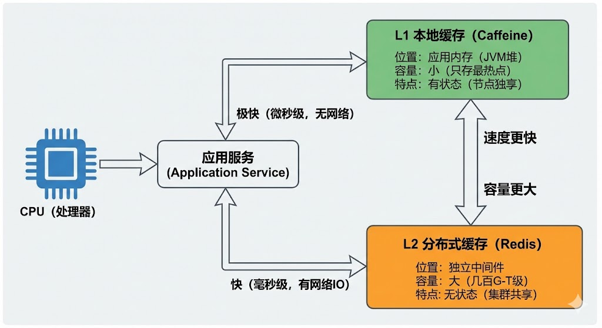
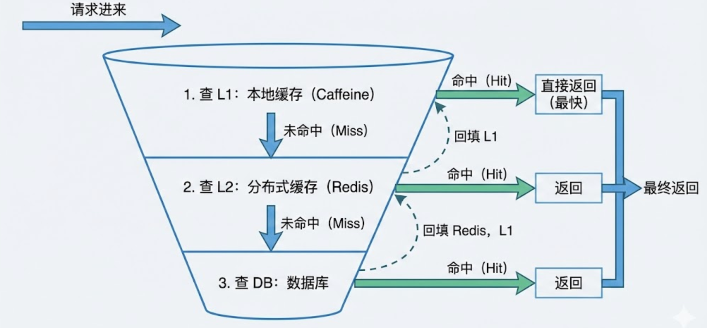
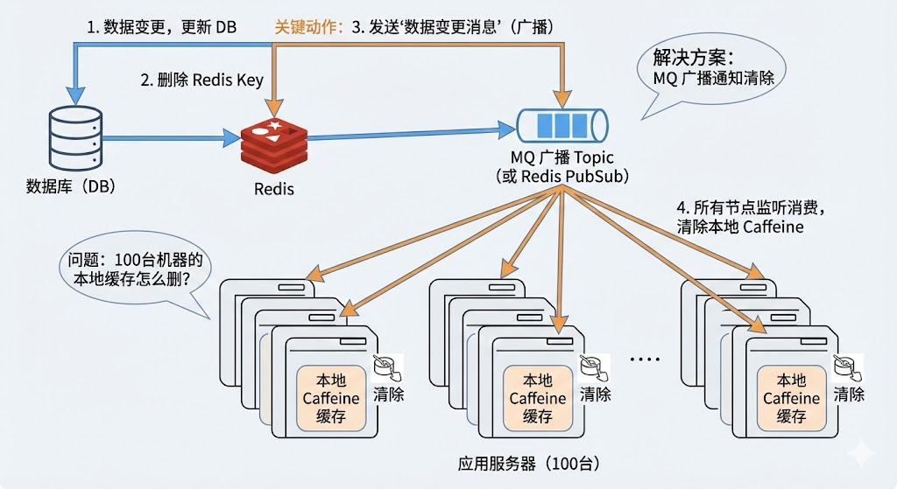

**标准的多级缓存架构通常是“L1 本地缓存+ L2 分布式缓存”的双层结构。L1 负责抗住极热数据的本地读取，减少网络 IO；L2 负责存储海量共享数据。两者的核心难点在于如何保证数据变更时的“一致性”。**

---

### 一、 核心架构设计逻辑

我们可以类比 CPU 的缓存设计（L1/L2/L3 Cache）：离 CPU 越近，速度越快，但容量越小。

#### L1 本地缓存

- **选型：** 通常使用 **Caffeine**
- **位置：** 就在应用服务的内存里。
- **特点：**
    - **极快：** 访问它就像访问一个 `HashMap`，微秒级响应，没有任何网络消耗。
    - **容量小：** 受限于 JVM 堆内存，不能存太多，只存“热点中的热点”。
    - **有状态：** 集群中 Server A 的本地缓存，Server B 是拿不到的。

#### L2 分布式缓存

- **选型：****Redis**。
- **位置：** 独立部署的缓存中间件。
- **特点：**
    - **快：** 毫秒级响应，但有网络 IO 开销。
    - **容量大：** 可以存几百 G 甚至 T 级数据。
    - **无状态：** 所有应用节点共享这份数据。

---

### 二、 关键读写流程与一致性难题

#### 读取流程

1. **查 L1：** 请求进来，先查 Caffeine。命中则直接返回（最快）。
2. **查 L2：** L1 没命中，去查 Redis。命中则返回，并**回填**到 L1。
3. **查 DB：** Redis 也没命中，去查数据库。命中则返回，并**回填**到 Redis 和 L1。

#### 一致性痛点

<u>这是面试官最想听的部分。</u>

- **问题：** 如果我改了数据库，Redis 我可以删掉，但应用服务器有 100 台，这 100 台机器内存里的 Caffeine 怎么删？
- **解决方案：MQ 广播 / Redis PubSub**。
    - 当数据变更时，先更新 DB，再删除 Redis。
    - **关键动作：** 同时发送一条“数据变更消息”到 MQ的广播 Topic。
    - **消费：** 所有应用节点都监听这个 Topic。一旦收到消息，立即**清除**本地 Caffeine 中对应的 Key。

---

### 三、 为什么要这么设计？

面试官可能会问：“Redis 已经很快了，为什么非要引入本地缓存把系统搞复杂？”

**理由只有两个字：热点（Hot Key）。**

- **场景：** 比如微博热搜、秒杀商品的详情页。
- **Redis 的瓶颈：** 虽然 Redis 单机能抗几万 QPS，但如果有 100 万人同时请求**同一个 Key**，Redis 单节点的网卡带宽会被瞬间打满，导致整个集群不可用。
- **本地缓存的价值：** 引入 Caffeine 后，这 100 万请求打到 100 台应用服务器上，每台机器只需要去 Redis 拉一次数据，剩下的 9999 次请求全部在本地内存消化。这就把 Redis 的压力转移到了应用层的 CPU 上，从而保护了 Redis。
