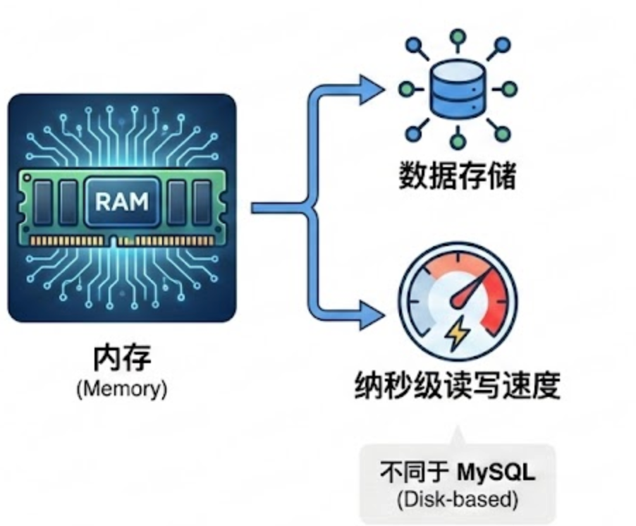

### 一、 知识点讲解

Redis (Remote Dictionary Server) 本质上是一个基于内存的非关系型（NoSQL）数据库。

与 MySQL 不同，它将所有数据存储在内存中，这使得它的读写速度达到了纳秒级别。同时，它不仅仅是一个简单的 Key-Value 存储），它是一个数据结构服务器，支持在服务端直接操作复杂的结构（如链表、哈希表、集合）。

#### **速度的核心来源：内存 + IO 多路复用**

- **内存存储：** 这是快的基础。磁盘的寻址是毫秒级的，内存是纳秒级的，两者差了几个数量级。
- **单线程模型：** Redis 的网络 IO 和键值对读写是由**一个主线程**串行完成的（6.0 以后引入了多线程处理网络 IO，但执行命令依然是单线程）。
    - **为什么单线程还快？** 因为 Redis 的瓶颈通常不在 CPU，而在网络带宽和内存。单线程避免了**多线程上下文切换**的昂贵开销，也就**不需要各种锁**来保证线程安全。
    - **IO 多路复用：** 它利用系统的 Epoll 机制，让一个线程同时监听成千上万个客户端连接，哪个连接有数据来了就处理哪个，绝不阻塞。

#### 丰富的数据结构

Redis 不是简单地把 value 当作一个字符串。它内部实现了针对不同场景优化的特定数据结构：

- **String：** 最基本类型，底层是 SDS（简单动态字符串），安全且高效。
- **List：** 双向链表，常用于消息队列。
- **Hash：** 哈希表，适合存储对象。
- Set/ZSet： 集合与有序集合，底层用到跳表，常用于排行榜。

这些结构使得计算（如排序、去重）可以直接在 Redis 内存中完成，而不用把数据拉到应用层处理。

#### 持久化与高可用

虽然是内存数据库，但 Redis 提供了机制防止数据丢失：

- **RDB (快照)：** 每隔一段时间把内存数据 dump 到磁盘。
- AOF (日志)： 把每一条写命令追加到文件里。
- 同时，通过 Sentinel（哨兵） 和 Cluster（集群） 实现了自动故障转移和数据分片。

---

### 二、 面试标准回答

Redis 是一个基于内存的高性能 Key-Value 数据库。在工程实践中，我们主要利用它极其快速的读写能力（QPS 可达 10 万+）来做缓存，同时利用它丰富的数据结构来实现复杂的业务逻辑（如排行榜、计数器）。

**第一，关于它的性能核心。**

Redis 之所以快，主要基于三点：

1. **纯内存操作**，避开了磁盘 I/O 的瓶颈。
2. **基于 IO 多路复用模型**，实现了非阻塞的网络 I/O，能高效处理海量并发连接。
3. **单线程执行模型**，避免了多线程频繁的上下文切换开销和竞态条件，不需要加锁。

**第二，关于数据结构与场景。**

它不仅仅存字符串，更重要的是支持复杂数据类型：

- 用 **String** 做缓存、计数器（`INCR`）或分布式锁（`SETNX`）。
- 用 **Hash** 存储用户对象，修改单个字段不用读取整个对象。
- 用 **List** 做简单的消息队列。
- 用 **ZSet** 实现实时排行榜，利用其底层的跳表结构进行快速排序。

**第三，关于高可用。**

Redis 虽然是内存数据库，但支持 RDB 和 AOF 两种持久化方式保证重启数据不丢。在生产环境中，我们通常配合 Sentinel（哨兵） 做主从切换的高可用，或者使用 Redis Cluster 做分片集群，以支持海量数据存储和水平扩展。

### 购买了课程的同学，本八股动画视频持续更新！

### 后续视频更新也会在群里分享，一定要先进群！
