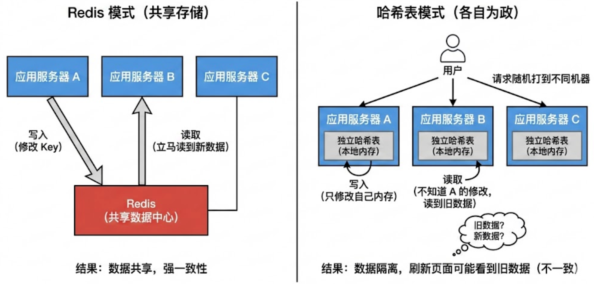

此处为语雀视频卡片，点击链接查看：[final_video.mp4](nullblank#wLEbB)

### 一、 知识点讲解

直接用语言自带的哈希表做缓存，本质上是将数据存储在应用进程的堆内存中。

这在架构上被称为本地缓存。相比于 Redis 这种远程缓存，它少了一次网络请求，速度是纳秒级的（比 Redis 快 100 倍以上），但它引入了“状态”问题，导致应用不再是无状态的，给水平扩展带来了巨大麻烦。

#### 分布式一致性

这是最大的痛点。现代后端服务通常是集群部署的（比如有 3 台 App Server）。

- **Redis 模式：** 所有 Server 连同一个 Redis，Server A 修改了 Key，Server B 立马能读到，数据是**共享**且**强一致**的。
- **哈希表模式：** 每个 Server 内存里都有一份独立的哈希表。Server A 修改了自己内存里的 Key，Server B 根本不知道。这就导致用户刷新一下页面，看到的可能是旧数据，再刷一下又是新数据（取决于请求打到了哪台机器）。

#### 内存管理的不可控性

Redis 是专业的内存数据库，它有完善的内存淘汰策略。

- **哈希表：** 简单的 `HashMap` 没有容量上限，也没有 LRU（最近最少使用）淘汰算法。如果你不断往里 `put` 数据，内存会无限膨胀，最终导致应用进程 **OOM** 崩溃。
- **解决成本：** 为了解决这个问题，你需要手写 LRU 链表、并发锁、过期时间清理逻辑。写到最后，你其实是在代码里重新造了一个“简易版 Redis”（比如 Java 的 Caffeine 或 Guava Cache 就是做这个的）。

#### **数据持久化与冷启动**

- **Redis：** 挂了能重启，有 RDB/AOF 恢复数据。
- **哈希表：** 只要应用重启，内存里的缓存瞬间清空。这意味着重启后的瞬间，所有流量会直接击穿缓存打到数据库上，可能把数据库打挂。

---

### 二、 面试标准回答

用哈希表直接做缓存是可以的，这在业界被称为本地缓存。但它不能在所有场景下替代 Redis，它更多是作为 Redis 的前置补充。它的核心优势是极低延迟，但存在数据不一致和内存管理复杂两大硬伤。

**第一，适用场景与优势。**

如果缓存的数据是静态的，或者对一致性要求不高，直接用哈希表是极其高效的。因为它省去了序列化和网络 I/O 的开销，性能比 Redis 高出 1-2 个数量级。

**第二，不可替代 Redis 的核心原因。**

1. **分布式一致性难题：** 在微服务或多节点部署下，本地哈希表是数据隔离的。修改一个节点的缓存，无法同步更新其他节点。这会导致用户看到的数据在不同请求间“跳变”。
2. **内存不可控：** 原生哈希表没有内存上限和 LRU 淘汰机制，容易引发 OOM。Redis 则提供了成熟的过期和淘汰策略，且进程隔离，不会因为缓存满了拖垮业务服务。
3. **持久化缺失：** 应用重启即数据丢失，会引发缓存雪崩，对数据库造成瞬间冲击。

**第三，最佳实践（多级缓存）。**

在高性能系统中，我们通常不会非此即彼，而是采用 “本地缓存 + Redis” 的多级缓存架构。

- **L1（本地）：** 用 HashMap 挡住最热的 Key（如热点商品），处理 80% 的读请求。
- **L2（Redis）：** 作为全量缓存和分布式协调层，保证数据最终一致性。
- 这样既利用了哈希表的极速，又利用了 Redis 的可靠性和一致性。
