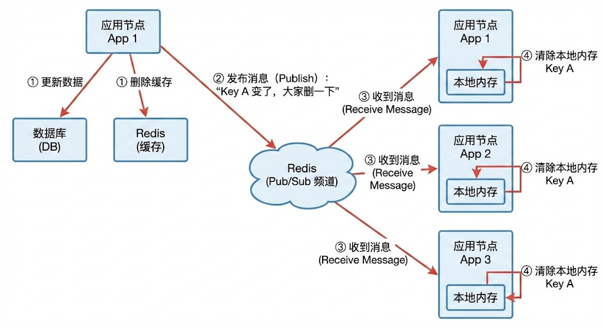
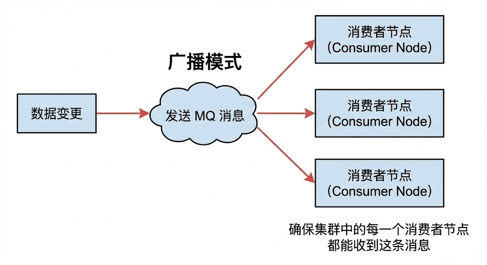
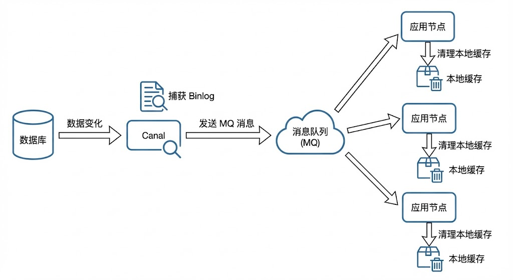

### 一、 知识点讲解

我们必须明确一个前提：多级缓存架构牺牲了一致性来换取极致的性能，因此我们追求的通常是**<u>最终一致性</u>**，而非强一致性。

要保证本地缓存与远端源数据一致，核心难点在于**“感知”**。当 App 1 修改了数据，App 2、App 3 的内存是独立的，它们无法感知这个变更。

解决这个问题的通用模式是 “主动通知 + 被动兜底”。主动通知依赖于消息广播机制（Pub/Sub 或 MQ），被动兜底依赖于TTL（过期时间）。

#### **基础防线：短 TTL**

无论你的通知机制设计得多完美，网络抖动或服务重启都可能导致通知丢失。

- **机制：** 给本地缓存设置一个极短的过期时间（例如 5秒 - 60秒）。
- **作用：** 即使所有通知都失败了，本地脏数据最多也只存在几十秒。这是系统一致性的最后一道保险。

#### 轻量级方案：Redis Pub/Sub（发布订阅）

利用 Redis 自带的消息通道功能。

- **流程：**
    - App 1 更新数据库，删除 Redis 缓存。
    - App 1 向 Redis 的固定频道发送一条消息：“Key A 变了，大家删一下”。
    - 所有订阅了该频道的应用节点（App 1, 2, 3...）收到消息。
    - 各个节点在自己的内存中清除对应的 Key。
- **优缺点：** 开发极其简单，不依赖额外组件。但 Redis 的 Pub/Sub 是“即发即弃”的，如果某个节点网络抖动断连了一瞬间，消息就丢了，导致该节点缓存无法清理（只能靠 TTL 兜底）。

#### 可靠方案：MQ 广播（如 RocketMQ/Kafka）

引入专业的消息队列。

- **流程：** 数据变更后，发送一条 MQ 消息。消费模式设置为**广播模式**，确保集群中的**每一个**消费者节点都能收到这条消息，而不是只有一个节点收到。
- **优缺点：** 可靠性极高，有重试机制。但架构变重了，维护成本增加。

#### 进阶方案：Canal + MQ（业务解耦）

为了不让业务代码里塞满“发消息”的逻辑，可以通过 Canal 监听数据库的 Binlog。

- **流程：** 数据库数据变化 -> Canal 捕获 Binlog -> 发送 MQ 消息 -> 各个应用节点消费 MQ -> 清理本地缓存。
- **作用：** 彻底解耦，业务代码只管写库，不用操心缓存清理的事。

---

### 二、 面试标准回答

在多级缓存架构中，保证一致性的核心策略是<u>“短窗口的过期时间”作为兜底，配合“消息广播机制”</u>进行实时同步。我们一般采用“主动失效”的策略，具体实现分为轻量级和高可靠两种路径。

**第一，必须设置本地缓存的短过期时间（TTL）。**

本地缓存只应该缓存热点数据，且有效期不宜过长。这样即使通知机制完全失效，脏数据造成的影响也被限制在 10 秒以内，保证了最终一致性。

**第二，基于 Redis Pub/Sub 的轻量级通知**

在大多数业务场景下，我们利用 Redis 天然的发布订阅功能。

当一个业务节点修改了数据并更新了 Redis 后，它会同时向 Redis 的特定 Channel 发布一条“清除消息”。集群中其他所有订阅了该 Channel 的业务节点收到消息后，会立即删除自己本地内存中对应的 Key。

- **权衡：** 这个方案的优点是架构简单，不引入新组件；缺点是 Redis 的消息没有持久化，极端网络下可能会丢失消息，但配合 TTL 兜底，这对大部分互联网业务是可以接受的。

**第三，基于 MQ 广播的高可靠方案。**

如果业务对一致性要求较高，我们会使用 RocketMQ 或 Kafka 的广播模式。

消息队列保证了消息的可靠投递。即使某个节点暂时 Full GC 卡顿或网络波动，恢复后依然能消费到积压的消息来清理缓存，从而消除了“漏删”的风险。
