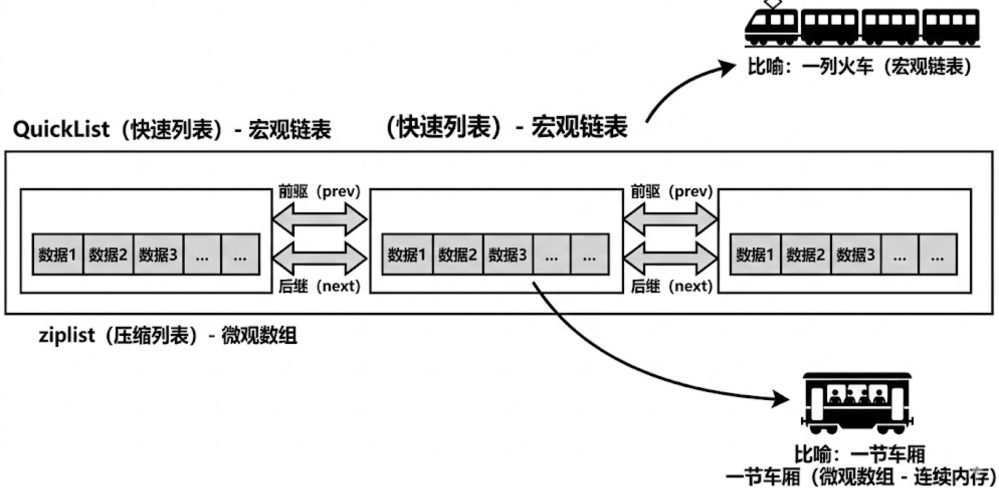

### 一、 知识点讲解

在 Redis 3.2 版本之前，List 的底层实现是“分裂”的：数据少时用 ziplist（压缩列表），数据多时用 linkedlist（双向链表）。

但这两者都有明显的缺陷：

- **LinkedList：** 内存碎片化严重，每个节点都要维护 `prev` 和 `next` 指针，内存开销大，且无法利用 CPU 缓存。
- **ZipList：** 也就是一块连续的内存。虽然省内存，但如果数据量大，插入或删除操作会导致整块内存的数据拷贝，性能极差。

为了解决这个问题，Redis 3.2 引入了 QuickList（快速列表）。

QuickList 本质上是一个“双向链表”，但它的每一个节点（Node）不是存一个简单的数值，而是一块 ziplist。

#### 宏观链表，微观数组

这就好比我们有一列火车：

- 宏观上看，它是一节节车厢连在一起的（双向链表）。
- 微观上看，每一节车厢里坐了很多人（`ziplist`，连续内存存储）。

#### **优势：取长补短**

- **解决内存碎片：** 因为每个节点是一个 `ziplist`，能存储几十上百个元素，这大大减少了链表节点的数量，从而减少了指针带来的内存消耗。
- **解决扩容性能：** 当我们需要插入数据时，只需要操作当前的那个 `ziplist` 节点。如果这个节点满了，就分裂出一个新节点，而不需要像纯数组那样拷贝整个大 List 的数据。

#### 演进：Listpack (Redis 7.0+)

在 Redis 7.0 中，quicklist 的内部结构发生了一点微调。它不再使用 ziplist 作为节点，而是替换成了 listpack（紧凑列表）。

- 原因：`ziplist` 存在一个致命设计缺陷——**连锁更新**。当一个元素的长度发生变化，可能引发后续所有元素的长度字段发生变化。`listpack` 彻底解决了这个问题，但整体架构依然是 QuickList。

---

### 二、 面试标准回答

Redis 的 List 底层实现随着版本演进有过较大变化。在 Redis 3.2 之前，它由 ziplist 和 linkedlist 混合实现。而在 3.2 之后，Redis 统一使用了 QuickList 作为底层实现。

**第一，QuickList 。**

QuickList 是一个双向链表和压缩列表的混合体。

简单来说，QuickList 的宏观结构是双向链表，但链表中的每一个节点实际包含的是一个 ZipList（在 Redis 7.0 后替换为 Listpack）。

**第二，它解决了什么问题。**

这种设计完美平衡了内存空间和访问性能：

1. **克服了原生链表的内存浪费：** 普通的双向链表每个节点都需要两个指针，且内存不连续，容易产生碎片。QuickList 将多个元素打包在一个 ZipList 节点中，大幅减少了指针占用，利用了 CPU 缓存。
2. **克服了原生数组的修改代价：** 如果直接用一个巨大的 ZipList，插入删除会导致大量的内存拷贝。QuickList 将大块数据切分成多个小段，修改操作限制在局部，避免了全局拷贝。
