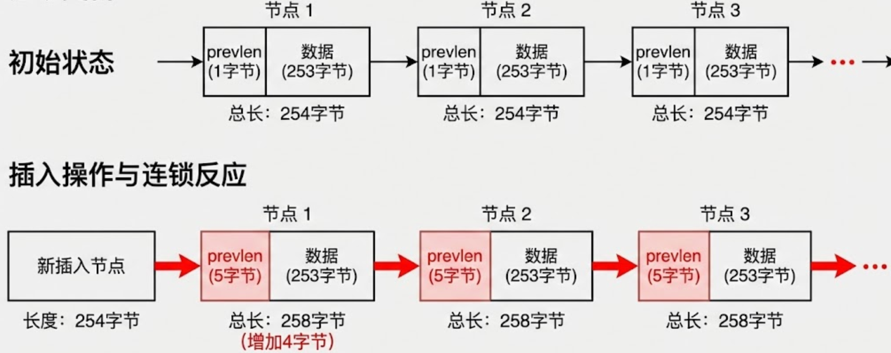
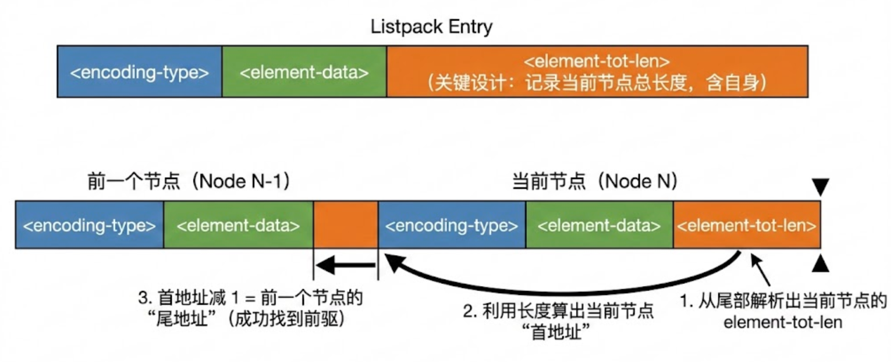

### 一、 知识点讲解

“连锁更新”的根源在于：ZipList 中的每个节点都保存了“前一个节点的长度”。这意味着，前一个节点的数据变了，当前节点的头部信息就得变。

Listpack 解决这个问题的思路是：彻底斩断节点间的依赖。每个节点只记录自己的长度，不再关心前一个节点有多长。

#### ZipList 的缺点：prevlen

ZipList 的 Entry 结构是这样的：

&lt;prevlen> &lt;encoding> &lt;entry-data>

- `**prevlen**`**：** 记录前一个节点的长度，为了支持从后向前遍历（双向链表特性）。
- **变长编码：** 如果前一个节点长度小于 254 字节，`prevlen` 占 **1 字节**；如果大于等于 254 字节，`prevlen` 占 **5 字节**。
- **问题场景：** 假设有一排节点，长度都是 253 字节（`prevlen` 都是 1 字节）。此时，你在最前面插入了一个 254 字节的新节点。
    - 第 2 个节点的 `prevlen` 必须从 1 字节扩展为 5 字节。
    - 导致第 2 个节点整体长度增加 4 字节，变成了 257 字节。
    - 第 3 个节点发现前面的兄弟变长了（超过 254），于是它的 `prevlen` 也要扩张。
    - ...以此类推，后面所有的节点可能都要重新分配内存。这就是 O(N) 的连锁更新。

#### Listpack 的解决方案：element-tot-len 后置

Listpack 的 Entry 结构改成了这样：

&lt;encoding-type> &lt;element-data> &lt;element-tot-len>

- **去掉了** `**prevlen**`**：** 头部不再存前一个节点的长度。
- `**element-tot-len**`**<u>（关键设计）</u>****：** 把它放在了当前节点的**尾部**。它记录的是**当前节点**的总长度（包括 encoding + data + len 本身）。
- **如何逆序遍历？** Listpack 的解码规则经过特殊设计，允许从当前节点的尾部解析出 `element-tot-len`。有了这个长度，就能算出当前节点的“首地址”。而当前节点的首地址减 1，就是前一个节点的“尾地址”。
- **结果：** 无论前一个节点怎么变，当前节点的任何信息都不需要改变（因为它不存前驱的长度）。节点之间彻底解耦。

---

### 二、 面试标准回答

ZipList 的连锁更新问题，根本原因在于其Entry 结构的耦合性。Listpack 通过改变 Entry 的编码结构，移除了对前驱节点的长度依赖，从而彻底解决了这个问题。

**第一，ZipList 的问题。**

ZipList 为了支持双向遍历，在每个节点的头部保存了 prevlen（前一个节点的长度）。这个字段是变长的（1 字节或 5 字节，分界线是 254 字节）。

一旦某个节点扩容跨过了 254 字节的阈值，其后继节点的 prevlen 就需要扩大内存空间。如果后继节点扩大后也超过了阈值，就会触发多米诺骨牌效应，导致后续大量节点需要连续进行内存重分配，这在极端情况下会将时间复杂度从 O(1) 拉低到 O(N)。

**第二，Listpack 的解决方案。**

Listpack 重新设计了 Entry 结构：encoding + data + backlen。

核心区别在于两点：

1. **移除前驱依赖：** 头部不再存储前一个节点的长度。前一个节点变大变小，跟当前节点完全无关。
2. **引入** `**backlen**`**：** 在当前节点的**尾部**存储当前节点自身的总长度。

**第三，如何保持双向遍历能力？**

Listpack 的巧妙之处在于，通过读取当前节点的 backlen，我们可以计算出当前节点的起始位置。而当前节点起始位置的前一个字节，就是前一个节点的 backlen。这样我们依然可以从后向前回溯遍历，但却消除了节点间的数据耦合，彻底根除了连锁更新的风险。
