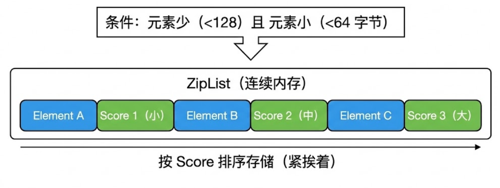
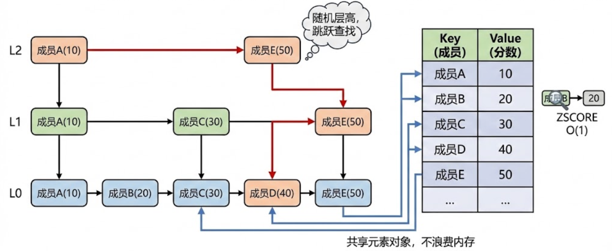

### 一、 知识点讲解

ZSet 的底层实现并不是单一的结构，而是根据数据量的大小进行动态切换的。

- **数据量小**时：使用 **ZipList**（压缩列表，7.0 后为 Listpack）。这时候它就像一个紧凑的数组，按 Score 排序。
- **数据量大**时：使用 **SkipList（跳表） + Dict（哈希表）** 的组合结构。这是 ZSet 高性能的核心所在。

#### 小数据场景：ZipList（压缩列表）

当 ZSet 中的元素个数较少（默认 &lt; 128），且每个元素的大小较小（默认 &lt; 64 字节）时，Redis 为了节省内存，会选择 ZipList。

- **原理：** 它是紧凑的连续内存块。Redis 将 `(element, score)` 两个节点紧挨着存入 ZipList，并按照 Score 进行排序。
- **性能：** 虽然插入和查询是 O(N) 的，但因为 N 很小且内存连续（利用 CPU 缓存），性能反而优于复杂的指针结构。

#### 大数据场景：SkipList + Dict

当数据量超出阈值，ZSet 会升级为由“跳表”和“哈希表”组成的复合结构。

- **SkipList（跳表）：提供 O(logN) 的有序查找**
    - **结构：** 它是一个**多层的链表**。最底层（Level 0）包含所有元素。上面的每一层都是下面一层的“索引”。
    - **查找逻辑：** 就像坐电梯，先上最高层往右找，发现下个节点比目标大，就下沉一层继续往右找。这种“跳跃式”的查找大大减少了遍历次数。
    - **随机层高：** 每次插入新节点时，Redis 会通过随机函数决定这个节点有几层（通常是抛硬币逻辑，1/4 概率升高一层）。这避免了像平衡树那样复杂的旋转操作。
- **Dict（哈希表）：提供 O(1) 的权重查询**
    - **作用：** 如果只用跳表，要查询“用户 A 的分数是多少（`ZSCORE`）”，需要遍历链表，复杂度是 O(logN)。
    - **优化：** Redis 旁路维护了一个哈希表，Key 是成员，Value 是分数。这样 `ZSCORE` 就变成了 O(1)。
    - **注意：** 这里的 Dict 和 SkipList 共享具体的元素对象（指针引用），所以不会造成严重的内存双倍浪费。

#### 为什么不用红黑树？

这是面试必问的对比。

- **范围查找：** ZSet 经常需要执行 `ZRANGE`。跳表在找到起点后，直接遍历底层链表即可；而红黑树的中序遍历相对复杂，缓存亲和性差。
- **实现简单：** 跳表的代码量和复杂度远低于红黑树，容易调试和维护。

---

### 二、 面试标准回答

ZSet 的底层实现采用了**“压缩列表”和“跳表+ 哈希表”**两种形态，根据数据量动态切换，以在内存占用和性能之间寻找平衡。

**第一，压缩列表形态。**

当 ZSet 存储的元素数量较少（默认小于 128 个）且元素长度较短时，Redis 使用 ZipList。这是一块连续的内存，元素和 Score 按顺序紧凑排列。虽然理论上插入是 O(N)，但在小数据量下，利用 CPU 的缓存行特性，它的实际读写速度极快，且极度节省内存。

**第二，跳表+ 哈希表形态。**

当数据增多，ZSet 会升级为复合结构：

1. **SkipList：** 这是主存储结构。它通过维护多级索引实现了平均 **O(logN)** 的查找效率，支持高效的插入、删除和**范围查询**。
2. **Dict：** 作为一个辅助结构，它维护了 `Member -> Score` 的映射。这使得 `ZSCORE` 命令的复杂度从 O(logN) 降到了 **O(1)**。

**第三，为什么选择跳表而不是红黑树。**

核心原因有两点：

1. **范围查询更高效：** ZSet 极度依赖区间查找。跳表一旦找到区间的起点，剩下的操作就是简单的链表遍历；而红黑树需要进行中序遍历，不仅逻辑复杂，而且内存跳跃大，对 CPU 缓存不友好。
2. **实现更简单：** 跳表通过概率平衡代替了红黑树复杂的旋转平衡，代码实现更轻量，也更易于内存管理。
