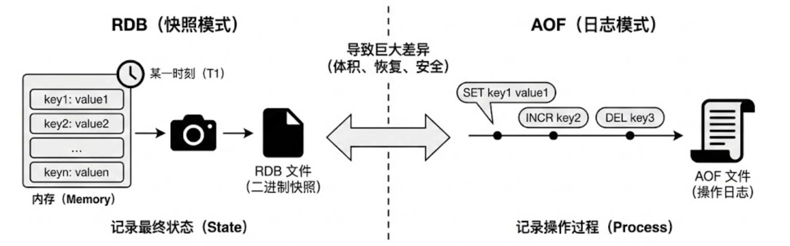

### 一、 知识点讲解

RDB 和 AOF 的本质区别在于记录的内容不同：

- **RDB：** 记录的是某一时刻的**最终状态**。它把内存里的数据直接 Dump 成二进制文件。
- AOF ： 记录的是导致状态变化的操作过程。它把每一条写命令（如 SET, INCR）追加到日志文件中。

正是因为这个本质区别，导致了它们在文件体积、恢复速度和安全性上的巨大差异。

#### **恢复速度的差异**

- **RDB 快：** Redis 加载 RDB 时，是直接将二进制数据读取到内存中，这属于**物理层面的数据拷贝**，速度极快。
- **AOF 慢：** Redis 加载 AOF 时，必须创建一个伪客户端，**把日志里的命令一条条重新执行一遍**。如果日志里有 1000 万条 `INCR` 命令，CPU 就得计算 1000 万次。这使得 AOF 的启动时间远慢于 RDB。

#### **文件体积的差异**

- **RDB 小：** 它是经过压缩的二进制格式，非常紧凑。
- **AOF 大：** 它是纯文本格式，即使有重写机制，记录过程通常也比记录结果要占空间。

#### **安全性与开销的权衡**

- **RDB：** RDB 依赖 `fork()` 子进程进行快照。`fork` 是一个重量级操作，所以不能频繁执行（通常几分钟一次）。一旦宕机，这几分钟的数据就没了。
- **AOF ：** AOF 仅仅是追加写文件，开销很小，可以每秒刷盘。所以它丢数据少，但持续占用磁盘 I/O。

---

### 二、 面试标准回答

对比 RDB 和 AOF，本质上是在做数据完整性与灾难恢复速度之间的权衡。简单来说，RDB 是“快照”，恢复快但易丢数据；AOF 是“日志”，数据全但恢复慢。

**第一，数据安全性。**

这是 AOF 最大的优势。

- **AOF** 默认开启 `everysec` 策略，每秒刷盘一次，极端情况下最多只丢失 1 秒的数据。
- **RDB** 是间隔触发的（比如 5 分钟一次），如果 Redis 意外宕机，我们会丢失最后一次快照之后的所有修改，这在很多核心业务中是不可接受的。

**第二，恢复速度。**

这是 RDB 的绝对优势。

- **RDB** 文件是紧凑的二进制数据，重启时直接加载进内存，速度极快，适合做冷备。
- **AOF** 需要将日志中的写命令逐条“重放”，如果是几十 GB 的数据，AOF 的加载时间可能比 RDB 慢一个数量级，这会延长故障恢复时间。

**第三，文件体积与优先级。**

- **体积：** 相同数据量下，AOF 文件通常比 RDB 大。
- **优先级：** 如果 Redis 重启时，既有 RDB 又有 AOF，Redis 会**优先加载 AOF**。因为 AOF 记录的数据通常比 RDB 更完整。
