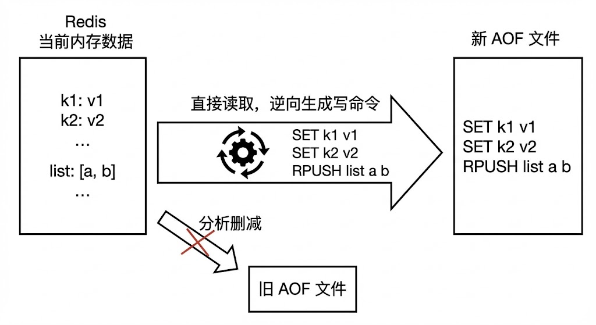

### 一、 知识点讲解

AOF 重写机制的核心目的是压缩日志体积。

随着时间推移，AOF 文件会记录无数条写命令。比如你对一个计数器 INCR 了 100 万次，AOF 文件里就有 100 万条记录，但恢复数据时，我们只需要最终结果 SET key 1000000 这一条命令。

AOF 重写就是把“历史过程”变成“最终状态”，从而极大地减少文件大小，加快重启恢复速度。

#### **基于内存的“逆向还原”**

AOF 重写并不是去分析旧的 AOF 文件并删减条目（那样太麻烦且低效）。

它的做法是： 直接读取 Redis 当前的内存数据，把内存里的每一个键值对，逆向生成一条能够重建该数据的写命令（比如读到 k=v，就生成 SET k v），然后写入一个新的 AOF 文件。

#### AOF 重写缓冲区

在子进程拼命写新文件的过程中，主线程依然在接收客户端的新写操作。如果不处理这些新数据，新 AOF 文件生成那一刻，数据就已经过时了（少了重写期间的数据）。

Redis 的解决方案是引入 AOF 重写缓冲区：

- 在重写期间，主线程执行完写命令后，不仅会写到常规的 `AOF 缓冲区`（为了写旧文件，保证安全），还会同时写到 `AOF 重写缓冲区`。
- 当子进程写完新文件后，向父进程发信号。
- 父进程收到信号，把 `AOF 重写缓冲区` 里的增量数据追加到新文件末尾。
- 最后原子地重命名新文件，替换旧文件。

---

### 二、 面试标准回答

AOF 重写机制是为了解决 AOF 文件随时间无限膨胀的问题。它的本质不是对旧日志的分析压缩，而是根据当前内存状态重建一份最小化的命令集。这个过程完全是后台进行的，对主线程的阻塞极小。

**第一，重写的本质。**

AOF 记录的是操作流水账。重写则是将这些繁杂的过程合并为最终状态。比如之前有 100 次 INCR 操作，重写后只会保留一条 SET 命令。这极大地减小了文件体积，提升了数据恢复速度。

**第二，增量数据的一致性保证。**

这是最关键的点。在子进程重写期间，主线程依然在处理新的写入请求。为了防止数据丢失，Redis 引入了 AOF 重写缓冲区。

1. 在重写期间，新的写命令除了写入原有的 AOF 缓冲，还会同时写入这个**重写缓冲区**。
2. 当子进程完成重写后，通知主线程。
3. 主线程会将重写缓冲区中的增量数据追加到新文件末尾，然后用新文件原子替换旧文件。
