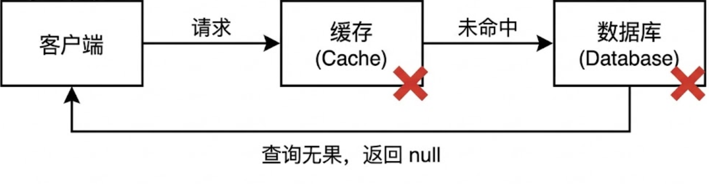
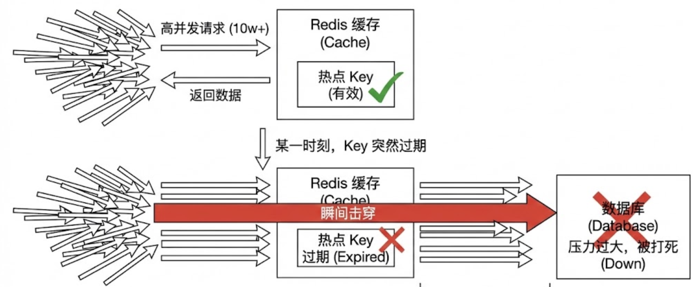
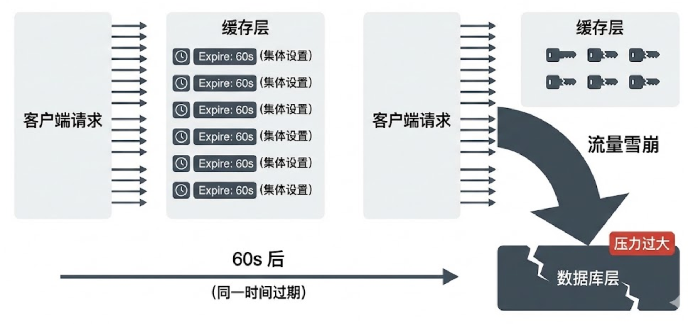

### 一、 知识点讲解

这三者都是缓存失效或不存在，导致大量请求穿过 Redis 直接打到 MySQL，从而导致数据库崩溃的场景。

- **穿透：** 查**根本不存在**的数据（Redis 和 DB 都没有）。
- **击穿：** 查**一个热点**数据（Redis 刚过期，DB 有）。
- **雪崩：** 查**大批量**数据（Redis 大量过期或宕机）。

#### **缓存穿透：数据不存在**

    - **现象：** 客户端请求的数据在缓存中没有，在数据库中也没有。
    - **后果：** 所有的请求都会打到数据库，数据库查不到数据（通常返回 null），也不会把 null 写入缓存。下一次请求来了还是打到数据库。
    - **典型场景：** 黑客恶意攻击（比如用 id=-1 或 UUID 狂刷接口），或者业务逻辑 bug。

#### **缓存击穿：热点过期**

    - **现象：** 针对**某一个** Key，它一直在扛着高并发。突然这个 Key 过期了。
    - **后果：** 在 Redis 失效、新缓存重建完成之前的这短短几百毫秒内，这 10w 个并发请求瞬间全部击穿到数据库，直接把数据库打死。
    - **关键点：** 它是“单点”问题，强调的是**并发**。

#### **缓存雪崩：集体过期**

    - **现象：** 缓存层出现了错误，或者大量的 Key 在**同一时间**过期。
    - **后果：** 流量像雪崩一样瞬间涌入数据库。
    - **关键点：** 它是“面”的问题，强调的是**批量**。比如设置缓存时全是 `expire 60s`，一分钟后所有缓存同时消失。

---

### 二、 面试标准回答

这三个问题是缓存系统中最典型的稳定性风险。它们的区别在于：穿透是查不存在的数据；击穿是单点热点过期；雪崩是大面积失效。针对每种场景，我们都有成熟的应对方案。

**第一，缓存穿透（防守不存在的数据）。**

核心思路是“拦截非法请求”。

1. **布隆过滤器：** 这是最推荐的方案。我们在 Redis 前置一个布隆过滤器，把所有可能存在的 ID 存进去。请求来了先查过滤器，如果过滤器说不存在，直接返回，绝不让请求碰数据库。
2. **缓存空对象：** 如果数据库查不到，我们也把这个 Key 存入 Redis，Value 设为 `null` 或特殊标记，并设置一个较短的过期时间（如 30秒）。这样下次请求就能命中缓存了。

**第二，缓存击穿（保护热点数据）。**

核心思路是“控制重建并发”或“永不过期”。

1. **互斥锁：** 当发现缓存过期时，不是所有线程都去查数据库，而是先抢一个 Redis 分布式锁。抢到锁的那个线程去查 DB 并重建缓存，其他线程等待。这样把 10w 并发压成了 1 个 DB 请求。
2. **逻辑过期：** 很多高并发场景我们会把 Key 设为永不过期，但在 Value 内部存一个时间戳。查询时如果发现“逻辑时间”过期了，后台开一个异步线程去构建新缓存，当前请求直接返回旧值。这保证了高可用。

**第三，缓存雪崩（避免集体失效）。**

核心思路是**“打散过期时间”和“高可用架构”**。

1. **随机 TTL：** 在设置过期时间时，不要设为固定的 60 秒，而是设为 `60 + random(0-10)` 秒。让过期时间分散开，避免同一时刻集体失效。
2. **Redis 高可用：** 搭建 Sentinel 或 Cluster 集群，防止 Redis 宕机导致的全链路雪崩。
3. **降级与限流：** 如果雪崩真的发生了，在网关层进行限流，或者开启服务降级（返回默认值），保住数据库不崩。
