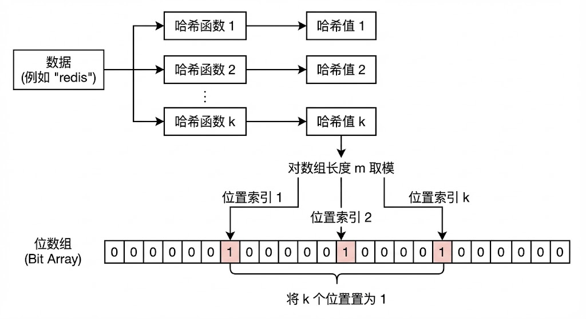
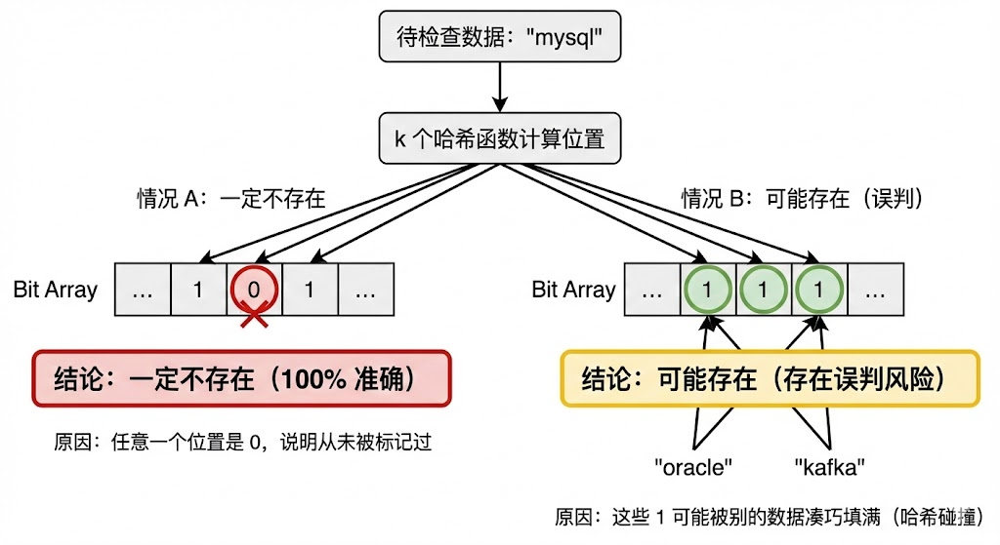

### 一、 知识点讲解

布隆过滤器本质上是由**一个很长的二进制向量（位数组）和一系列随机映射函数（哈希函数）**组成的。

它不存数据的具体内容，只存“数据的指纹”。

它的核心逻辑是：如果它说一个元素不存在，那一定不存在；如果它说存在，那可能是误判（可能存在）。

#### 位数组

想象一个长度为 N 的数组，里面只存 0 和 1。初始状态下，全部都是 0。这是一个极其节省空间的数据结构，存 1 亿个状态可能只需要几十 MB。

#### 写入流程

当我们要把一个数据（例如字符串 "redis"）加入过滤器时：

1. 使用 k 个不同的哈希函数对 "redis" 进行计算，得到 k 个哈希值。
2. 将这 k 个值对数组长度 m 取模，得到 k 个位置索引。
3. 将位数组中这 k 个位置的 bit 全部置为 1。

#### 查询流程

当我们要检查字符串 "mysql" 是否在集合中时：

1. 同样用那 k 个哈希函数计算 "mysql" 的位置。
2. 检查位数组中这 k 个位置的 bit：
    1. **情况 A：** 如果**任意一个**位置是 0，说明这个位置从来没被置为 1 过。**结论：** "mysql" 一定不存在（100% 准确）。
    2. **情况 B：** 如果**所有**位置都是 1，说明这些位置都被置为 1 了。**结论：** "mysql" **可能**存在。
        - *为什么是可能？* 因为这几个 1 可能是被别的字符串（如 "oracle", "kafka"）凑巧分别填满的。这就是**哈希碰撞**导致的**误判**。

#### 无法删除

标准的布隆过滤器不支持删除。因为一个位置的 1 可能是由多个元素共同“贡献”的。如果你把某个位置置为 0，可能会误伤其他元素，导致它们被判断为“不存在”。

---

### 二、 面试标准回答

布隆过滤器是一种空间效率极高的概率型数据结构，主要用于判断一个元素是否在一个集合中。它的核心特点是：它能 100% 判定一个元素不存在，但判定存在时会有一定的误判率。

**第一，实现原理。**

它底层维护了一个 bit 数组和 $$$$ 个哈希函数。

- **存储时：** 将元素经过 k 次哈希计算，将对应的 bit 位标记为 1。
- **查询时：** 同样经过 k 次哈希，如果发现有任何一位是 0，则该元素一定不存在；如果全为 1，则该元素可能存在。

**第二，优劣。**

- **优势：** 相比于 HashSet 或 HashMap，它不需要存储原本的数据内容，空间占用极小，且插入和查询的时间复杂度都是 O(k)，非常快。
- **劣势：** 存在**误判率**，且**不支持删除**操作。

**第三，典型应用场景。**

最经典的就是解决 Redis 的缓存穿透问题。

我们将所有存在的数据库主键（ID）预热加载到布隆过滤器中。当一个请求来查数据时，先问布隆过滤器。如果布隆过滤器说“不存在”，我们直接拦截返回，从而保护数据库不被海量无效请求打垮。此外，像网络爬虫的 URL 去重、垃圾邮件过滤也是常见场景。
