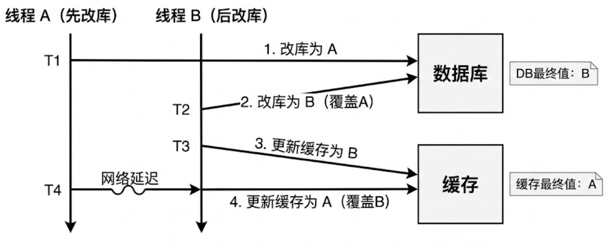
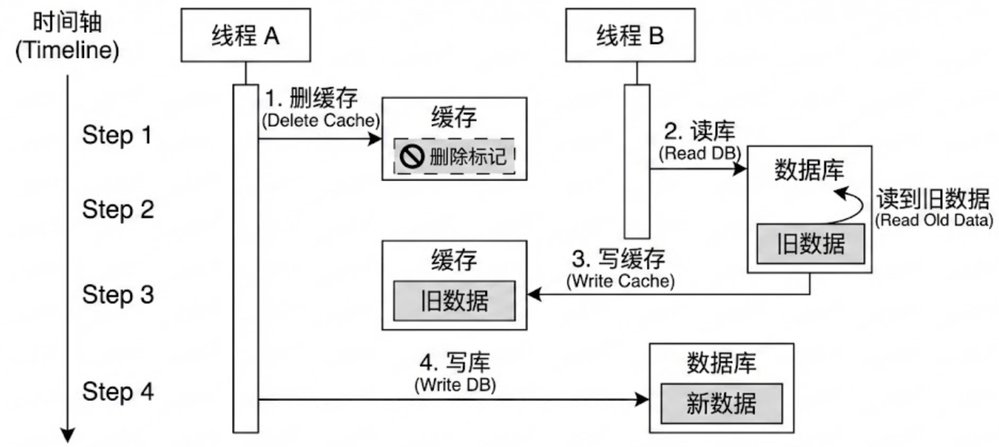

### 一、 知识点讲解

保证一致性的核心难点在于：网络是不稳定的，且并发是无序的。

当我们执行“写数据库”和“操作缓存”这两个动作时，只要这两个动作不是原子性的，就一定会出现时间差。在这个时间差内，如果有读请求进来，或者两个写请求并发执行，就会导致 Redis 里存的是旧数据，而 MySQL 里是新数据。

#### 为什么选择“删除缓存”而不是“更新缓存”？

很多新手直觉上觉得“改了数据库，顺便把缓存里的值也改成新的”效率最高。但这在并发下是致命的。

- **脏数据风险：** 假设线程 A 和线程 B 同时修改数据。
    - 线程 A 先改库，线程 B 后改库。
    - 但在更新缓存时，由于网络波动，线程 B 先更新了缓存，线程 A 后更新。
    - **结果：** 数据库是 B 的新值，缓存里却是 A 的旧值。数据永久不一致。

#### 为什么选择“先写库，后删缓存”？

我们要在这两个操作之间二选一：

- **先删缓存，后写库：**

    - 线程 A 删了缓存，还没来得及写库。
    - 线程 B 来了，发现缓存没了，去读库（读到了旧数据），然后把旧数据写入缓存。
    - 线程 A 终于写完库了（新数据）。
    - **结果：** 缓存里永远是旧数据。
- **先写库，后删缓存：**
    - 虽然也存在理论上的极端并发问题（比如读操作卡顿极久），但在实际生产中，写数据库（IO 操作）通常比读缓存慢得多。这种时间差使得出现不一致的概率极低。

#### 兜底方案：异步重试与 Binlog

万一“删缓存”这个动作失败了怎么办？或者为了解决极端的并发不一致？

- **延迟双删：** 删一次 -> 写库 -> 休眠 500ms -> 再删一次。强制清除那段时间可能产生的脏数据。
- **订阅 Binlog（Canal）：** 这种方案最解耦。业务代码只管写库。专门有个组件（如 Canal）伪装成 MySQL Slave 监听 Binlog，一旦发现数据变了，由这个组件去发消息删除 Redis。

---

### 二、 面试标准回答

关于 MySQL 和 Redis 的一致性，我的观点是：在非强一致性场景下，我们追求最终一致性。 业界标准的解决方案是 旁路缓存模式，具体操作顺序是 “先更新数据库，再删除缓存”。

**第一，为什么采用“删除”而非“更新”。**

相比于直接更新缓存，删除缓存有优势：**避免并发脏数据：** 在多线程并发写入时，更新缓存容易出现“后写先至”的竞态条件，导致缓存中保留了脏数据。

**第二，为什么是“先写库，后删缓存”。**

如果先删缓存，在数据库还没更新完的间隙，读请求会将旧数据重新加载回缓存，导致长时间不一致。

虽然“先写库”也存在理论上的并发漏洞，但由于数据库写入耗时远大于缓存读取，这种概率极低。

**第三，如何保证“最终一致性”。**

为了防止“删除缓存”失败，或者应对极端的并发场景，我们在生产环境中通常采用异步补偿机制：

1. **消息队列重试：** 删除缓存失败时，将 Key 发送给 MQ，由消费者进行重试删除。
2. **基于 Binlog 的异步删除：** 利用 Canal 监听 MySQL 的 Binlog 变更。一旦监测到数据修改，直接投递消息到 MQ，由下游服务负责清理 Redis。这种方式将缓存维护逻辑与业务逻辑彻底解耦，可靠性最高。

第四，关于延时双删。

如果业务对一致性非常敏感，我们还会采用延时双删策略：在写库前后各删除一次缓存，第二次删除设定一个短暂的延时（如 500ms），以确保清除在这期间可能产生的脏读数据。
