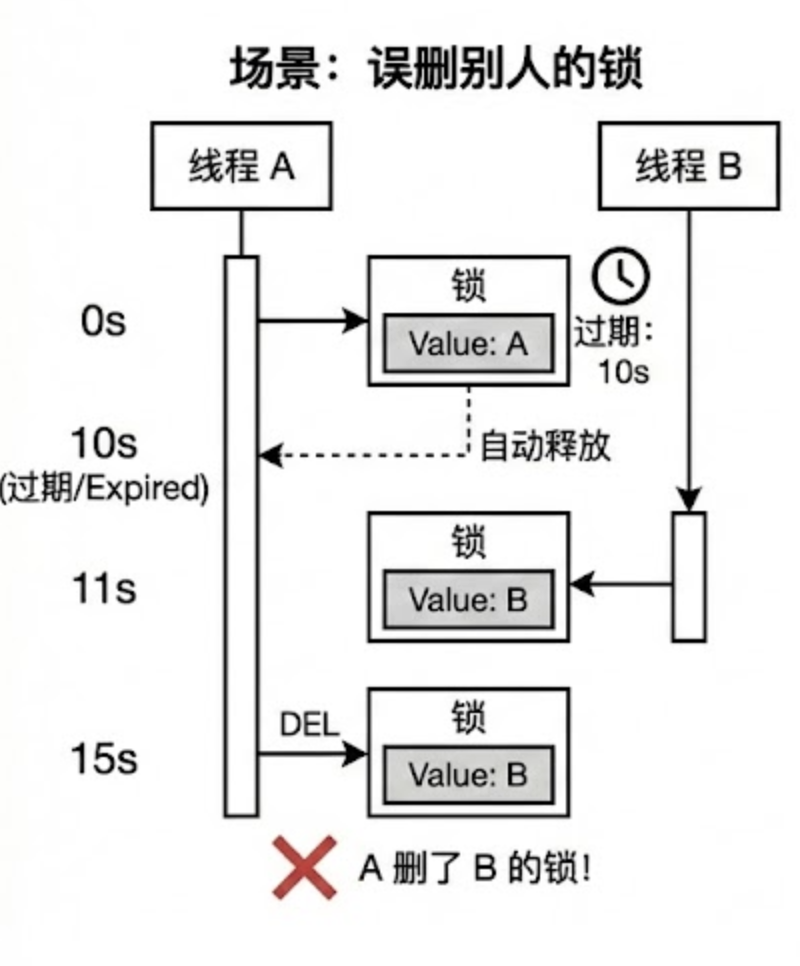
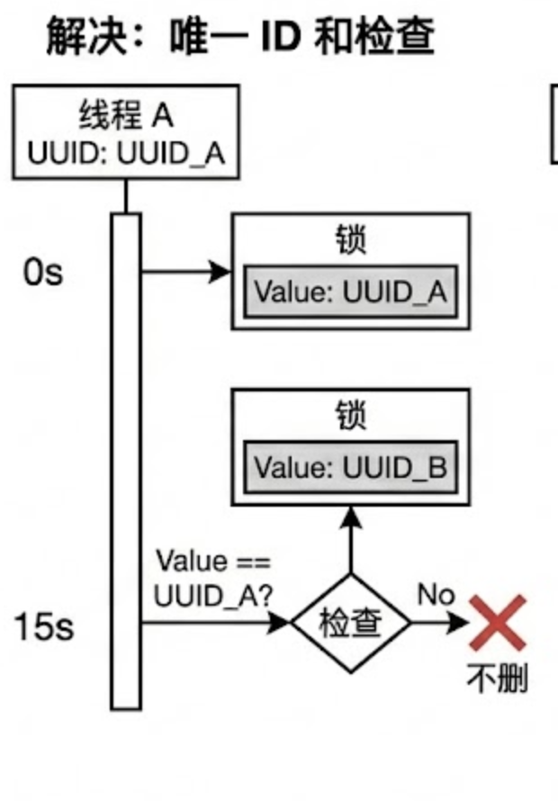
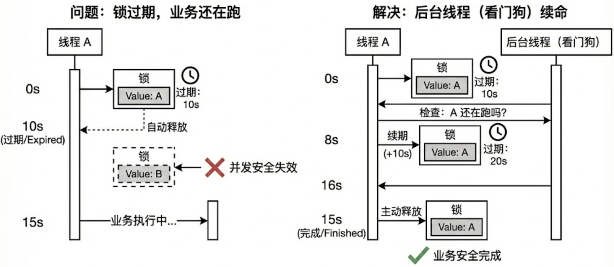

### 一、 知识点讲解

在单机环境下，我们用本地的锁就能搞定。但在分布式系统中，不同机器上的线程看不见彼此，需要一个公共的“仲裁者”。Redis 单线程处理命令的特性，天然适合做这个仲裁者。

实现分布式锁的核心就三句话：**加锁要原子性，解锁要防误删，续期要自动。**

#### **加锁的原子性**

- **错误做法：** 先 `SETNX key value`（加锁），再 `EXPIRE key 10`（设过期时间）。
    - *隐患：* 如果刚执行完 `SETNX`，机器断电了，`EXPIRE` 没执行，这把锁就永远没有过期时间，成了死锁。
- **正确做法：** 使用 Redis 2.6.12 之后的扩展命令 `SET key value NX PX 10000`。
    - `NX`：Not Exists，不存在才执行（抢锁）。
    - `PX`：过期时间（毫秒）。
    - 这条命令是原子执行的，要么全成功，要么全失败，彻底杜绝了死锁隐患。

#### **防止误删**

**场景：** 线程 A 抢到锁，过期时间 10s。结果 A 执行业务花了 15s。

- 第 10s 时，锁过期自动释放。
- 第 11s 时，线程 B 抢到了锁。
- 第 15s 时，A 醒了，执行 `DEL` 命令。**注意：A 删掉的是 B 的锁！**

**解决：** 加锁时，Value 不能随便写，必须是一个**全局唯一的 ID**（如 UUID + 线程ID）。解锁时，先检查 Value 是不是自己的，如果是再删。

**原子性：** “检查”和“删除”是两步操作，必须用 **Lua 脚本** 封装，保证原子性。

#### **锁续期（看门狗机制）**

- **问题：** 还是上面的场景，A 执行时间超长，导致锁自动过期，业务还在跑，并发安全就失效了。
- **解决：** 我们不能无限拉长过期时间。需要一个后台线程，每隔一段时间=检查一下：“A 还在跑吗？”如果在，就给锁续命。成熟的框架 **Redisson** 完美实现了这个机制。

---

### 二、 面试标准回答

Redis 实现分布式锁，在生产环境中我们通常采用 Redisson 框架来实现，而不是手写，因为手写很容易踩坑。其核心逻辑可以概括为三个层面：原子加锁、Lua 解锁 和 Watchdog 续期。

第一，关于加锁。

最底层的实现是使用 Redis 的 SET 命令，带上 NX 和 PX 参数：SET key requestId NX PX 30000。

这里有两个关键点：

1. **必须利用** `**SET**` **命令的原子性**，一次性设置键值和过期时间，防止因为宕机导致死锁。
2. **Value 必须是唯一标识**（比如 UUID），用于后续解锁时的身份验证。

第二，关于解锁。

解锁时，绝对不能直接调用 DEL。因为这可能导致“A 线程的业务超时了，锁自动过期，B 线程拿到锁，结果 A 执行完把 B 的锁删了”这种 Bug。标准做法是使用 Lua 脚本。脚本逻辑是：先 GET 判断锁的 Value 是否等于当前线程的 ID，如果相等再 DEL。Lua 脚本保证了这两个操作的原子性。

第三，关于锁续期。

这是一个很难处理的业务痛点：我们很难预估业务到底要执行多久。

Redisson 引入了一个 Watchdog 机制。如果不手动指定锁时间，它默认给 30 秒。只要持有锁的线程还在运行，后台会有一个定时任务自动把锁的时间重新续满。这保证了业务没跑完锁绝不会过期，业务跑完了看门狗停止，锁自然过期。
