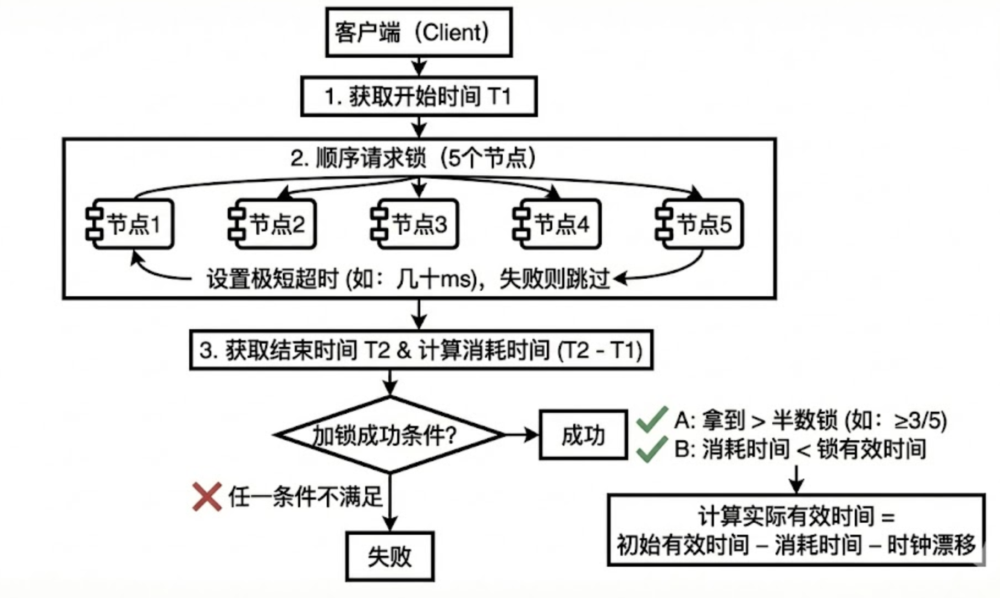

### 一、 知识点讲解

在普通的 Redis 主从架构中，锁是不完全安全的。

因为 Redis 的主从复制是异步的。试想：客户端 A 在 Master 拿到了锁，Master 还没来得及把数据同步给 Slave 就挂了。Slave 晋升为新 Master，此时它并没有锁的数据。客户端 B 就可以在新的 Master 上再次拿到锁。这就导致了“锁失效/双重加锁”。

RedLock 就是为了解决这个问题，试图用多个完全独立的 Redis 节点（没有主从关系）来实现更安全的分布式锁。

#### N 个独立节点

RedLock 假设我们有 N 个 Redis Master 节点，这些节点分布在不同的物理机上，彼此之间没有任何联系<u>（不搞主从复制，不搞集群分片）</u>。

#### 加锁过程（过半机制）

客户端要获取锁，必须执行以下步骤：

1. **获取当前时间戳**  。
2. **按顺序向 5 个节点请求锁**。
    1. 为了防止某个节点挂了导致客户端一直等，请求设置一个极短的超时时间（比如几十毫秒）。如果不成功，立马跳过找下一个。
3. **计算消耗时间**。客户端统计拿到锁后的时间 。只有满足两个条件，才算加锁成功：
    1. **条件 A：** 拿到了超过半数节点的锁（N/2 + 1，即 5 个里至少拿 3 个）。
    2. **条件 B：** 消耗的时间（）小于锁的有效时间。
4. **计算实际有效时间**。`实际有效时间 = 初始有效时间 - 消耗时间 - 时钟漂移`。

#### 争议：时钟依赖

RedLock 的安全性强依赖于所有服务器的系统时间是同步的。

分布式系统专家 Martin Kleppmann 曾发文质疑 RedLock：如果某台机器发生了 NTP 时间跳变（比如时钟突然往后跳了几秒），或者发生了 停顿，原本有效的锁可能会在那个节点上瞬间过期，导致锁失效。

所以，RedLock 试图在不可靠的网络和时钟上建立可靠的锁，这在理论上是不完美的。

---

### 二、 面试标准回答

RedLock 是 Redis 作者 Antirez 提出的一种基于**多节点的分布式锁**算法。它的核心目的是为了解决 <u>Redis 主从异步复制可能导致的“主节点宕机锁丢失”</u>问题。

**第一，核心流程**

RedLock 假设有 N 个（通常是 5 个）独立的 Redis 节点。加锁时，客户端需按顺序向这 5 个节点申请锁。

只有当客户端在大多数节点（N/2 + 1）上都成功获取了锁，且总消耗时间小于锁的 TTL 时，我们才认为这把分布式锁加锁成功。

**第二，它解决了什么。**

它解决了单点故障和主从切换的数据丢失问题。即使挂掉 1-2 台机器，只要满足过半数存活，锁依然可用且互斥。

**第三，为什么生产环境很少用？**

虽然算法设计很巧妙，但在实际工程中我们很少使用 RedLock，主要有两个原因：

1. **太重了：** 为了把锁，我得维护 5 个独立的 Redis 实例，运维成本过高。
2. **安全性争议：** 分布式专家 Martin Kleppmann 指出，RedLock 严重依赖服务器的**系统时钟**。如果发生 NTP 时钟跳跃或长时间的 GC Paused，锁的安全性会崩溃。

**选型建议。**

- 如果业务允许极低概率的锁丢失，**单机 Redis + 主从哨兵**足够了，性能最高。
- 如果业务对数据一致性要求极高，我会选择 **ZooKeeper** 这类强一致性（CP 模型）的组件，而不是强行用 Redis 实现 CP 特性。
