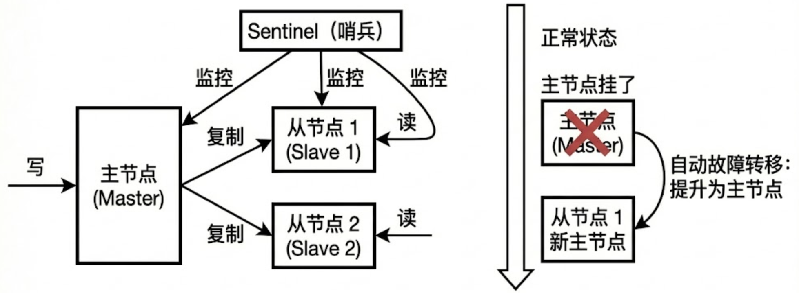
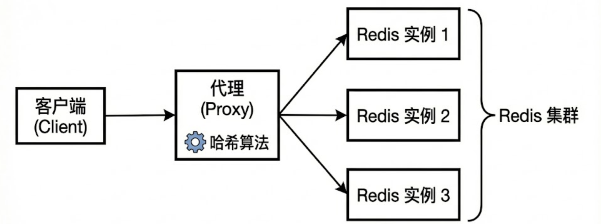
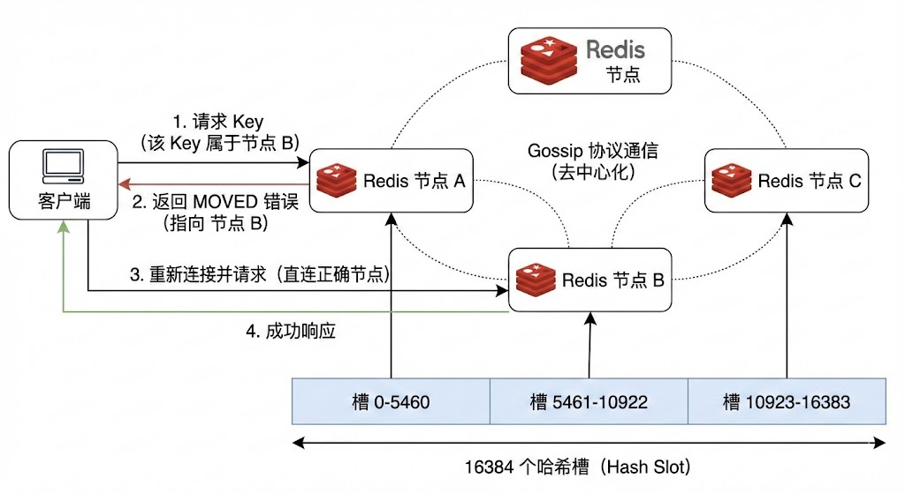

### 一、 知识点讲解

单机 Redis 的瓶颈在于：内存容量有限和 CPU 处理能力有限。为了解决这些问题，Redis 的架构经历了从“主从复制”到“代理分片”，再到“去中心化集群”的演进。

#### **基础阶段：主从复制 + Sentinel（哨兵）**

- **架构：** 一主多从。主节点负责写，从节点负责读。Sentinel 组件负责监控，当主节点挂了，自动把从节点提升为主节点。
- **解决的问题：** 读写分离（分担读压力）和高可用（自动故障转移）。
- **未解决的问题：****无法进行海量数据存储**。因为每个节点存的都是全量数据，主节点的内存上限就是整个集群的上限。

#### **过渡阶段：代理分片模式**

- **架构：** 客户端不直接连 Redis，而是连一个代理（Proxy）。代理通过哈希算法（如一致性哈希），把 Key 转发到后端不同的 Redis 实例上。
- **特点：** 客户端无感知，像用单机一样用集群。但架构变复杂了，多了一层网络转发，延时增加。

#### **最终阶段：Redis Cluster（官方原生集群）**

- **架构：** Redis 3.0 之后推出的**去中心化**方案。没有代理，节点之间通过 **Gossip 协议** 通信。
- **核心机制：****Hash Slot（哈希槽）**。它将整个数据空间切分成 16384 个槽，集群中的每个节点负责维护一部分槽。客户端直接连接任意节点，如果 Key 不在该节点，节点会返回 `MOVED` 错误，告诉客户端去连正确的节点。
- **特点：** 性能最高，官方支持，生态最完善，是目前的绝对主流。

---

### 二、 面试标准回答

Redis 的集群方案随着版本迭代主要经历了三个阶段。目前生产环境中最常用的方案是 Redis Sentinel（适合小数据量高可用） 和 Redis Cluster（适合大数据量分片）。早期的代理方案如 Codis 正在逐渐退出历史舞台。

**第一，高可用方案：Sentinel（哨兵模式）**

这是基于主从复制的增强版。

- **核心能力：** 监控、通知和自动故障转移。
- **适用场景：** 数据量不需要切分（单机内存能装下），主要是为了保证服务不宕机。
- **局限性：** 它是**垂直扩展**，无法解决写操作的瓶颈和海量存储问题。

**第二，中间件代理方案**

这是在 Redis Cluster 成熟之前的主流方案。

- **核心原理：** 在客户端和 Redis 之间架设一层 Proxy，由 Proxy 负责分片逻辑。
- **现状：** 虽然 Codis 提供了非常好用的 UI 和扩容工具，但随着 Redis 官方 Cluster 的成熟，Codis 维护成本较高且不再更新，现在新项目一般不再推荐使用。

**第三，服务端分片方案：Redis Cluster**

这是 Redis 3.0 引入的去中心化分片方案，是目前的标准。

- **核心原理：** 引入了 **Hash Slot（哈希槽）** 概念，共有 16384 个槽。数据通过 `CRC16(key) % 16384` 映射到具体的槽，而集群中的每个节点负责管理一部分槽。
- **优势：** 支持水平扩展（Scale Out），性能极高（无代理层损耗），且具备自动故障转移能力。
