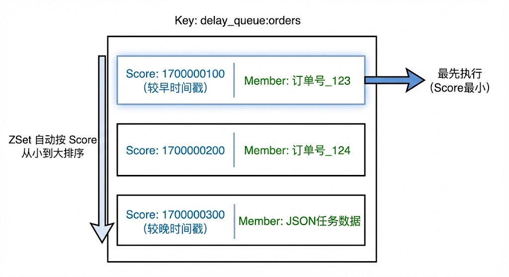
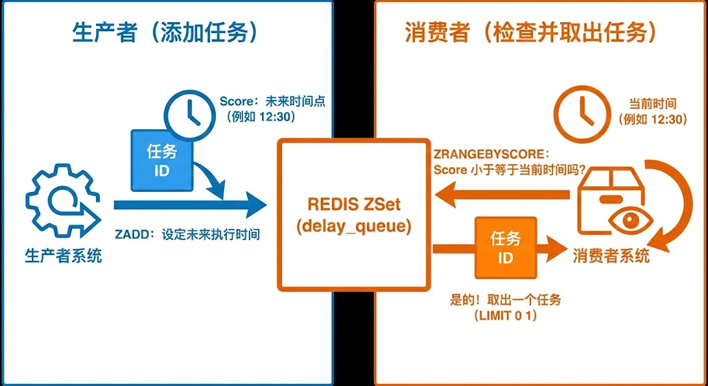
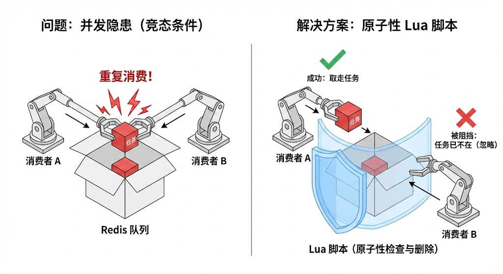
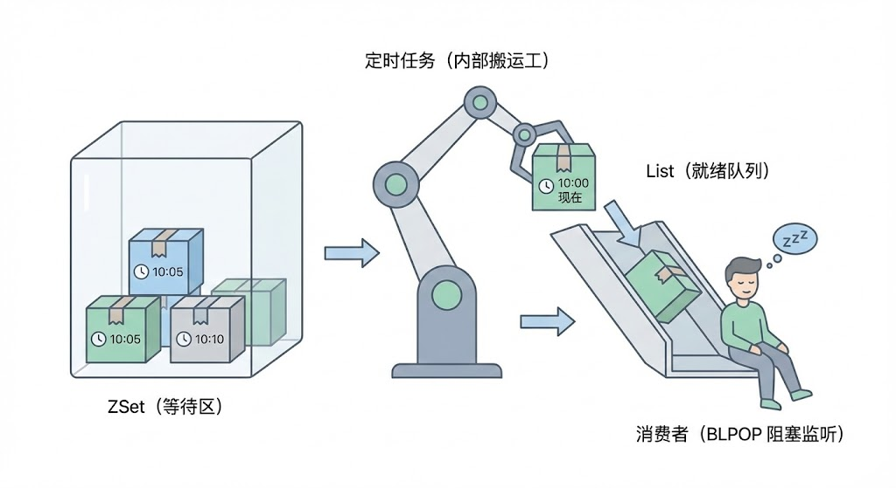

### 一、 知识点讲解

Redis 本身并没有直接提供“延时队列”这种数据结构。实现延时队列的核心思路是：将任务存起来，并按照“执行时间”进行排序。消费端不断轮询，把“已经到时间”的任务取出来消费。

最契合这个需求的数据结构是 ZSet 。

#### **设计：ZSet 充当优先级队列**

    - **Key：** 队列名称，如 `delay_queue:orders`。
    - **Member：** 具体的任务数据（如订单号、JSON 字符串）。
    - **Score：****任务执行的时间戳**。这是核心，ZSet 会自动按 Score 从小到大排序。

#### **生产与消费流程**

**生产者**

- 调用 ZADD delay_queue &lt;future_timestamp> &lt;task_id>。例如：当前 12:00，想让任务在 12:30 执行，就计算出 12:30 的时间戳存入 Score。

**消费者**

- 开启一个死循环，每隔一小段时间执行一次查询：
    - `ZRANGEBYSCORE delay_queue 0 <current_timestamp> LIMIT 0 1`
    - 这句话的意思是：**“Redis，请把 Score 小于等于当前时间（即已经过期/该执行）的任务给我拿出来 1 个。”**

#### 并发安全

这里有一个巨大的并发隐患：如果有多个消费者同时轮询，它们可能同时通过 ZRANGEBYSCORE 查到了同一个任务。为了防止重复消费，必须保证“查询”和“删除”这两个动作是原子性的。

- **解决方案：** 使用 **Lua 脚本**。脚本逻辑是：先查有没有到期的任务，如果有，先 `ZREM` 删掉它。如果删除成功（返回 1），再把任务返回给客户端处理；如果删除失败（返回 0），说明被别的消费者抢了，忽略即可。

#### Redisson 的做法

手写 Lua 脚本比较麻烦且容易出错。Java 的 Redisson 框架实现了更高级的延时队列。

- **原理：** 它不仅仅用 ZSet，还配合了一个 List（阻塞队列）。
- **流程：** 内部有一个定时任务，把 ZSet 里到期的任务搬运到 List 中。消费者直接用 `BLPOP` 阻塞监听 List。这样就避免了消费者频繁轮询 ZSet 造成的 CPU 空转，性能更好。

---

### 二、 面试标准回答

Redis 实现延时队列，最经典且成熟的方案是使用 ZSet。它的核心利用了 ZSet 的 Score 属性来存储任务的执行时间戳，从而实现自动排序。

**第一，基于 ZSet 的实现逻辑。**

我们将任务的具体内容作为 ZSet 的 Member，将任务执行的绝对时间戳作为 Score 存入。

消费者端启动一个线程进行轮询，定期执行 ZRANGEBYSCORE 命令，查询 Score 小于等于当前时间戳的任务，一旦查到，就取出进行消费。

**第二，如何解决并发重复消费。**

在多消费者分布式场景下，直接查很容易导致同一个任务被多个节点获取。

我们必须使用 Lua 脚本 来保证原子性。脚本的逻辑遵循 “Check-and-Set” 思想：先查询符合条件的元素，然后直接执行 ZREM 删除。只有删除成功的那个消费者，才真正拿到了执行权，从而确保任务只被执行一次。

**第三，开源框架的优化。**

在生产环境一般直接使用 Redisson 的 RDelayedQueue。

它对上述模式进行了优化：它引入了一个阻塞队列。内部会有一个 Watchdog 线程，负责将 ZSet 中到期的任务原子地移动到 List 中。消费者只需要使用 BLPOP 阻塞监听 List 即可。这比客户端频繁轮询 ZSet 要高效得多，也解决了空轮询消耗 CPU 的问题。
