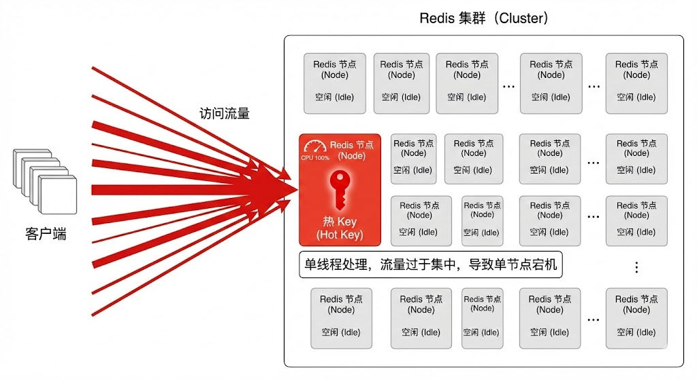

### 一、 知识点讲解

热 Key 问题指的是：在 Redis 集群中，某一个特定的 Key 接收到的访问流量远远高于其他 Key，导致流量过于集中。

由于 Redis 处理命令是单线程的，且数据是根据哈希槽分配到具体的某个分片上的。这就导致了一个尴尬的局面：**虽然你的集群有 100 台机器，但因为这个热 Key 只存在于其中 1 台机器上，所有的流量都打到了这 1 台机器，导致该节点 CPU 飙升至 100% 甚至宕机，而其他 99 台机器却空闲**。

#### **产生的后果**

- **CPU 瓶颈：** 单线程处理不过来海量请求，导致该分片响应变慢，甚至超时。
- **网卡带宽打满：** 如果这个热 Key 的 Value 稍微大一点（比如几十 KB），高并发下网卡带宽会瞬间被吃光，导致该机器上的其他服务也受影响。
- **缓存击穿/雪崩：** 一旦热 Key 所在的节点挂了，这部分海量流量会瞬间击穿到数据库，导致数据库宕机，引发全链路崩溃。

#### 如何发现热 Key？

在解决之前，先得能监控到它：

- **客户端统计：** 在业务代码的 Redis Client 层（如 Jedis/Lettuce）做一层封装，统计每个 Key 的调用次数。优点是实时、准确；缺点是有代码侵入。
- **Redis 自带命令：** 使用 `redis-cli --hotkeys` 命令（Redis 4.0+），它会扫描所有 Key 并统计。缺点是耗时较长，对性能有轻微影响。

---

### 二、 面试标准回答

热 Key 问题本质上是流量倾斜导致的单点性能瓶颈。在 Redis Cluster 架构中，热 Key 会导致原本均衡的流量全部涌向某一个分片，使其成为系统的短板。

**第一，如何精准定位热 Key。**

在生产环境中，我们不能等到服务器挂了才去查。通常采用以下方案：

1. **客户端上报（最常用）：** 在 Redis 客户端（如 Jedis）的封装层引入原子计数器，对 Key 的访问进行采样统计。一旦某 Key 的 QPS 超过阈值，就将其判定为热 Key 并上报监控系统。
2. **Redis 原生扫描：** 在低峰期使用 `redis-cli --hotkeys` 进行扫描分析，作为辅助手段。

**第二，核心解决方案：多级缓存。**

这是解决热 Key 最有效、成本最低的手段。

- **原理：** 当客户端发现某个 Key 是热 Key 后，直接将这个 Key 的数据缓存在**应用服务器的本地内存**中。
- **效果：** 下次请求这个 Key 时，直接从 JVM 堆内存返回，请求根本不会到达 Redis。这相当于把流量分散到了所有的应用服务器上，彻底解放了 Redis。
- **代价：** 需要接受短时间内的数据不一致（本地缓存过期时间通常设得很短，如 5秒 - 60秒）。

**第三，备份/分片方案。**

如果业务对一致性要求高，或者本地缓存不适用，我们会采用“Key 备份”策略：

1. **读热点：** 将热 Key 复制多份，重命名为 `key_1`, `key_2`, `key_N`，并将它们分散存储在不同的 Redis 节点上。客户端访问时，随机选择一个后缀进行访问。这样就把单节点的压力分摊到了多节点。
2. **写热点：** 如果是类似于“微博热搜点赞”这种高频写入，通常需要使用**消息队列**进行削峰填谷，或者在业务层先做**聚合写入**（比如在本地累加到 100 次，再一次性去 Redis `INCRBY` 100）。
