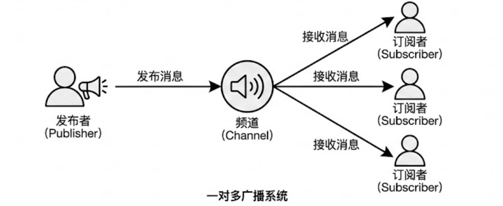

### 一、 知识点讲解

Redis 的发布订阅是一种消息通信模式。

它主要由三部分组成：发布者（Publisher）、频道（Channel）、订阅者（Subscriber）。

这就好比一个广播系统：发布者只管向某个“频道”喊话，所有正在收听这个“频道”的订阅者都能立刻收到消息。它是一对多的。

#### 核心机制：转发而非存储

这是 Pub/Sub 和 Redis List（作为队列使用）最大的区别：

- **List：** 消息是存下来的，消费者拉走一条，List 里就少一条。这是一对一的。
- **Pub/Sub：** 消息**不落地**，不存储。Redis 只是一个“路由器”。当发布者发送消息时，Redis 遍历当前所有订阅了该频道的客户端，把消息直接推给它们。推完之后，Redis 就不管了。

#### 缺点：即发即弃

因为不存储消息，所以存在一个巨大的隐患：

如果订阅者掉线了（哪怕只断网了 1 秒），在这 1 秒内发布者发送的所有消息，订阅者重连后是收不到的。 这些消息直接丢弃了，找不回来。

因此，它绝对不能用于那种“一条数据都不能丢”的业务场景。

#### 典型的应用场景。

基于上述特性，它主要用于对可靠性要求不高，但对实时性要求高的场景：

1. **即时聊天室/弹幕：** 丢一两条弹幕无所谓，但速度要快。
2. **系统内部通知：** 比如“缓存失效广播”。一个服务改了数据，广播一下，让所有服务的本地缓存失效。

#### 替代方案

如果业务既需要 Redis 的轻量级，又需要消息持久化和消费者分组（Consumer Group），我会推荐使用 Redis 5.0 引入的 Redis Stream，它是 Pub/Sub 的可靠性升级版。

---

### 二、 面试标准回答

Redis 的发布订阅（Pub/Sub）是一种基于频道的轻量级消息广播机制。它实现了发布者和订阅者的完全解耦。与 List 结构的“点对点”模式不同，Pub/Sub 是典型的“一对多”广播模式。

**第一，轻量级与实时性。**

它不需要任何额外的配置，命令非常简单（PUBLISH/SUBSCRIBE）。它的吞吐量极高，延迟极低，非常适合需要实时广播的场景。

**第二，它最大的缺点（数据可靠性）。**

Redis Pub/Sub 的消息是不持久化的，它采用“即发即弃”策略。

如果订阅者下线，哪怕只是短暂的网络抖动，在这期间发送的消息都会永久丢失。Redis 并没有为离线客户端维护“消息积压（Backlog）”的机制（直到 Redis 5.0 的 Stream 出现）。

因此，绝不能把它当成专业的 MQ（如 Kafka、RabbitMQ）来处理核心业务数据。

**第三，典型的应用场景。**

基于上述特性，它主要用于对可靠性要求不高，但对实时性要求高的场景：

1. **即时聊天室/弹幕：** 丢一两条弹幕无所谓，但速度要快。
2. **系统内部通知：** 比如“缓存失效广播”。一个服务改了数据，广播一下，让所有服务的本地缓存失效。
