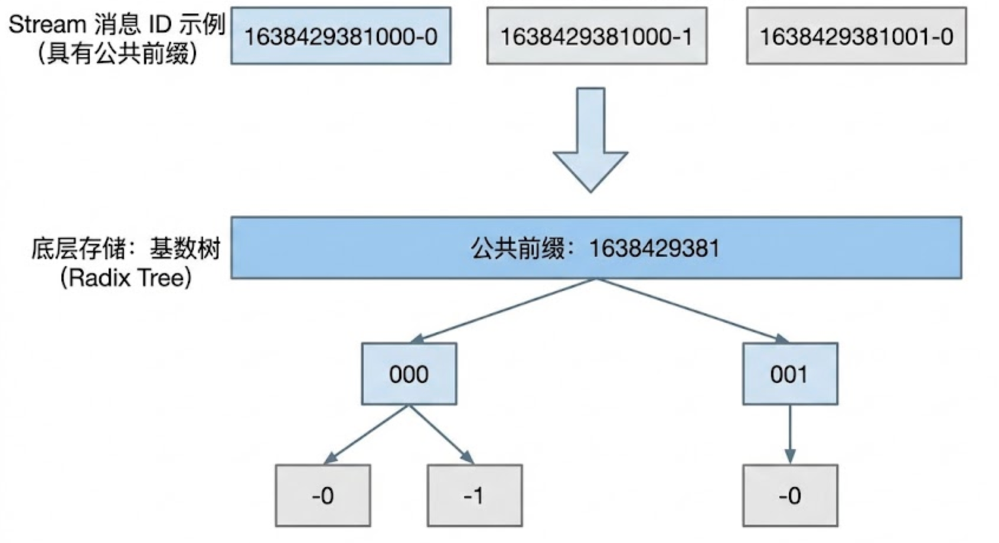
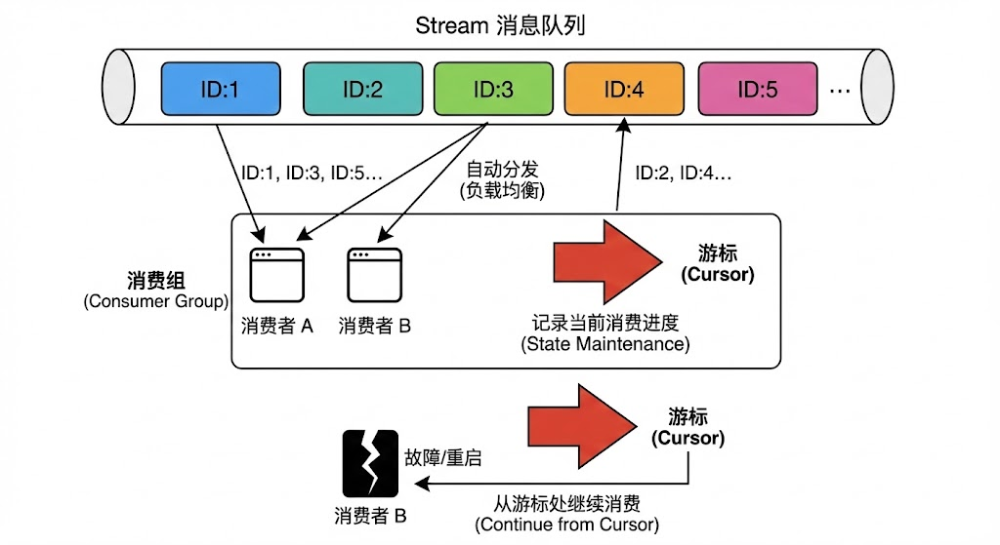
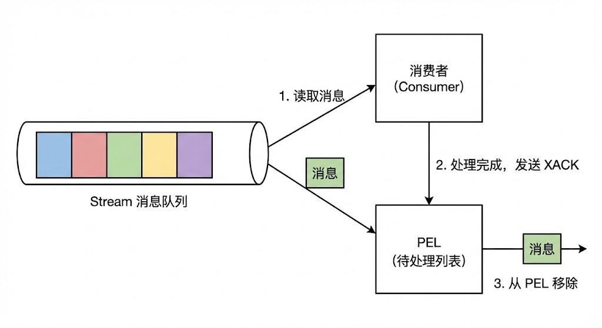

### 一、 知识点讲解

Redis Stream 本质上是一个**仅追加**的日志数据结构。

你可以把它理解为 Redis 内部的一个轻量级 Kafka。

在此之前，Redis 做消息队列都有硬伤：

- **List：** 是一对一的，无法广播；且消息被 `LPOP` 拿走就没了，无法回溯。
- Pub/Sub： 虽然能广播，但在消费者下线期间的消息会直接丢弃，无法持久化。
- Stream 完美解决了这两个问题：它既支持持久化存储（消息发出去后存在内存里，不会自动消失），又支持**消费组**模式（支持多播，也支持负载均衡）。

#### 底层结构：基数树（Radix Tree）

Stream 并不是一个简单的数组或链表，它的底层使用 **基数树** 来存储。

- **为什么用 基数树？** Stream 的消息 ID 是基于时间戳生成的（如 `1638429381000-0`）。这些 ID 具有很强的前缀相似性。Radix Tree 可以高效地压缩存储这些公共前缀，极大地节省内存空间，同时支持高效的范围查询。

#### 核心机制：消费组

这是 Stream 最像 Kafka 的地方。

- **分组消费：** 多个消费者可以组成一个组。Stream 会自动把消息分发给组内的不同消费者（负载均衡）。比如有 100 条消息，组内有 A、B 两个消费者，它们可能各处理 50 条，互不干扰。
- **状态维护：** 每个消费组都维护了一个游标，记录当前消费到了哪里。即使 Redis 重启，或者消费者挂了重启，都能接着上次的位置继续消费，不会丢数据。

#### 可靠性保证：PEL (Pending Entries List)

Stream 引入了 ACK（确认）机制。

当消费者读取了一条消息，这条消息不会立刻从 Stream 中删除，而是进入一个 PEL（待处理列表）。

只有当消费者处理完业务逻辑，发送了 XACK 命令后，该消息才会从 PEL 中移除。

- **崩溃恢复：** 如果消费者拿了消息还没处理完就宕机了，消息会一直停留在 PEL 中。系统可以监控 PEL，发现长时间未 ACK 的消息，将其转移给其他健康的消费者处理（消息转移）。

---

### 二、 面试标准回答

Redis Stream 是 Redis 5.0 引入的一种专门用于实现消息队列的数据结构。它的设计理念大量参考了 Kafka，支持持久化存储、多消费者组以及消息确认（ACK）机制，填补了 Redis 过去在 List 和 Pub/Sub 之间缺失的专业 MQ 能力。

**第一，持久化与多播**

与 Pub/Sub 的“即发即弃”不同，Stream 中的消息是持久化保存在内存中的。

这意味着即使消费者下线，消息也不会丢失，重连后可以从上次的偏移量继续消费。同时，它引入了 消费组 概念，既支持同一份数据被多个业务系统（多个组）同时订阅，也支持同一个业务系统内（组内）的多个消费者并发分担压力。

**第二，数据可靠性**

这是 Stream 能够作为业务 MQ 的基石。Stream 维护了一个 PEL（待处理列表）。当消费者读取消息但尚未发送 XACK 确认时，消息会暂存在 PEL 中。如果消费者宕机，我们可以通过读取 PEL 来找回那些“已读取但未处理成功”的消息，并重新分发，从而保证了“至少消费一次”的语义。

**第三，底层实现**

Stream 的底层使用了 基数树。由于 Stream 的消息 ID 通常是基于时间戳生成的，具有高度的前缀重合性，基数树能够非常高效地压缩存储这些 ID，并在内存占用和查询性能之间取得了很好的平衡。

**第四，应用场景与局限。**

- **适用场景：** 它的定位是**轻量级 MQ**。非常适合用于中小规模的异步解耦、即时通信记录、或者作为简单的事件溯源存储。
- **不适用场景：** 如果数据量达到海量级别（TB 级），或者对数据可靠性要求极高（不允许任何内存数据丢失风险），则更加推荐使用 **Kafka** 或 **RocketMQ**，因为 Redis 毕竟是内存存储，且 Stream 的内存成本相对较高。
