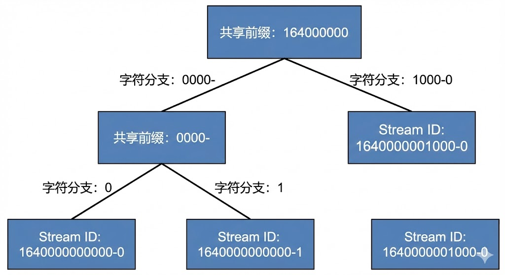
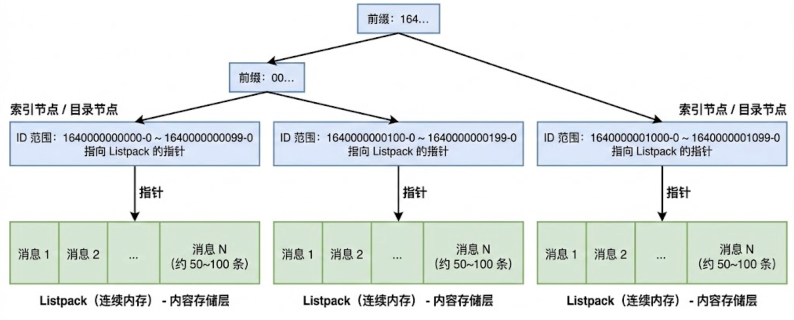

### 一、 知识点讲解

Redis Stream 的底层结构并非单一的树，而是一个 Rax（基数树） 和 Listpack（紧凑列表） 的混合体。

- **宏观上：** 它是一棵基数树。但这棵树的节点不像普通的二叉树那样存一个数值，而是利用“前缀压缩”技术，将多个具有相同前缀的 ID 压缩在一条路径上。
- **微观上：** 树的每一个叶子节点（甚至部分内部节点）不再挂载单一的消息，而是挂载一个 **Listpack**。这个 Listpack 里紧凑地存储了即使条甚至上百条具体的 Stream 消息。

#### 什么是基数树（Radix Tree）？

它是 Trie（前缀树）的压缩优化版。

- **普通 Trie：** 字符串 `apple` 和 `apply` 需要 5 个节点来存储 `a-p-p-l-e`，分叉在 `y`。这导致树的高度很高，节点很多，内存指针开销极大。
- **Radix** **Tree****：** 它会合并“只有一个子节点”的路径。`apple` 和 `apply` 会被压缩成一个节点存储 `appl`，然后分叉出 `e` 和 `y`。
- **Stream 的场景：** Stream ID 是 `时间戳-序号`（如 `1680000000000-1`）。这些 ID 具有极高的前缀重合度（同一毫秒内的消息前缀完全一样）。使用 Radix Tree 可以将这十几字节的公共前缀只存一份，极大地节省内存。

#### 核心设计：Macro Nodes（宏节点）

如果 Rax 树的每个叶子节点只存一条消息，那树依然会很大，且内存碎片化严重。

Redis 引入了 宏节点 的概念：

Rax 树的节点并不直接存储 Stream 的消息内容，而是存储一个指向 Listpack 的指针。

- 一个 Listpack 是一块连续的内存块，里面可能打包了 50-100 条消息。
- Rax 树只负责索引这些 Listpack 的 ID 范围（比如这个节点负责 `1000-0` 到 `1000-99`）。
- **效果：** 这种“目录（Rax）+ 内容页（Listpack）”的组合，既保留了树的查找能力（O(logN)），又利用了线性数组的内存紧凑性。

---

### 二、 面试标准回答

Redis Stream 的底层实现使用的是一种被称为 Rax 的数据结构。它本质上是一个**支持前缀压缩的基数树（Radix Tree）与紧凑列表（Listpack）**的结合体。这种设计是为了在保证范围查询性能的同时，将内存占用降到最低。

**第一，基于前缀压缩的索引结构。**

Stream 的消息 ID 由“时间戳+序列号”组成，具有显著的单调递增和前缀重复特性。

普通的哈希表或二叉树无法有效利用这种特性。而 Rax 通过压缩公共前缀（比如将同一毫秒内的所有 ID 的时间戳部分合并存储），极大地减少了树的节点数量和高度。

**第二，宏节点设计。**

这是 Redis 对 Radix Tree 最关键的改造。Rax 树的叶子节点并不直接存储单条消息，而是挂载一个 Listpack。

- **Listpack** 是一个紧凑的连续内存块，内部顺序存储了几十到上百条具体的 Stream 消息。
- Rax 则作为索引层，仅记录每个 Listpack 中第一条消息的 ID。

这种设计将“随机内存访问”变成了“局部连续内存访问”，不仅减少了内存碎片，还大幅提升了 CPU 缓存命中率。

**第三，查询效率与内存的平衡。**

当我们执行 XRANGE 进行范围查询时：

1. 首先在 Rax 树上进行路径查找，利用公共前缀快速定位到目标 ID 所在的 Listpack（复杂度接近 O(K)，K 为 ID 长度）。
2. 然后在 Listpack 内部进行简单的顺序遍历或二分查找。

这种“两级索引”机制，使得 Stream 即便存储数百万条消息，内存占用依然非常低，且查询延迟稳定。
