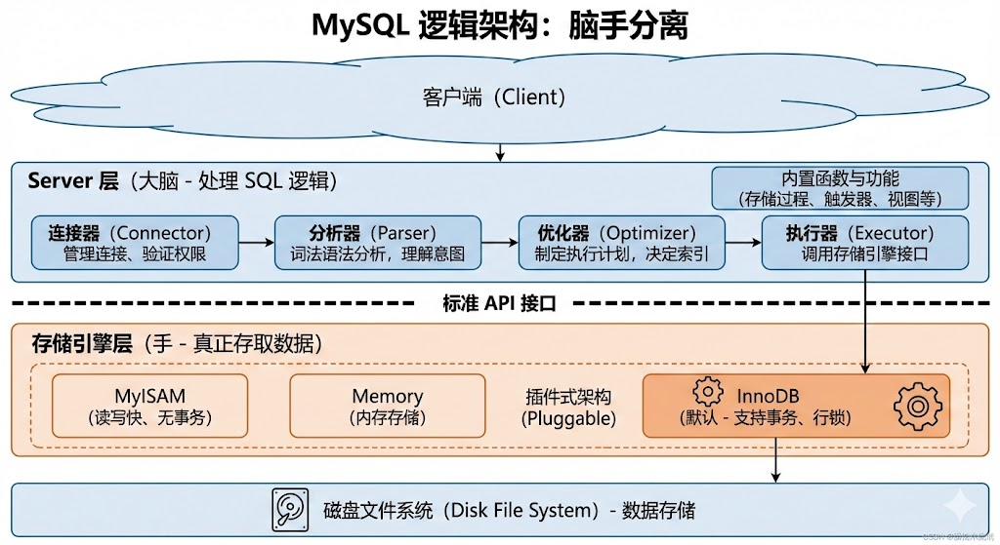

MySQL 的逻辑架构设计得非常巧妙，核心就一句话：**“脑手分离”**。

它把“处理 SQL 逻辑的地方”**（Server 层）和**“真正存取数据的地方”（存储引擎层）完全拆开了。这就像是一个公司，“管理层”负责制定计划，“工人”负责去仓库搬砖。

我们可以把 MySQL 的架构拆解为上下两层：

1. **Server 层**
- **定位：** 它是 MySQL 的大脑，所有跨存储引擎的功能都在这里实现。
- **主要干什么：**
    - **连接器（Connector）：** 负责跟客户端建立连接、验证权限。
    - **分析器（Parser）：** 词法分析和语法分析。把你的 SQL 语句拆解，看懂你想干嘛，有没有语法错误。
    - **优化器（Optimizer）：** 这是核心。它会决定用哪个索引，或者决定多表关联时的连接顺序。也就是制定“执行计划”。
    - **执行器（Executor）：** 拿着计划去调用存储引擎的接口，获取数据。
    - **内置函数与功能：** 像存储过程、触发器、视图以及各种日期、数学函数，都在这一层处理。
1. **存储引擎层**
- **定位：** 它是真正的**文件系统**交互者，负责数据的存储和提取。
- **主要干什么：**
    - 它不关心 SQL 语法，只关心怎么把数据写到磁盘上，或者怎么把数据读进内存里。
    - **插件式架构（Pluggable）：** 这是 MySQL 最牛的地方。你可以根据需求换引擎。
        - 想支持事务、行级锁？用 **InnoDB**（默认）。
        - 只要读写快、不需要事务？用 **MyISAM**。
        - 想把数据存内存里？用 **Memory**。
    - **接口隔离：** Server 层通过一套标准的 API 接口跟存储引擎对话，所以 Server 层根本不需要知道底下用的是哪种引擎。

---

### 面试标准回答

MySQL 的逻辑架构在设计上采用了‘Server 层’**与**‘存储引擎层’分离的模式。

第一，Server 层（通用逻辑层）：

它涵盖了 MySQL 的大多数核心服务功能，与具体的存储引擎无关。

- 主要包含**连接器**（管理连接与权限）、**分析器**（词法语法分析）、**优化器**（生成执行计划）和**执行器**（操作引擎）。
- 所有的**内置函数**（如日期、数学）、**存储过程**、**触发器**、**视图**等跨引擎功能都在这一层实现。

第二，存储引擎层（数据存储层）：

它的架构是**插件式**的，主要负责数据的存储和提取。

- Server 层通过一套定义的 **API 接口**与存储引擎通信，不感知具体的底层实现。
- 我们可以根据业务需求选择不同的引擎，比如支持事务和行锁的 **InnoDB**（MySQL 5.5 后默认），或者不支持事务但读取速度快的 **MyISAM**。
