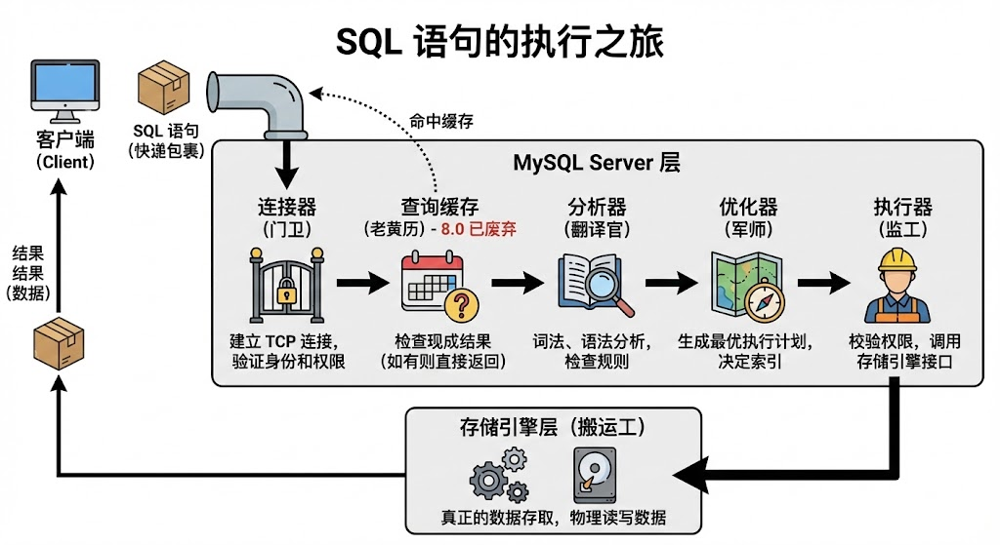

一条 SQL 语句从你按下回车的那一刻起，它就像一个**“快递包裹”**，在 MySQL 内部被不同的部门层层传递、拆解、审批，最后才把里面的东西（数据）拿出来给你。

整个过程主要分为这 **6 个关键关卡**：

1. **连接器（门卫）：先查查你是谁**
- 你发请求过来，第一件事是建立 TCP 连接。
- 连接器负责接待你，让你输入账号密码。如果密码不对，直接把你拒之门外。如果对了，它会去读你的权限配置（是管理员还是普通用户），后面所有的操作都基于这个权限。
1. **查询缓存（老黄历）：查查有没有现成的**
- **注意：** 这是一个**曾经**存在的步骤。MySQL 拿到 SQL 后，会先看之前有没有人查过一模一样的。如果有，直接返回结果，后面都不用干了。
- **现状：** 因为这个功能太鸡肋（表只要一更新，缓存就全失效），**MySQL 8.0 版本已经直接把这个功能删了**。所以现在面试时，这步提一下就行，重点说“8.0 已废弃”。
1. **分析器（翻译官）：看看你想干嘛**
- **词法分析：** 识别出字符串里的关键词。比如识别出 `select` 是查询，`T` 是表名，`ID` 是列名。
- **语法分析：** 检查你的语句通不通顺，符不符合语法规则。比如你把 `WHERE` 写成了 `WHER`，或者括号没闭合，报错就是在这里报的。
1. **优化器（军师）：决定怎么干最快**
- 这是 Server 层最核心的部分。
- 一条 SQL 可能有好几种执行方式（比如是先走索引 A 还是索引 B？是先连表 A 还是先连表 B？）。
- 优化器的作用就是**根据统计信息，算出一个它认为效率最高的“执行计划”**。
1. **执行器（监工）：开始干活**
- 拿到执行计划后，执行器先做最后一件事：**权限校验**（查查你有没有这张表的查询权限）。
- 校验通过后，它就调用底下**存储引擎**提供的接口，一条一条地把数据取出来，如果不满足条件就扔掉，满足条件就存起来，最后把所有满足的数据返回给客户端。
1. **存储引擎（搬运工）：真正的数据存取**
- 像 InnoDB 或 MyISAM，它们才真正知道数据在硬盘的哪个扇区，或者在内存的哪一页。它们负责把物理数据搬给执行器。

---

### 面试标准回答

一条 SQL 语句的执行过程，主要经历 MySQL Server 层的各个组件，最后到达存储引擎层。具体流程如下：

第一步，连接器（Connector）：

客户端通过 TCP 与 MySQL 建立连接，连接器负责验证用户名、密码以及读取该用户的权限信息。

第二步，查询缓存（Query Cache）：

（如果是 MySQL 8.0 之前）系统会先检查缓存，如果命中则直接返回。但由于缓存失效非常频繁，MySQL 8.0 已彻底移除该功能，所以现在通常直接进入下一阶段。

第三步，分析器（Parser）：

对 SQL 语句进行词法分析和语法分析。识别关键字（如 SELECT, FROM），并检查 SQL 语句是否符合语法规范。

第四步，优化器（Optimizer，核心步骤）：

在真正执行前，MySQL 需要决定使用哪个索引，或者决定多表关联（Join）的顺序。优化器会根据成本分析，生成一个它认为最优的执行计划。

第五步，执行器（Executor）：

执行器首先校验用户对该表的操作权限。

权限校验通过后，它会根据执行计划，调用底层**存储引擎（Storage Engine）**的 API 接口。

第六步，存储引擎：

存储引擎（如 InnoDB）负责真正的数据存储与提取，它将数据返回给执行器，执行器再将最终结果返回给客户端。
