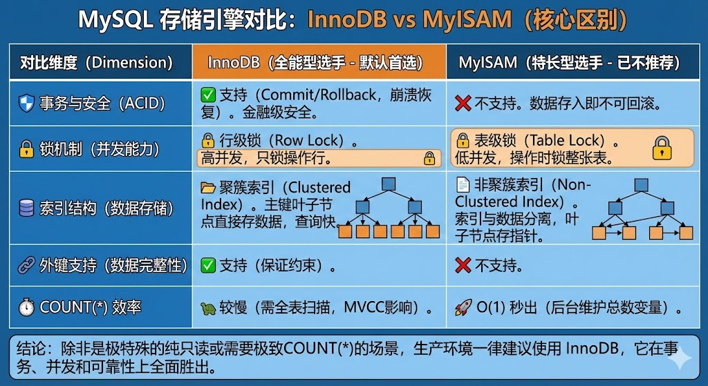

简单一句话总结：**InnoDB 是“全能型选手”（支持事务、行锁、奔溃恢复），是现在的默认首选；而 MyISAM 是“特长型选手”（读写分离场景下的读性能），除了极个别历史遗留项目，现在基本不推荐使用了。**

具体的技术区别，主要体现在以下 **5 个核心维度**：

1. **事务与安全（最本质的区别）**
    1. **InnoDB：** 支持 **ACID 事务**。如果你的业务涉及到钱，或者要求数据绝对不能错（比如转账：A 扣钱 B 必须加钱），必须用 InnoDB。它支持 `commit`、`rollback` 和崩溃恢复能力。
    2. **MyISAM：****不支持事务**。它不管你操作了一半是不是报错了，数据存进去了就是存进去了，回滚不了。
2. **锁的粒度（并发能力）**
    1. **InnoDB：** 支持 **行级锁（Row Lock）**。你改第一行数据，只锁第一行，别人可以改第二行。并发性能极高。
    2. **MyISAM：** 只支持 **表级锁（Table Lock）**。你只要想改这一张表里的任何一个字，整个表都会被锁住，其他所有人都得等着。所以在读写混合的场景下，性能很差。
3. **索引结构（数据怎么存）**
    1. **InnoDB：** 是 **聚簇索引（Clustered Index）**。
        - 它的主键索引的叶子节点里，直接**存了完整的数据行**。
        - 这意味着拿着主键找数据，一次就能找到，不需要回表，速度极快。
    2. **MyISAM：** 是 **非聚簇索引（Non-Clustered Index）**。
        - 它的索引和数据是分开存的。索引的叶子节点里存的是**指向数据的内存指针（地址）**。
        - 这意味着拿着主键找数据，还得根据地址再去“跑一趟腿”找数据文件。
4. **外键支持**
    1. **InnoDB：** 支持外键（Foreign Key），能保证数据的完整性约束。
    2. **MyISAM：** 不支持外键。

**5.** `**COUNT(*)**` **的效率**

- **MyISAM：** 它在后台专门拿了个变量记住了表的总行数。你查 `SELECT COUNT(*) FROM table` 时，它直接返回那个数字，**速度是 O(1)**，秒出。
- **InnoDB：** 因为有 MVCC（多版本并发控制），每个事务看到的行数可能不一样，所以它不敢直接存个总数。你查 `COUNT(*)` 时，它必须**老老实实把每一行都扫一遍**，速度较慢。

---

### 面试标准回答

在 MySQL 5.5 之前 MyISAM 是默认引擎，但现在 InnoDB 在性能和功能上已经全面超越。除非是纯粹的只读报表系统或者需要利用 MyISAM COUNT(*) O(1) 的特性，否则生产环境一律建议使用 InnoDB。

InnoDB 和 MyISAM 的区别主要体现在**事务安全性**、**并发性能**和**存储结构**三个方面：

第一，事务支持（核心区别）：

InnoDB 是事务型存储引擎，支持 ACID 特性，拥有 Commit、Rollback 和崩溃修复能力（通过 Redo Log 实现）。

而 MyISAM 不支持事务，一旦系统崩溃，数据极易损坏且难以恢复。

第二，锁机制与并发：

InnoDB 支持行级锁（Row Lock），适合高并发写入的场景。

MyISAM 只支持表级锁（Table Lock），一旦有更新操作，整张表都会被锁住，导致读写冲突严重，并发上限很低。

第三，索引存储结构：

InnoDB 采用聚簇索引，主键索引的叶子节点直接存储数据行，减少了磁盘 IO。

MyISAM 采用非聚簇索引，索引文件和数据文件是分离的，索引保存的是数据文件的指针。
