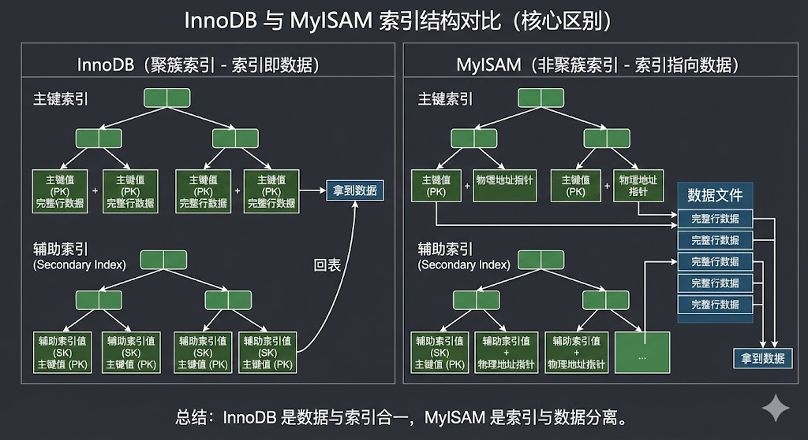

简单一句话总结：**InnoDB 的索引就是数据本身（聚簇索引），而 MyISAM 的索引只是数据的“地址薄”（非聚簇索引）。**

两者的核心区别在于“数据行存在哪里”，具体可以分为主键索引和辅助索引两个维度来看：

1. **InnoDB：索引即数据（聚簇索引）**
- **主键索引：**
    - InnoDB 的表数据文件本身就是一颗 B+ 树。
    - 这棵树的叶子节点里，**直接存了完整的行数据**。
    - 所以，你拿着主键去查，找到叶子节点的那一刻，数据就到手了。这就叫**聚簇索引**（数据和索引聚在一起）。
- **辅助索引：**
    - InnoDB 的辅助索引，叶子节点里**不存地址**，而是存**主键的值**。
    - **为什么要这么设计？** 为了方便数据移动。如果存地址，一旦数据页分裂导致地址变了，所有索引都得改。存主键就不怕数据搬家。
    - **代价（回表）：** 如果你通过名字（辅助索引）找人，你先找到的是他的身份证号（主键），然后你还得拿着身份证号再去主键索引树里跑一趟，才能拿到完整数据。这叫**回表**。
1. **MyISAM：索引与数据分离（非聚簇索引）**
- **主键索引：**
    - MyISAM 的索引文件（.MYI）和数据文件（.MYD）是完全分开的。
    - B+ 树的叶子节点里，存的是**数据记录的物理地址（指针）**。
    - 找到索引后，还得根据这个地址去另外一个文件里把数据读出来。
- **辅助索引：**
    - 在 MyISAM 里，主键索引和辅助索引在结构上**完全一样**。
    - 它们都是存的物理地址。只不过主键要求唯一，辅助索引不要求唯一而已。

---

### 面试标准回答

InnoDB 是‘索引即数据’，数据就在主键树上；MyISAM 是‘索引指向数据’，数据单独存放。这也是为什么 InnoDB 推荐必须定义主键，且主键最好是自增整型（减少页分裂和索引大小）的原因。

**第一，InnoDB 使用的是聚簇索引（Clustered Index）**：

- 它的表数据文件本身就是按 B+ Tree 组织的一个索引结构。
- **主键索引**的叶子节点中，直接存储了**完整的行数据**。这意味着通过主键查询非常高效，只需一次查找。
- **辅助索引**的叶子节点存储的是**主键的值**。因此，使用辅助索引查询时，通常需要先拿到主键，再回主键索引树查数据，这个过程叫做‘回表’。

**第二，MyISAM 使用的是非聚簇索引（Non-Clustered Index）**：

- 它的索引文件和数据文件是分离的。
- **主键索引**的叶子节点中，存储的是指向数据文件中数据行的**物理地址（指针）**。
- **辅助索引**的结构与主键索引完全一致，也是存储物理地址。
