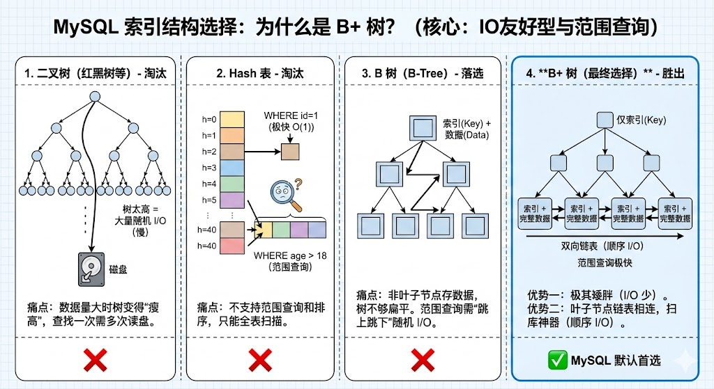

这个问题，本质上是在问你：**“在把数据存到慢吞吞的硬盘上时，哪种数据结构最能抗住大规模的读写？”**

MySQL 选 B+ 树，不是因为它在算法书上最酷，而是因为它是IO友好型的数据结构**。它完美地在**查找速度、**范围查询**和**磁盘 I/O 次数**之间找到了平衡点。

具体原因，我们来一个个对比，你就明白了：

1. **为什么要淘汰二叉树（红黑树/BST）？—— 树太高了**
    1. **原理：** 二叉树每个节点只能分两个叉。这就导致如果数据量大（比如 1000 万行），这棵树会**变得非常高**（瘦高型）。
    2. **致命伤：** 数据库的数据是存在硬盘上的。树高 20 层，就意味着要把硬盘读 20 次（20 次 I/O）。硬盘读一次要 10ms，读 20 次就是 0.2 秒，这慢得无法接受。
    3. **B+ 树优势：** 它是**多路平衡查找树**（矮胖型）。一个节点可以存上千个索引，所以存几千万数据，树的高度也只有 3 层左右。3 次 I/O 就能找到数据。
2. **为什么要淘汰 Hash 表？—— 没法做“范围查询”**
    1. **原理：** Hash 表通过算 Hash 值直接定位，查单条记录 `WHERE id = 1` 极快（O(1)）。
    2. **致命伤：** 数据库经常要查 `WHERE age > 18` 或者 `ORDER BY`。Hash 值是无序的，面对这种范围查找和排序，它直接瞎眼，只能全表扫描。
    3. **B+ 树优势：** B+ 树的索引是有序的，天然支持范围查询和排序。
3. 为什么要淘汰 B 树（B-Tree）？

B 树和 B+ 树很像，但 MySQL 依然选了 B+ 树，主要赢在两点细节：

    1. **细节一：B+ 树能存更多索引（树更矮）**
        - **B 树：** 每个节点里既存索引（Key），也存数据（Value）。这导致一个页（Page，默认 16KB）存不了几个节点，树就会变高。
        - **B+ 树：****非叶子节点只存索引，不存数据**。只有叶子节点才存数据。这样非叶子节点能塞进更多的 Key，树变得更“扁平”，I/O 次数更少。
    2. **细节二：B+ 树是“扫库”神器（范围查询）**
        - **B 树：** 节点分散在树的各层，要做范围查询（比如查 id 10 到 100），得在树里跳上跳下（中序遍历），这是大量的随机 I/O。
        - **B+ 树：****所有数据都在叶子节点**，而且叶子节点之间用**双向链表**串起来了。查范围时，只要找到起点，顺着链表往后拉就行了，这是高效的顺序 I/O。

---

### 面试标准回答

MySQL（InnoDB）选择 B+ 树作为索引结构，主要是为了**减少磁盘 I/O 次数**并**优化范围查询**。我们可以通过对比其他数据结构来说明：

第一，对比二叉树（红黑树/AVL）：

二叉树的节点度数太小，导致在海量数据下树的高度（Depth）过高。

数据库索引是存储在磁盘上的，树越高意味着需要越多的磁盘 I/O 操作，性能会严重下降。而 B+ 树是多路平衡树，层高通常控制在 3-4 层，能极大减少 I/O。

第二，对比 Hash 索引：

Hash 索引虽然单点查询（等值查询）最快，但它不支持范围查询（Range）、不支持排序，也不能利用索引的最左匹配原则，这不符合关系型数据库通用的业务场景。

第三，对比 B 树（关键点）：

虽然 B 树也解决了树高问题，但 B+ 树做了两点重要改进：

1. **非叶子节点不存数据**：B+ 树的非叶子节点只存储键值（Key），不存储实际数据。这意味着**同样大小的磁盘页可以容纳更多的索引**，使得 B+ 树比 B 树更加‘矮胖’，进一步减少了 I/O 次数。
2. **叶子节点使用链表连接**：B+ 树的所有数据都存储在叶子节点，且叶子节点通过**双向链表**连接。这使得 B+ 树在执行**范围查询**（如 `BETWEEN`, `>`）时，只需要找到起点，然后顺序遍历链表即可，效率远高于 B 树的中序遍历。”
