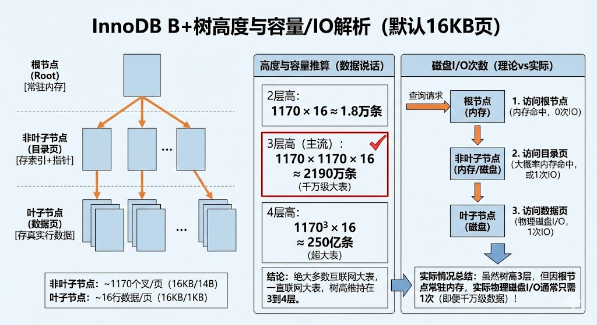

这个问题给一个很明确的数字：**在绝大多数互联网生产环境中，B+ 树的高度通常是 3 到 4 层**。

这意味着，即使是一张存了上亿条数据的大表，你通过主键查一条数据，理论上也只需要 **1 到 3 次磁盘 I/O**。

为什么是这个数字？咱们不能光背结论，得给面试官“算笔账”，用数据说话：

1. **基础数据设定**
    1. **页大小（Page Size）：** InnoDB 默认一页是 **16KB**。
    2. **主键大小：** 假设我们要存的主键是 `BigInt`（8 字节），加上 InnoDB 的指针（6 字节），一个索引项大概占 **14 字节**。
    3. **数据行大小：** 假设一行业务数据平均 **1KB**。
2. **每一层能存多少东西？**
    1. **非叶子节点（目录页）：** 它只存索引和指针。一页 16KB 能存多少个索引？`16384 / 14 ≈ 1170`。也就是说，它能分出 1170 个叉。
    2. **叶子节点（数据页）：** 它存真实的业务数据。一页 16KB 能存多少行数据？`16384 / 1024 ≈ 16` 行。
3. **开始盖楼（计算高度与容量）**
    1. **2 层高：**
        - 根节点分出 1170 个叉。
        - 每个叉连着一个叶子节点（存 16 行）。
        - 总容量：$$1170 \times 16 \approx 1.8 $$ 万条数据。
    2. **3 层高：**
        - 根节点分 1170 个叉 -> 第二层节点再分 1170 个叉。
        - 总容量：$$1170 \times 1170 \times 16 \approx 2190$$ 万条数据。
        - **结论：** 只要你的表数据在 **2000 万行以内**，树高都是 **3 层**。
    3. **4 层高：**
        - 再乘一个 1170。
        - 总容量：$$2190万 \times 1170 \approx 250$$亿条数据。
        - **结论：** 就算是千亿级的大表，4 层也绰绰有余了。
4. **关于磁盘 I/O 次数**
- **理论值：** 树高几层，就得查几次。如果是 3 层，理论上要 3 次 I/O。
- **实际值：** 这里的关键在于 **Root 节点常驻内存**。
    - B+ 树的根节点（Root）几乎永远在内存（Buffer Pool）里。
    - 如果是 3 层树，第一次查 Root（内存操作），第二次查目录页（大概率也在内存），第三次查叶子节点（可能在磁盘）。
    - 所以，实际的**物理磁盘 I/O 通常只有 1 次，甚至 0 次**（如果数据页也被缓存了）。

---

### 面试标准回答

在生产环境中，InnoDB 引擎的 B+ 树高度通常维持在 **3 到 4 层**。

这个数字是怎么来的呢？我们可以基于 InnoDB 默认的 16KB 页大小来推算：

假设主键是 BigInt（8 字节），加上指针（6 字节），一个非叶子节点大概能存放 1170 个索引指针。

假设一行数据大小为 1KB，一个叶子节点能存放 16 行数据。

- 如果是 **3 层** 的 B+ 树，其存储容量约为 $$1170 \times 1170 \times 16$$，大概能存 **2000 万条**数据。
- 如果是 **4 层** 的 B+ 树，容量则能达到 **200 亿条**级别。

所以一般千万级的大表，树高就是 3 层。

关于磁盘 I/O 次数：

虽然树高是 3 层，但并不意味着每次都需要 3 次物理磁盘 I/O。

因为 B+ 树的根节点以及高频访问的目录页通常会被缓存在内存（Buffer Pool）中。

因此，在实际查询中，通常只需要 1 次物理磁盘 I/O 就能定位到目标数据行，如果 Buffer Pool 命中率高，甚至可以做到 0 次磁盘 I/O。
