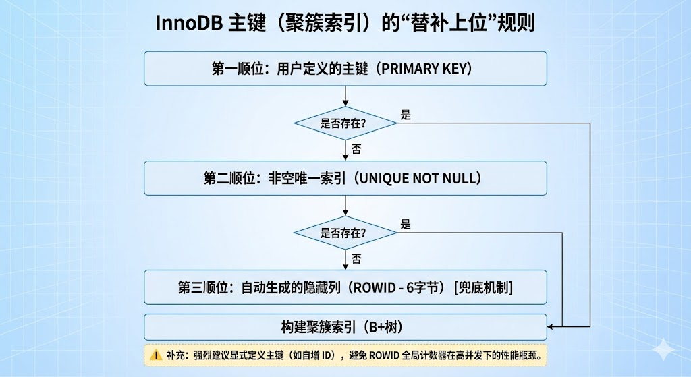

**InnoDB 是基于聚簇索引的存储引擎，它必须有一个主键。如果你不给，它就自己找；找不到，它就自己造。**

InnoDB 的数据存储逻辑非常严谨，它必须依赖一个 B+ 树结构来把数据组织起来。

具体的处理流程遵循一套严格的“三级替补上位”规则：

1. 第一顺位：用户定义的主键

如果你定义了 PRIMARY KEY，那就用你定义的。这是最理想的情况。

1. 第二顺位：第一个“非空唯一索引”

如果你没定义主键，InnoDB 会去检查表里有没有 UNIQUE 且 NOT NULL 的列。

- 如果有，就选**第一个**符合条件的列作为“隐形主键”，用它来构建聚簇索引。
1. 第三顺位：自动生成的隐藏列（ROWID）

如果以上两个都没有，InnoDB 就会启动兜底机制。

    1. 它会自动在每一行数据上添加一个 **6 字节** 的隐藏列，通常被称为 `**ROWID**`。
    2. 这个列对用户是不可见的（你 select 查不出来），但 InnoDB 内部会用它来作为主键构建 B+ 树。

**补充：为什么不建议让 InnoDB 自动生成？**

虽然系统会兜底，但我们强烈建议显式定义主键（通常是自增 ID）。

因为这个自动生成的 ROWID 是基于一个全局计数器实现的（所有没有主键的表共用这个计数器）。在超高并发插入的场景下，这个全局计数器可能会成为性能瓶颈（互斥锁竞争）。而且，没有显式主键，后续做主从同步、分库分表都会很麻烦。

---

### 面试标准回答

InnoDB 是**索引组织表（Index Organized Table）**，数据必须存放在聚簇索引的叶子节点上，因此表**必须**要有主键。

如果我们在建表时没有显式定义主键，InnoDB 会按照以下**优先级**进行处理：

第一步，寻找替代品：

它会遍历表中所有的索引，判断是否存在非空唯一索引（Unique Not Null）。如果存在，则选择第一个定义的非空唯一索引作为主键。

第二步，强制生成（兜底）：

如果没有找到合适的索引，InnoDB 会自动为每一行生成一个 6 字节 的隐藏列（通常称为 ROWID），并以此作为主键构建聚簇索引。

**也就是：优先用你的，没有就找能用的，再没有就自己造一个。**

**（补充）**：这也是为什么我们总是建议在建表时显式定义一个自增主键。因为使用隐藏的 `ROWID` 不仅用户无法利用它进行查询，而且在早期的 InnoDB 版本中，`ROWID` 的生成依赖全局计数器，可能会在高并发插入时带来性能争用问题。
