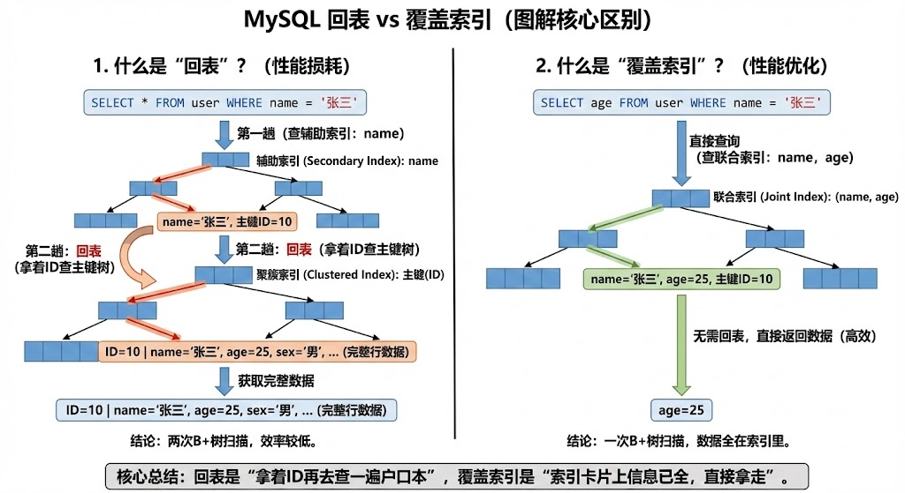

**“回表”就是拿着只有身份证号（主键）的索引，不得不回老家（聚簇索引）去查完整的户口本信息；而“覆盖索引”就是你的索引卡片上刚好写全了你要查的信息，直接拿着卡片走人，不用回老家了。**

具体的技术细节和优化逻辑如下：

1. 什么是“回表”？

在 InnoDB 中，索引分两种：

    1. **聚簇索引（Clustered Index）：** 就是主键索引。它的叶子节点存的是**完整的行数据**。
    2. **辅助索引（Secondary Index）：** 普通索引（比如你给 `name` 字段建的索引）。它的叶子节点存的是**主键的值**（ID）。

**当你执行** `**SELECT * FROM user WHERE name = '张三'**` **时，过程是这样的：**

    3. **第一趟：** 先去 `name` 的 B+ 树里查，找到了 `'张三'`，并拿到了对应的主键 ID（比如 ID=10）。
    4. **第二趟（回表）：** 拿着 ID=10，去**主键索引**的 B+ 树里再查一遍，找到 ID=10 对应的完整数据行（包括 age, sex 等其他字段）。
    5. **结论：** 这“第二趟”就叫回表。它导致了两次 B+ 树扫描，如果是范围查询，会产生大量的随机 I/O，性能很差。
1. **什么是覆盖索引？**
    1. **原理：** 如果你的 SQL 语句中，**查询的所有字段**（Select 列 + Where 列）都已经包含在某个索引树里了，那数据库就没必要再去查主键树了。
    2. **举例：**
        - 假设你有索引 `idx_name_age (name, age)`。
        - 你执行 `SELECT age FROM user WHERE name = '张三'`。
        - **过程：** 去 `idx_name_age` 树里查 `'张三'`，发现叶子节点里已经存了 `age` 的值。直接把 `age` 返回。
        - **结果：** 不需要回表。这就是**覆盖索引**。

---

### 面试标准回答

回表操作是 InnoDB 存储引擎中一种常见的性能损耗现象。

所谓‘回表’，是指：

当我们通过辅助索引查询数据时，如果查询需要的列没有完全包含在该索引中，InnoDB 会先在辅助索引中找到对应的主键 ID，然后**拿着这个主键 ID 去聚簇索引（主键索引）**中再次查找，才能获取到完整的行数据。

这个‘回到聚簇索引查找’的过程，就叫回表。它会导致额外的磁盘 I/O 和 CPU 开销。

如何避免回表？核心方案是使用‘覆盖索引’。

覆盖索引并不是一种特殊的索引类型，而是一种查询状态。

具体做法是：

将被查询的字段建立到联合索引中。

例如，如果业务经常执行 SELECT age FROM user WHERE name = '...'，我们就建立一个 (name, age) 的联合索引。

这样，当通过 name 查找时，B+ 树的叶子节点中已经包含了 age 的值，MySQL 可以直接返回结果，无需再去主键索引中查找，从而避免了回表，极大地提升了查询性能。
