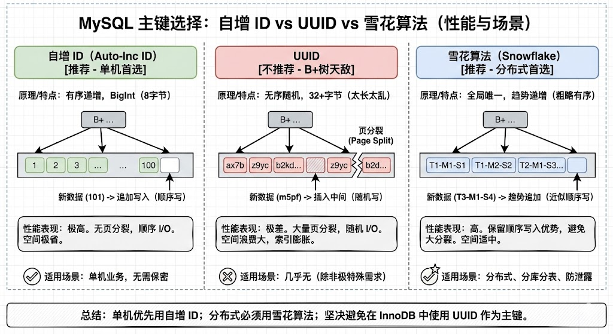

**在单机或一般业务下，自增 ID 完胜，因为它顺应了 B+ 树的特点；而 UUID 是 B+ 树的“天敌”**。

至于雪花算法，那是**分布式架构**下的最优方案。

具体的原因分析如下：

### 为什么推荐自增 ID？

    - **写入性能最高：**
        - B+ 树的数据存储是有序的。自增 ID 就像是排队进场，新来的 ID 永远比老的大，所以数据永远只需要追加到最后面的数据页。
        - 页写满了就开新页，几乎**没有碎片**，写入效率极高（顺序写）。
    - **空间占用最小：**
        - `BigInt` 只有 8 个字节。
        - 别忘了，**所有的辅助索引（****非聚簇索引****）****叶子节点****存的都是****主键****值**。如果你主键很小，那整张表所有的索引都会很小，极其节省内存（Buffer Pool）和磁盘空间。

### 为什么不推荐 UUID？

UUID 作为主键有两个致命伤：**“太长”和“太乱”**。

    - **太乱导致“页分裂”：**
        - UUID 是无序的随机字符串。新来的数据可能要插到原本已经写满的中间某个数据页里。
        - 为了插进去，InnoDB 不得不把那个页的数据挪来挪去（页分裂），甚至要把数据从磁盘读出来再写回去。
        - 这会导致大量的**随机 I/O**，写入性能可能比自增 ID 慢几倍甚至几十倍。
    - **太长浪费内存：**
        - UUID 通常是 32 个字符（甚至更多），是自增 ID 的 4 倍以上。
        - 这会导致你的辅助索引变得巨大无比，Buffer Pool 能缓存的索引页变少，查询效率直接下降。

### 什么情况下用雪花算法？

当你从单机数据库升级到**分布式数据库（分库分表）**时，自增 ID 就不行了。

    - **自增 ID 的缺陷：**
        - **分库冲突：** 表拆分到不同的机器上，大家都从 1 开始自增，ID 就重复了。
        - **数据泄露：** 竞争对手下一单是 ID=100，明天下一单是 ID=200，立马就能算出你一天卖了 100 单，商业机密全泄露。
    - **雪花算法的优势：**
        - **全局唯一：** 结合了机器 ID、时间戳、序列号，保证分布式环境下不重复。
        - **粗略有序（趋势递增）：** 这是它最牛的地方。它生成的 ID 虽然不连续，但在**时间上是递增的**。这意味着它依然能保持 B+ 树的“追加写入”特性，避免了 UUID 的页分裂问题。

---

### 面试标准回答

在 MySQL 的 InnoDB 引擎中，推荐使用自增 ID，坚决不推荐使用 UUID，主要原因是基于**性能**和**存储**的考量。

第一，从性能角度（B+ 树特性）来看：

InnoDB 是聚簇索引，数据是按主键顺序存储的。

- **自增 ID** 是有序的，写入时只需追加，几乎不会产生页分裂，这是高效的**顺序写**。
- **UUID** 是无序的，新数据经常需要插入到已满的数据页中间，这会强制触发**页分裂**，导致大量数据的移动和**随机磁盘 I/O**，写入性能极差。

**第二，从存储空间来看**：

- 自增 ID（BigInt）只占 8 字节。
- UUID 通常占 32 字节甚至更多。
- 由于 InnoDB 的所有辅助索引都会引用主键，主键过长会导致所有辅助索引膨胀，占用宝贵的内存（Buffer Pool）和磁盘空间。

关于雪花算法的使用场景：

它主要用于分布式分库分表的场景。

因为自增 ID 在分片环境下很难保证全局唯一，且容易泄露业务量。而雪花算法生成的 ID 既能保证全局唯一，又通过时间戳保证了趋势递增（Time-ordered），完美保留了 B+ 树顺序写入的性能优势，是分布式 ID 的最佳方案。
