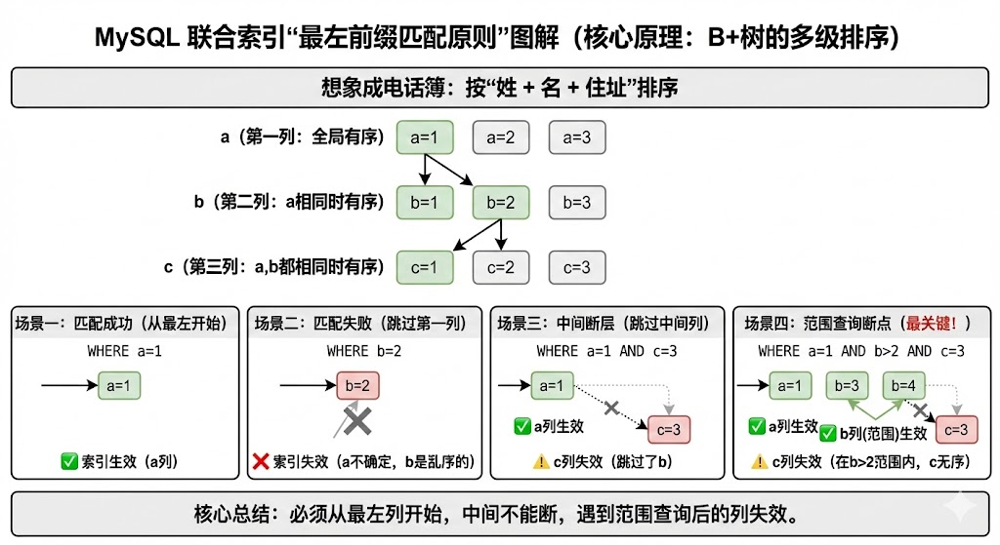

**在使用联合索引（比如** `**name, age**`**）时，MySQL 必须严格按照从左到右的顺序来检索。一旦中间断了，后面的索引就全部作废。**

我们可以把联合索引想象成**电话簿**，假设它是按“姓 + 名”排序的（先排姓，姓一样再排名）。

- 你想找“张三”，可以直接翻到“张”那一页，再找“三”。（**索引生效**）
- 你想找“所有姓张的人”，直接翻到“张”那一页就行。（**索引生效**）
- 但如果你想找“所有名字叫‘三’的人”（不管姓什么），你在电话簿里是没法找的，因为名字是散落在各个姓氏里面的，没有规律。（**索引失效**）

具体的技术细节，体现在这三个维度的“匹配规则”上：

1. **不能跳过第一列**
    1. 假设你建了个索引 `(a, b, c)`。
    2. 查询 `WHERE a=1`：**用到了**。
    3. 查询 `WHERE b=2`：**完全没用**。因为 B+ 树是先按 a 排序的，在 a 不确定的情况下，b 是乱序的，根本没法找。
2. **不能跳过中间列**
    1. 查询 `WHERE a=1 AND c=3`：
        - **a 用到了**索引。
        - **c 没用到**。
        - **原因：** 就像电话簿，你确定了“姓张”，但你跳过了“名”，直接找“住址”。在“张某某”的条目里，住址是乱序的，只能一个个看。
3. **范围查询可能会失效**
    1. 这是面试最大的坑。
    2. 查询 `WHERE a=1 AND b>2 AND c=3`：
        - **a 用到了**。
        - **b 用到了**（因为是范围查询）。
        - **c 没用到**（索引在这里断掉了）。
        - **原因：** 在 b > 2 的范围内，c 是无序的。比如 b=3 时 c 是 5，b=4 时 c 可能是 1。B+ 树没法利用索引去找 c=3 的数据。

---

### 面试标准回答

最左前缀匹配原则是 MySQL **联合索引**生效的核心规则。它的底层原理是由 B+ 树的排序特性决定的。

我们可以把联合索引 (a, b, c) 理解为一种‘多级排序’结构：

全局是按 a 有序排列的；在 a 相同时，按 b 有序；在 b 相同时，按 c 有序。但如果跨过 a 直接看 b，它是无序的。

**基于这个原理，在实际查询中表现为：**

1. 查询必须从索引的最左列开始：
2. 如果查询条件中没有包含第一列（如直接查 b=1），索引无法使用，会触发全表扫描。
3. 中间不能断层：
4. 如果查询条件是 WHERE a=1 AND c=3，那么只有 a 列用到了索引，c 列无法使用索引（因为跳过了 b）。
5. 遇到范围查询会停止匹配（最关键点）：
6. 如果查询条件是 WHERE a=1 AND b > 2 AND c=3，那么索引匹配会在 b 列停止。也就是说，a 和 b 会走索引，但 c 只能作为过滤条件，因为在 b > 2 的范围内，c 不是全局有序的。
