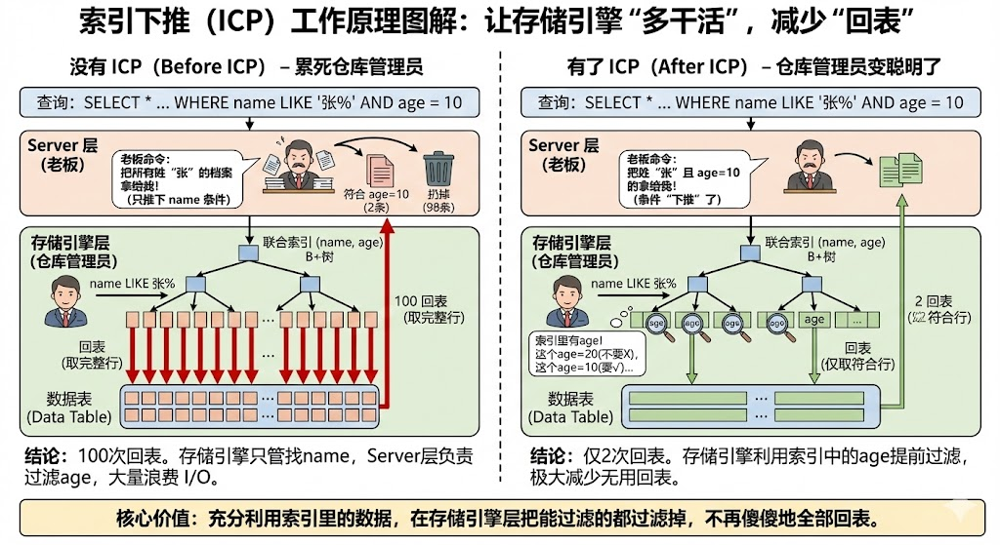

索引下推，说白了就是**MySQL 试图让存储引擎“多干点活”，把过滤工作下沉到底层，省得去回表查数据**。

这是 MySQL 5.6 版本引入的一个重磅优化。它的核心目的只有一个：**减少“回表”的次数**。

我们可以把 Server 层比作老板，把存储引擎层比作仓库管理员。

没有 ICP 时： 老板说“把所有姓张的档案拿给我”。管理员跑几十趟仓库，把所有姓张的档案都搬来。老板一个个翻：“这个年龄不对，扔掉；那个年龄不对，扔掉...”。（浪费了管理员的体力，搬了很多无用的档案）。

有了 ICP 后： 老板直接说“把所有姓张且 10 岁的档案拿给我”。管理员在仓库里看一眼目录，发现只有两个符合，于是只搬了这两个档案上来。（大大节省了体力）。

具体的工作原理可以对比来看看：

1. 场景设定

假设有一张表，建了一个联合索引 (name, age)。

我们要查：SELECT * FROM user WHERE name LIKE '张%' AND age = 10。

根据最左前缀原则，name LIKE '张%' 走索引了，但后面的 age 在这里索引断了（因为是范围查询），理论上用不上索引来检索。

1. **没有 ICP 的处理流程**
    1. 存储引擎在索引树上找到所有“姓张”的节点（假设有 100 个）。
    2. 它不管 `age` 是多少，因为它觉得自己只负责找“姓张”的。
    3. 于是，它进行了 **100 次回表**，把这 100 行完整数据取出来，全部扔给 Server 层。
    4. Server 层拿到数据后，再判断 `WHERE age = 10`，结果发现只有 2 个符合，把剩下 98 个扔掉。
    5. **亏损点：** 那 98 次回表是纯浪费。
2. **有了 ICP 的处理流程**
    1. 存储引擎在索引树上找到“姓张”的节点。
    2. **关键点来了：** 虽然 `age` 不能用来快速定位（因为前面是模糊匹配），但是索引叶子节点里**确实存了 age 的值**啊！
    3. 存储引擎在**准备回表之前**，先偷偷看一眼手中的索引：“哎，这个姓张，但 age 是 20，不符合老板要的 10，算了，不回表取它了”。
    4. 最终，只有那 2 个真正符合 `age=10` 的记录，存储引擎才会去回表。
    5. **盈利点：** 回表次数从 100 次降到了 2 次。

---

### 面试标准回答

索引下推并没有改变索引的排序规则，但它极大地减少了回表（随机 I/O）的次数，从而显著提升了查询性能。它的核心思想是：

在索引遍历过程中，对索引中包含的字段，直接在存储引擎层进行判断过滤，而不是把所有数据都取回 Server 层再过滤。

以联合索引 (name, age) 为例：

当执行 SELECT * FROM table WHERE name LIKE '张%' AND age = 10 时：

- 在没有 ICP 之前：
- 存储引擎只能利用索引找到所有 name 以 '张' 开头的记录，然后每一次都进行回表，将完整数据返回给 Server 层。Server 层再根据 age=10 进行过滤。如果匹配的数据多，回表次数会非常巨大。
- 开启 ICP 之后：
- 存储引擎在索引遍历时，虽然 age 无法用于快速定位，但引擎会利用索引中已有的 age 值先做判断。如果不符合 age=10，直接跳过，不进行回表。
