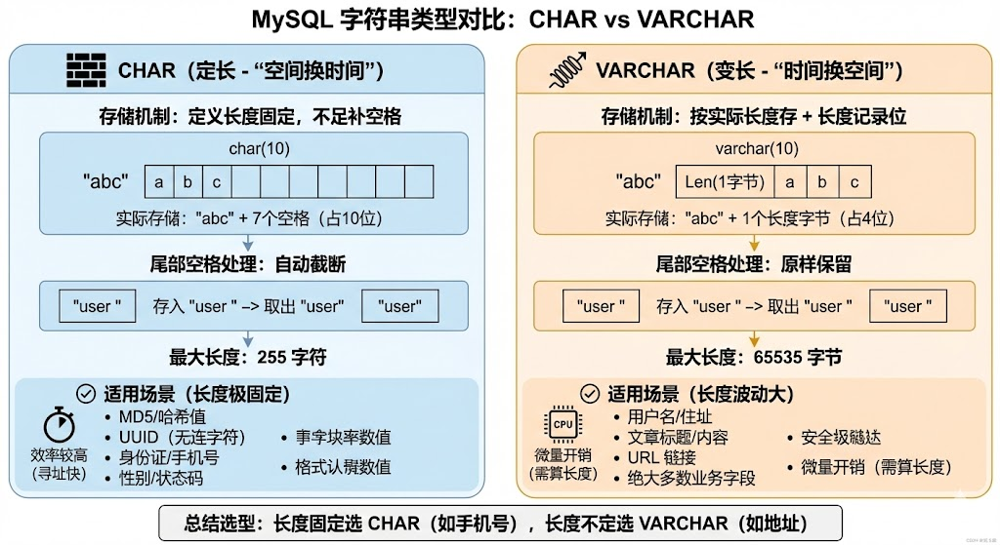

`char` 和 `varchar` 是数据库中最基础的字符串类型，它们的区别核心就在于两个词：**“定长”与“变长”**。

简单来说：`**char**` **是你定多少它就占多少，不够用空格凑；**`**varchar**` **是你存多少它占多少（加一点点开销）。**

## **存储方式：空间换时间 vs 时间换空间**

    - **CHAR（定长）：**
        - **机制：** 如果你定义 `char(10)`，不管你存的是 "abc" 还是 "1234567890"，它在硬盘上永远雷打不动占用 10 个字符的空间。
        - **补位：** 如果你只存了 "abc"（3个字符），数据库会在后面自动填充 7 个空格，把它撑满到 10 个。取出来的时候，再把这些空格删掉。
        - **效率：** 因为长度固定，数据库在处理的时候很容易算偏移量，**读取速度相对更快**（空间换时间）。
    - **VARCHAR（变长）：**
        - **机制：** 如果你定义 `varchar(10)`，存 "abc"，它就只占 3 个字符的空间，再加上 **1 到 2 个字节** 用来记录“这行数据到底有多长”。
        - **开销：** 既然是变长，数据库在读的时候就得先读那个长度位，算一下这行数据到哪结束，再读内容。这一步计算会消耗微量的 CPU（时间换空间）。

## **对尾部空格的处理**

    - **CHAR：** 它靠空格补位，所以如果你原本的数据末尾就有空格（比如 "user "），存进去再取出来，**末尾的空格会被系统当成填充物直接切掉**。
    - **VARCHAR：** 会原样保留你的空格。

## **最大长度限制**

    - **CHAR：** 最大长度是 255 字符。
    - **VARCHAR：** 最大长度是 65535 字节（受限于 row size）。

---

## 如何选择？

选择的标准不是“谁省空间”，因为现在的硬盘很便宜。核心标准应该是“数据长度是否固定”**和**“数据是否频繁修改”。

1. **首选 CHAR 的场景（长度极度固定）**
    1. **MD5 / 哈希值：** 比如密码加密后的字符串，永远是 32 位或者 64 位，用 `char` 是最完美的。
    2. **UUID：** 去掉连字符后是固定的 32 位。
    3. **固定代码：** 比如身份证号（18位）、手机号（11位）、银行代码、性别（'M'/'F'）、状态码（'Y'/'N'）。
    4. **超短字符串：** 比如只有 2-3 个字符。这时候 `varchar` 还要多搭上 1 个字节存长度，反而不划算。
2. **首选 VARCHAR 的场景（长度波动大）**
    1. **绝大多数业务字段：** 用户名、家庭住址、文章标题、评论内容、URL 链接。这些数据的长度参差不齐，用 `char` 会造成巨大的空间浪费（全是空格）。
    2. **避免碎片：** 虽然 `char` 速度快，但现代数据库引擎（如 InnoDB）对 `varchar` 的优化已经很好，除非是那种几亿行的高频查询表，否则为了这点性能损失灵活性并不值得。

---

### 面试标准回答

CHAR 和 VARCHAR 是 MySQL 中两种最主要的字符串类型，它们的区别主要体现在**存储策略**和**性能特性**上：

**第一，存储结构不同**：

- **CHAR 是定长的**。定义多少就是多少，不足的部分用空格填充。因此它会**去除**数据末尾原本的空格。
- **VARCHAR 是变长的**。它根据实际内容存储，只占用必要的空间，但需要额外使用 **1-2 个字节**来记录字符串的长度。

**第二，性能与空间取舍**：

- CHAR 类似于‘空间换时间’，因为长度固定，内存寻址和磁盘 I/O 效率略高，不容易产生内存碎片。
- VARCHAR 类似于‘时间换空间’，虽然节省了存储空间，但读取时需要计算长度，且在频繁更新且长度变化大时，容易导致数据页的分裂（碎片）。

在实际选型中，我的策略是：

对于长度完全固定且较短的字段，比如 MD5、UUID、手机号、性别代码等，我会优先选择 CHAR，以获得更高的查询效率。

对于长度不确定或者较长的字段，比如名字、地址、备注等，一律使用 VARCHAR，以节省空间并减少 I/O 压力。”
