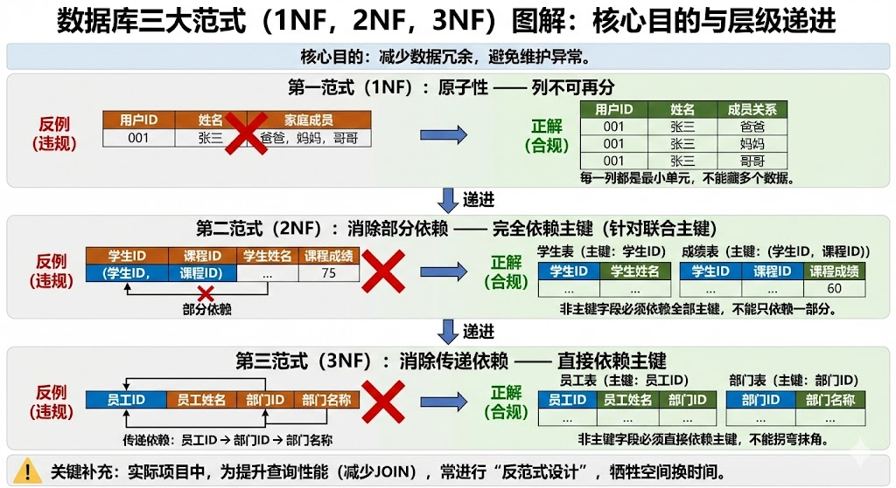

数据库范式（Normal Form），说白了就是“设计数据库表的时候必须遵守的规矩”。

这些规矩的核心目的就两个：**第一，减少数据冗余；第二，避免数据维护异常。**

虽然理论上有更高阶的范式（如 BCNF、4NF），但在面试和实际工作中，通常只需要掌握前三种（1NF、2NF、3NF）就足够了。它们的层级关系是层层递进的：

1. **第一范式（1NF）：原子性 —— “列不可再分”**
    1. **核心：** 每一列都必须是最小的单元，不能里面藏着好几个数据。
    2. **反例：** 你有一列叫“家庭成员”，里面存了“爸爸, 妈妈, 哥哥”。这就违规了。
    3. **正解：** 必须拆成多行，或者拆成多张表，保证每个格子里只有一个值。
2. **第二范式（2NF）：消除部分依赖 —— “必须完全依赖主键”**
    1. **前提：** 这通常是针对**联合主键**（两个或以上字段组成的主键）的情况。
    2. **核心：** 表里的每一个非主键字段，必须依赖于**全部**主键，而不能只依赖主键的**一部分**。
    3. **反例：** 比如一张成绩表，主键是 `(学生ID, 课程ID)`。表里有个字段叫 `学生姓名`。
        - `学生姓名` 确实依赖 `学生ID`，但它跟 `课程ID` 半毛钱关系没有。这就叫“部分依赖”。
        - 这样会导致无论这个学生选多少门课，他的名字都要被重复存很多遍（冗余）。
    4. **正解：** 把学生信息单独抽出来做一张表，成绩表里只留 ID。
3. **第三范式（3NF）：消除传递依赖 —— “必须直接依赖主键”**
    1. **核心：** 表里的非主键字段，必须**直接**依赖于主键，不能通过别的字段“拐弯抹角”地依赖。
    2. **反例：** 比如一张员工表，主键是 `员工ID`。表里有 `部门ID` 和 `部门名称`。
        - `部门名称` 其实是依赖于 `部门ID` 的，而 `部门ID` 依赖于 `员工ID`。
        - 这就是 `员工ID -> 部门ID -> 部门名称` 的传递依赖。
    3. **正解：** 把部门信息单独拆表。员工表里只存 `部门ID`。

---

### 面试标准回答

数据库范式是为了建立冗余较小、结构合理的数据库而设计的一系列规则。在实际开发中，我们主要关注前三种范式：

第一范式（1NF）要求原子性：即数据库表的每一列都是不可分割的原子数据项，不能是集合或数组。

第二范式（2NF）要求消除部分依赖：在满足 1NF 的基础上，要求表中的非主键字段必须完全依赖于主键，而不能只依赖主键的一部分（主要针对联合主键）。

第三范式（3NF）要求消除传递依赖：在满足 2NF 的基础上，要求非主键字段必须直接依赖于主键，不能存在 A 依赖 B，B 依赖主键的情况。

（关键补充）：

虽然范式越高，数据冗余越小，但在实际项目中，我们并不会严格遵守所有范式。

*因为完全规范化会导致表被拆得太散，查询时需要大量的 JOIN 操作，严重影响读性能。*

*所以，在互联网高并发场景下，我们经常会进行反范式设计，比如在订单表中冗余存储‘用户姓名’或‘商品名称’，用空间换时间，来提高查询效率。*
