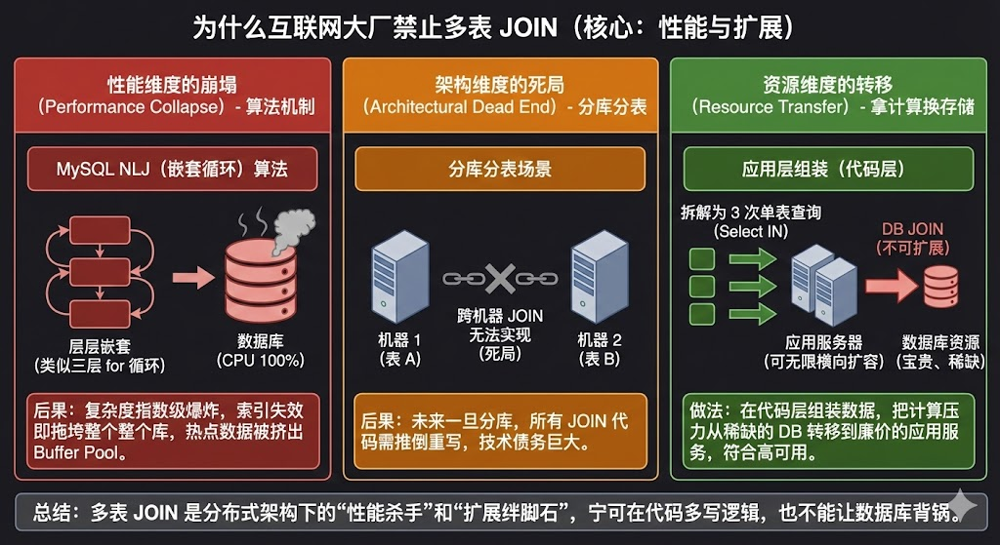

在互联网大厂的开发规范中（比如阿里巴巴 Java 开发手册），明确规定了“超过三张表禁止 JOIN”。

简单总结一句话：**多表 JOIN 是分布式架构下的“性能杀手”和“扩展绊脚石”，我们宁愿在代码里多写几行逻辑，也不能让数据库背这个锅。**

为什么这么绝对？主要基于以下三个维度的考量：

1. **性能维度的崩塌**
    1. **原理：** MySQL 做 JOIN 的时候，本质上用的是 **NLJ（Nested Loop Join）** 算法。
    2. **算法逻辑：** 就像写了三层嵌套的 `for` 循环。
        - 先拿 A 表的一行，去 B 表里查；
        - 找到 B 表的一行，再去 C 表里查。
        - 如果是 3 张大表 JOIN，时间复杂度是呈**指数级爆炸**的。
    3. **后果：** 只要其中一张表的索引失效，或者数据量稍微大一点，CPU 会瞬间飙升 100%，甚至会导致 Buffer Pool 里的热点数据被这种大查询挤出去，把整个数据库拖垮。
2. **架构维度的死局（分库分表）**
    1. **痛点：** 现在的系统发展很快，今天数据少还在一个库里，明天数据多了就要做**分库分表**。
    2. **死局：** 一旦分库了，表 A 在机器 1 上，表 B 在机器 2 上。**数据库层面根本做不到跨机器 JOIN**。
    3. **前瞻性：** 如果你现在代码里写满了 JOIN，等到要分库分表的那一天，你的整个业务层代码必须全部推倒重写，这个技术债务太大了。
3. **资源维度的转移（拿计算换存储）**
    1. **逻辑：** 数据库资源（DB Connection、CPU、IO）是最宝贵、最难扩展的；而应用服务器（Tomcat/Go 服务）是可以无限横向扩容的。
    2. **做法：** 我们把 JOIN 拆成三次简单的单表查询（Select IN），在**代码层（Java/Go）** 把数据组装起来。
    3. **好处：** 虽然网络请求多了两次，但把计算压力从稀缺的 DB 转移到了廉价的 App Server 上，这更符合分布式架构的“高可用”原则。

---

### 面试标准回答

不建议使用多表 JOIN，尤其是在高并发的互联网业务中，主要基于以下三个核心原因：

第一，性能不可控（算法机制）：

MySQL 的 JOIN 实现原理通常是 Nested Loop Join（嵌套循环）。

多表 JOIN 就像是多层嵌套循环。如果关联字段没有命中索引，或者表数据量较大，会产生笛卡尔积级别的扫描，导致 CPU 和磁盘 I/O 飙升，甚至阻塞整个数据库连接池。

第二，不利于架构扩展（分库分表）：

在分布式架构中，数据量大了必然要进行分库分表。

一旦数据分布在不同的物理数据库实例上，数据库层面是无法跨库 JOIN 的。如果我们早期大量使用了 JOIN，后期重构代码的工作量将是灾难性的。

第三，利用缓存效率低：

很多时候，单表查询可以利用 Redis 等缓存，或者利用 MySQL 自身的查询缓存（8.0 前）。

如果把查询拆解为单表查询，我们可以先从缓存取数据，取不到再查库，最后在应用层（代码层）进行数据组装。这虽然增加了代码复杂度，但把计算压力从不可扩展的数据库转移到了可水平扩展的应用服务上，这在系统设计上是更合理的。
