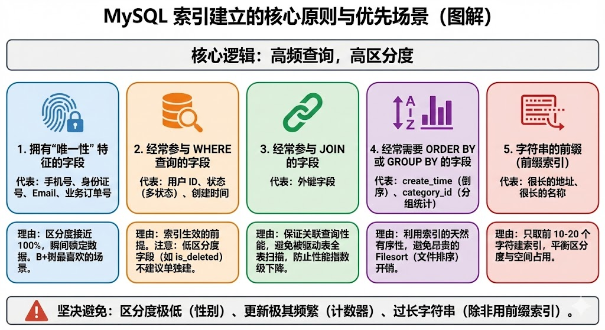

核心逻辑只有八个字：**“高频查询，高区分度”**。

如果一个字段建了索引，但它要么很久才查一次，要么查出来的结果占了全表的一半（比如性别），那这个索引就是纯粹的累赘，只会拖慢写入速度，浪费磁盘空间。

具体来说，这 **5 类字段**是建立索引的优先考虑：

1. **拥有“唯一性”特征的字段**
    1. **代表：** 手机号、身份证号、Email、业务订单号。
    2. **理由：** 这种字段的**区分度（Cardinality）** 几乎是 100%。索引一抓这就准，能瞬间把几千万行数据缩小到 1 行。这是 B+ 树最喜欢的场景。
2. **经常参与** `**WHERE**` **查询的字段**
    1. **代表：** 用户 ID、状态（如果状态种类较多）、创建时间。
    2. **理由：** 只有出现在 `WHERE` 后面的字段，索引才有机会生效。
    3. **注意：** 如果是“逻辑删除”的字段 `is_deleted`（只有 0 和 1），区分度太低，**通常不建议单独建索引**。
3. **经常参与** `**JOIN**` **的字段**
    1. **代表：** 外键字段。
    2. **理由：** MySQL 在做关联查询时，必须保证**被驱动表**的连接字段上有索引。否则，每一次关联都要去全表扫描被驱动表，性能会呈指数级下降。
4. **经常需要** `**ORDER BY**` **或** `**GROUP BY**` **的字段**
    1. **代表：**`create_time`（按时间倒序展示）、`category_id`（按分类统计）。
    2. **理由：** 索引本身就是**有序**的。如果利用好了索引的有序性，MySQL 就不用把数据加载到内存里做专门的排序（Filesort），这能省下巨大的 CPU 开销。
5. **字符串的前缀（前缀索引）**
    1. **代表：** 很长的地址、很长的名称。
    2. **理由：** 没必要给整个字符串建索引，太占空间。通常只取前 10-20 个字符建索引（`index(field(10))`），既能保证区分度，又能节省空间。

---

### 面试标准回答

在 MySQL 中，索引的设计需要平衡查询效率和维护成本。一般来说，我会优先为以下几类字段建立索引：

第一，高区分度的字段：

这是首选。比如主键、唯一约束字段（如手机号、身份证）。这些字段的基数很大，索引扫描的行数极少，效率最高。

**第二，核心业务查询字段（WHERE / JOIN）**：

- 经常出现在 `WHERE` 条件中的字段。
- 尤其是**多表关联（JOIN）时的关联字段**，必须建立索引，否则会导致笛卡尔积级别的扫描。

第三，排序和分组字段（ORDER BY / GROUP BY）：

利用 B+ 树天然有序的特性，为排序字段建立索引，可以避免 MySQL 进行昂贵的 Filesort（文件排序） 操作。

第四，考虑覆盖索引：

如果某些业务查询非常高频，我会建立联合索引，把需要查询的字段都包含进去，从而避免回表。

**同时，我也会坚决避免在以下字段建索引**：

1. **区分度极低**的字段（如性别、布尔类型的状态）。
2. **更新极其频繁**的字段（如浏览量计数器），因为维护索引树的成本太高。
3. **过长**的字符串（除非使用前缀索引）。
