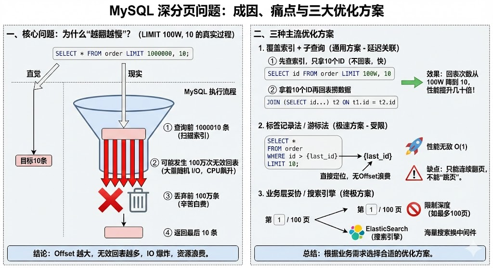

深分页是 MySQL 中 `LIMIT offset, size` 语法的天然缺陷。当 `offset` 非常大时，MySQL 并不是直接跳到那一行，而是把前面的数据全部读出来扔掉，纯纯的资源浪费。



具体的问题根源和 3 种主流优化方案如下：

### 一、 核心问题：为什么“越翻越慢”？

假设你执行 `LIMIT 1000000, 10`（从第 100 万行开始取 10 条）。

- **直觉：** MySQL 直接定位到第 100 万行，拿 10 条走人。
- **现实：** MySQL 会先查询出 **1000010** 条数据。
    - 如果是全表扫描，它要读 100 万行数据。
    - 即使走了索引，如果不是覆盖索引，它还需要拿着这 100 万个主键去进行 **100 万次“回表”** 操作。
    - **最后一步：** 也就是最气人的，它把前面辛苦拿到的 100 万条数据**全部丢弃**，只保留最后 10 条返回给你。
- **结论：** 偏移量（Offset）越大，回表次数越多，IO 也就炸了。

### 二、 3 种方案

1. **覆盖索引 + 子查询（最通用方案）**
    1. **原理：** 既然“回表”最耗时，那我们就先别回表。
    2. **做法：** 先在**索引树**上把这 10 条数据的 ID 找出来（因为索引树小，不回表，速度快），然后再拿着这 10 个 ID 去主表里捞数据。
    3. **SQL 对比：**
        - *优化前（慢）：*`SELECT * FROM order LIMIT 1000000, 10;`
        - *优化后（快）：*
        - SQL

```
SELECT * FROM order t1
JOIN (SELECT id FROM order LIMIT 1000000, 10) t2
ON t1.id = t2.id;
```

        - **效果：** 同样是扫描 100 万行，优化后只扫描索引，不读数据页，性能提升几十倍。
2. **标签记录法 / 游标法（性能最高，限制最大）**
    1. **原理：** 记不住页码，但我记住上一页最后那条数据的 ID。
    2. **做法：** 也就是 **Seek 方法**。告诉前端，别传 `offset` 了，传 `last_id` 给我。
    3. **SQL：**`SELECT * FROM order WHERE id > {last_id} LIMIT 10;`
    4. **优点：** 无论翻到第几亿页，它都是直接走索引定位，**时间复杂度 O(1)**，性能无敌。
    5. **缺点：** 只能连续翻页，不能“跳页”（比如直接跳到第 500 页），而且要求 ID 必须是连续递增的（或者有明确的排序字段）。
3. **业务层妥协 / 搜索引擎（终极方案）**
    1. **限制深度：** 比如百度和谷歌，你搜个东西，它只让你翻到 70 多页就不让翻了。因为没人真的会看第 1000 页的数据。
    2. **换中间件：** 如果真有海量数据搜索需求，直接上 **ElasticSearch**。MySQL 本来就不擅长干这事。

---

### 面试标准回答

MySQL 深分页问题的本质是 LIMIT offset, size 语法的实现机制导致的。

当 Offset 非常大时，MySQL 需要查询出 offset + size 条记录，然后将前 offset 条记录丢弃，只返回最后 size 条。

**这会导致两个严重问题**：

1. **无效回表**：如果查询没有命中覆盖索引，MySQL 会对前面被丢弃的百万行数据进行回表操作，造成巨大的随机 I/O 浪费。
2. **资源消耗**：大量的无效数据加载到内存，会挤占 Buffer Pool 的空间，甚至导致 CPU 飙升。

**针对这个问题，通常有三种优化策略**：

第一，使用子查询优化（延迟关联）：

我们可以先通过覆盖索引（只查主键）查出目标分页的 ID，然后再通过 JOIN 关联主表获取完整数据。

比如：SELECT * FROM t JOIN (SELECT id FROM t LIMIT 1000000, 10) tmp ON t.id = tmp.id。这样就把全量回表变成了只回表 10 次。

第二，使用游标法（Seek Method）：

如果业务允许，去掉 OFFSET，改用 WHERE id > last_id LIMIT 10。这能利用索引直接定位，性能是 O(1) 的，也是性能最好的方案，但它不支持跳页。

第三，业务限制：

限制最大分页深度（比如只能翻到 100 页），或者引入 ElasticSearch 来处理海量数据的检索。
