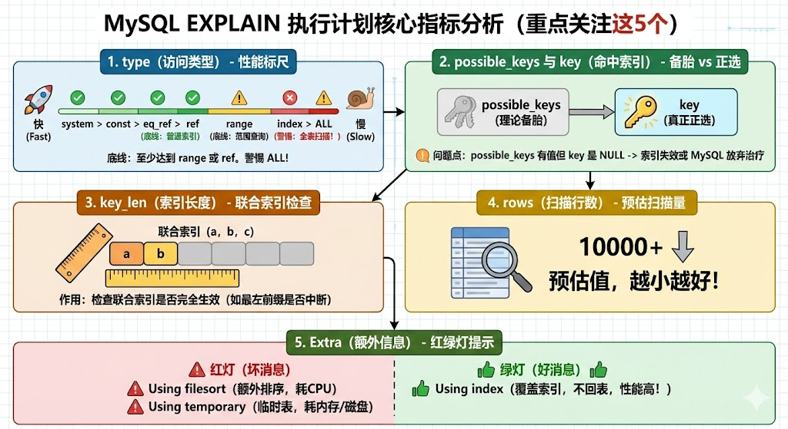

想要看透一条 SQL 到底是怎么跑的，快不快，核心工具就一个：`**EXPLAIN**` 命令。

它不会真的执行 SQL，而是展示 MySQL 优化器“打算”怎么执行这条语句。

分析执行计划，我们不用盯着所有字段看，重点关注这 **5 个核心指标**就够了：

1. type（访问类型）—— 最核心的性能指标

这是判断查询快慢的第一把标尺。它告诉你 MySQL 是怎么找数据的。

- **性能排序（从快到慢）：**`system` > `const` > `eq_ref` > `ref` > `range` > `index` > `ALL`。
- **底线：** 生产环境至少要达到 `**range**`（范围查询）或 `**ref**`（普通索引）级别。
- **警惕：** 如果看到 `**ALL**`，说明发生了**全表扫描**，必须优化（除非表非常小）。

**2.** `**possible_keys**` **与** `**key**`**（命中索引）**

- `possible_keys`：理论上可能用到的索引（备胎）。
- `key`：**实际上** 真正用到的索引（正选）。
- **问题点：** 如果 `possible_keys` 有值，但 `key` 是 `NULL`，说明 MySQL 觉得走索引不如全表扫描快，或者你的索引失效了。

**3.** `**key_len**`**（索引长度）**

- 它告诉你索引被使用了多少字节。
- **作用：** 主要用来检查**联合索引**是否完全生效。比如索引是 `(a, b, c)`，如果 `key_len` 很短，可能只用到了 `a`，后面的 `b` 和 `c` 没用上（最左前缀原则断了）。

**4.** `**rows**`**（扫描行数）**

- 这是一个**预估值**。MySQL 估算为了找到结果，需要扫描多少行数据。
- 这个数字**越小越好**。
1. Extra（额外信息）

这里面会有一些很直白的文字描述，提示你好坏：

    1. **红灯（坏消息）：**
        - `Using filesort`：说明需要额外的**文件排序**（无法利用索引顺序），消耗 CPU。
        - `Using temporary`：说明用到了**临时表**（通常在 GROUP BY 或 DISTINCT 时），消耗内存或磁盘。
    2. **绿灯（好消息）：**
        - `Using index`：说明用到了**覆盖索引**，不需要回表，性能极高。

---

### 面试标准回答

分析 SQL 执行计划，我主要使用 `**EXPLAIN**` 关键字。在拿到的结果中，我会重点关注以下几个字段来评估性能瓶颈：

第一，看 type（访问类型）：

这是最关键的指标。我要确保它不是 ALL（全表扫描）。

一般来说，我会优化 SQL 至少达到 range（用于范围查询）或 ref（普通索引查找）的级别。如果是主键查询达到 const 是最好的。

第二，看 key 和 key_len（索引使用情况）：

key 告诉我有没有走索引。如果 key 是 NULL，我会检查是不是因为违背了最左前缀原则，或者发生了隐式类型转换。

对于联合索引，我会结合 key_len 来计算索引到底命中了几列，判断索引是否充分利用。

第三，看 Extra（额外细节）：

我会特别警惕 Using filesort 和 Using temporary。

这意味着查询涉及了无法利用索引的排序或临时表操作，通常是严重的性能杀手，需要通过调整索引或重写 SQL 来解决。

相反，如果看到 Using index，说明触发了覆盖索引，不需要回表，这是性能最优的表现。
