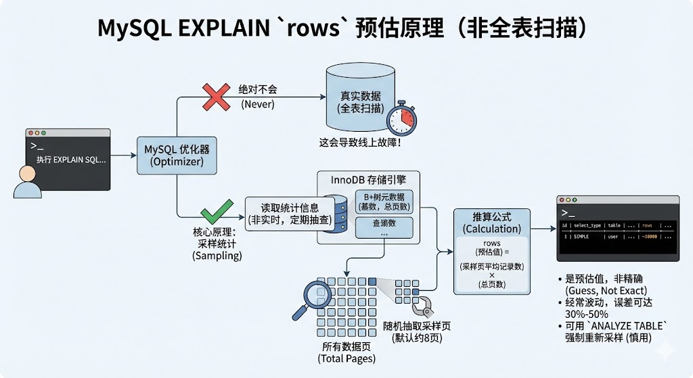

**普通的** `**EXPLAIN**` **绝对不会导致全表扫描。**

那列 `rows` 里的数字，纯粹是 MySQL 优化器的预估值。

如果 `EXPLAIN` 都要全表扫描，那线上排查慢 SQL 的时候，岂不是查一条挂一次库？这显然不合理。

它是怎么“算”出来的？简单来说就是：**基于“采样统计”的概率学猜测。**

具体逻辑如下：

### 核心原理：采样统计

MySQL（特别是 InnoDB 引擎）在后台维护了一套“统计信息”。这个信息不是实时更新的，也不是全量统计的，而是定期“抽查”出来的。

当你执行 `EXPLAIN` 时，优化器去查这个统计信息，而不是去查真实数据。

**怎么抽查？**

- InnoDB 会随机选取几个数据页（默认是 8 个或 20 个，取决于配置），统计这几个页里有多少行记录，算出一个平均密度。

**怎么推算？**

- rows（预估值） = 选取的页平均记录数 × 总页数。

这就是为什么你会发现 `EXPLAIN` 显示的 `rows` 经常变来变去，而且跟真实数据量（`SELECT COUNT(*)`）往往对不上，误差有时候能达到 30% 甚至 50%。因为它是猜的。

### 数据的来源：B+ 树的元数据

除了采样，优化器还会参考 B+ 树索引的**元数据**：

- **基数（Cardinality）：** 索引上大概有多少个不同的值。
- **页面数量：** 只有聚簇索引知道确切的页面数。

如果你觉得 `EXPLAIN` 的 `rows` 实在太离谱（比如导致选错了索引），你可以执行 `ANALYZE TABLE 表名`。这个命令会强制 MySQL **“重新抽样”**，让统计信息稍微准一点（但这步操作在生产大表上要小心，虽然它很快，但也会加锁）。

---

### 面试标准回答

`EXPLAIN` 命令中的 `rows` 字段是一个**预估值**，它的计算**绝对不会**触发全表扫描。

**它的统计原理是基于 InnoDB 的‘采样统计’机制：**

1. **数据来源**：MySQL 优化器并不会去读取真实的数据行，而是直接读取存储引擎维护的**索引统计信息**。
2. 采样算法：
    1. InnoDB 会在后台随机抽取少量的叶子节点（数据页）（默认通常是 8 个页），统计这些页中的记录密度。
    2. 然后利用公式：平均每页记录数 × 总页数，推算出全表的总行数。
3. 结果特性：
    1. 因为是采样估算，所以这个 rows 值是不准确的，且会随着采样页面的不同而波动。如果发现统计信息偏差过大导致索引失效，我们可以使用 ANALYZE TABLE 命令来重新触发采样，修正统计数据。”
