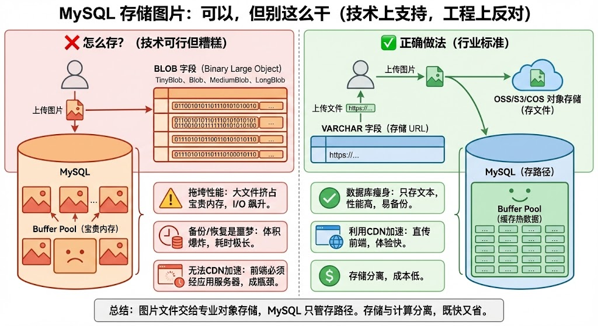

**MySQL 当然可以存图片，但是千万别这么干。**

只有在极少数特定场景下（比如图片极小、为了数据强一致性），才会考虑把图片存进数据库。在 99% 的互联网生产环境中，标准的做法是**“数据库存路径，图片存 OSS（对象存储）”**。

具体的原因分析和技术细节如下：

1. 怎么存？

MySQL 提供了专门的二进制数据类型来存这些二进制数据，也就是 BLOB (Binary Large Object) 系列：

- **TinyBlob**：存个图标（255 字节）。
- **Blob**：存个小图（65 KB）。
- **MediumBlob**：存个中图（16 MB）。
- LongBlob：存个大图（4 GB）。

原理就是把图片读成二进制流（byte array），直接塞进这些字段里。当然，你也可以把图片转成 Base64 字符串存到 TEXT 字段里，但这会把体积撑大 33%，更亏。

1. **为什么别这么干？**
    1. **拖垮数据库性能（最致命）：** 数据库最宝贵的资源是内存（Buffer Pool）。数据库是为了处理结构化数据（行数据）设计的。如果你每次查询都读出一堆几 MB 的图片，Buffer Pool 里的热点数据瞬间就被这些大文件挤出去了，导致正常的业务查询全部要走磁盘 I/O，系统直接卡死。
    2. **备份恢复是噩梦：** 一个只有文本的库可能就 20GB，半小时备份完。加了图片可能变成 2TB。一旦数据库挂了，恢复这 2TB 数据需要好几天，这时候老板就在你后面拿着刀呢。
    3. **无法利用 CDN：** 图片存在数据库里，前端怎么拿？必须经过你的后端应用服务器读出来再写回给浏览器。这意味着你的应用服务器成了流量瓶颈，还没法直接接 CDN 加速。
2. **正确做法是什么？**
    1. **图片文件：** 扔给专业的对象存储服务（阿里云 OSS、AWS S3、腾讯云 COS）或者自建的文件服务器（MinIO、FastDFS）。
    2. **MySQL 里：** 只存一个字符串 URL（比如 `https://oss.aliyun.com/img/avatar_001.jpg`）。

---

### 面试标准回答

从技术上来讲，MySQL 是**绝对支持**存储图片的。

我们可以使用 `**BLOB**` 系列数据类型（如 `MediumBlob` 或 `LongBlob`）来存储图片的二进制数据。

**但是，在实际的生产架构中，我坚决反对把图片直接存入 MySQL，理由主要有三点：**

第一，严重影响数据库性能：

数据库的 Buffer Pool（缓存池）是极其宝贵的内存资源，原本是用来缓存热点行数据的。如果存储大量图片，大字段（Big Column）会快速占满缓存，把真正的业务热数据挤出去（Cache Eviction），导致磁盘 I/O 飙升，整个系统变慢。

第二，增加运维难度和成本：

存储图片会导致数据库文件体积爆炸式增长（从 GB 变 TB）。这会让数据库的**备份（Backup）和恢复（Restore）**变得极慢。一旦发生灾难，RTO（恢复时间目标）将无法保证。而且数据库存储（SSD）的成本通常远高于文件存储。

第三，架构耦合，无法加速：

图片存在库里，前端读取时必须经过应用服务器，增加了后端负载，且难以利用 CDN 进行边缘加速。

因此，标准的最佳实践是：

MySQL 只存图片的 URL 路径，真正的图片文件存储在专门的对象存储服务（如 OSS、S3）或分布式文件系统（如 MinIO）中。这样实现了存储与计算分离，既便宜又快。
