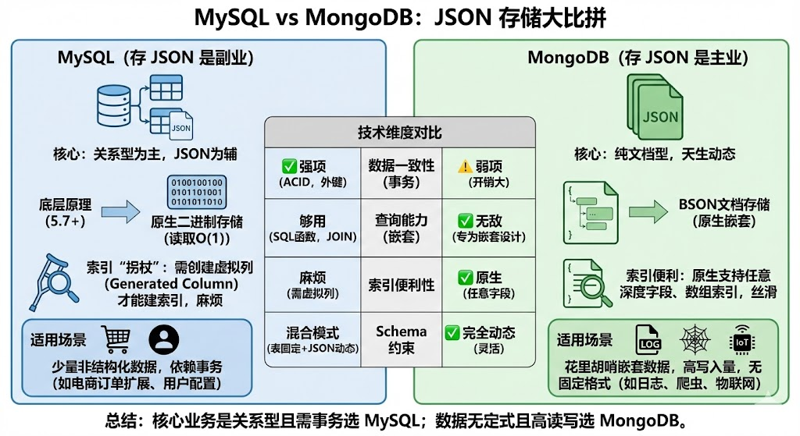

**MySQL 当然可以存 JSON（5.7 版本以后原生支持），但这只是它的“副业”；而存储 JSON 是 MongoDB 的“老本行”。**

如果你只是有少量的非结构化数据（比如用户配置、扩展字段）要存，且必须依赖事务，选 MySQL。

如果你全是花里胡哨的嵌套数据，写多读少，且数据量极大，请出门左转找 MongoDB。

具体的技术差异和选型逻辑，可以从下面三个层面来拆解：

1. **MySQL 存 JSON 的底层原理**
    1. **原生支持：** 在 MySQL 5.7 之前，我们只能用 `VARCHAR` 或 `TEXT` 存 JSON 字符串，那是纯文本，查起来很慢。但 5.7 之后引入了原生的 `JSON` 数据类型。
    2. **二进制存储：** MySQL 现在的 JSON 不是当字符串存的，而是转成了**二进制格式**。
        - **好处：** 读取时不需要把整个 JSON 文本解析一遍，它可以直接通过“指针”跳到你要查的那个 Key 上，读取速度 O(1)。
    3. **索引的“拐杖”：** 这是 MySQL 最别扭的地方。你不能直接给 JSON 里的某个字段加索引。你必须使用一些其他方法：
        - 创建一个**虚拟列（Generated Column）**，把 JSON 里的某个值提取出来。
        - 给这个虚拟列加索引。
2. **对比 MongoDB**

| **维度** | **MySQL (JSON)** | **MongoDB** |
| --- | --- | --- |
| **数据一致性** | 强项。支持 ACID 事务，支持外键关联。如果你的 JSON 数据和钱、订单有关，必须用 MySQL。 | 弱项。虽然 4.0 支持了多文档事务，但性能开销大，且不如 MySQL 成熟。 |
| **查询能力** | 够用。可以用 SQL 函数（如 JSON_EXTRACT）查，也支持 JOIN。 | 无敌。它的查询语法（Find, Aggregate）本来就是为嵌套文档设计的，查深层数据极其丝滑。 |
| **索引便利性** | 麻烦。需要手动建虚拟列才能索引，维护成本高。 | 原生。直接给 JSON 里的任意深度的字段建索引，支持数组索引、地理位置索引等。 |
| **Schema 约束** | 混合模式。表结构是固定的，只有 JSON 字段是动态的。 | 完全动态。今天存个 A 字段，明天存个 B 字段，没人管你。 |

1. **什么时候用哪个？**
    1. **选 MySQL 的场景：** 你的核心业务依然是关系型的（比如电商订单、用户信息），只是**偶尔**有几个字段是不确定的（比如“用户个性化设置”、“商品扩展属性”）。这时候没必要为了这 5% 的数据引入一个新的 MongoDB 组件，直接用 MySQL 的 JSON 字段最省事。
    2. **选 MongoDB 的场景：** 你的数据完全没有固定格式（比如日志、爬虫数据、物联网设备上报），或者写入量巨大（QPS 几万+），且不需要复杂的事务和多表 JOIN。

---

### 面试标准回答

MySQL 从 5.7 版本开始就原生支持 JSON 数据类型，但这并不意味着它可以完全替代 MongoDB，两者的适用场景是完全不同的。

首先，关于 MySQL 的 JSON 特性：

MySQL 存储 JSON 采用的是内部优化的二进制格式，这使得读取特定 Key 时非常快（O(1)），不需要解析整个文本。

但是，MySQL 对 JSON 的索引支持是通过**‘虚拟生成列（Virtual Generated Column）’**来实现的，我们需要先把 JSON 里的字段提取成一个虚拟列，再对该列建索引。这一步操作相对繁琐。

**其次，对比 MongoDB，主要有以下区别**：

1. 数据模型：
    1. MySQL 是**‘关系型 + JSON’**的混合模式，适合绝大部分数据是结构化的，只有少量扩展字段需要灵活性的场景。
    2. MongoDB 是**纯粹的文档型数据库**，适合数据结构完全不可控或变化极快的场景。
2. 事务与强一致性：
    1. 如果数据涉及核心交易（如支付、库存），必须依赖 MySQL 的 ACID 事务和强一致性。MongoDB 虽然也支持事务，但在复杂关联查询和数据严谨性上不如 MySQL。
3. 查询与索引性能：
    1. 对于深层嵌套查询和数组索引，MongoDB 是原生的，性能和开发体验远好于 MySQL。
