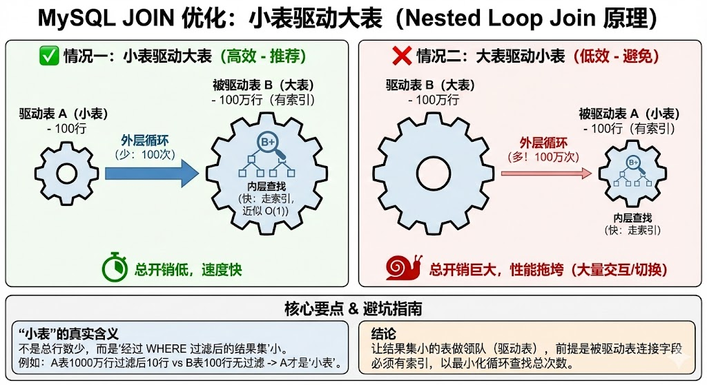

小表驱动大表，说白了就是“让那个跑腿次数少的人去当领队”。

它的核心目的是为了优化 **Nested Loop Join**算法的效率。

**在被驱动表（大表）有索引的前提下，驱动表（小表）越小，外层循环的次数就越少，数据库做“连接”查找的开销就越低。**



为了彻底理解，我们可以通过“代码类比”**和**“原理拆解”两个层面来看：

1. 代码类比（嵌套 For 循环）

你可以把 MySQL 的 JOIN 操作想象成你在写代码时的双层 for 循环：

- **表 A（小表）：** 100 行数据。
- **表 B（大表）：** 100 万行数据（且连接字段有索引）。

**情况一：小表驱动大表**

```
// 只需要循环 100 次for (rowA : 小表) {
    //这一步直接走 B 表的 B+ 树索引，速度极快（近似 O(1)）
    lookup_in_big_table_index(rowA.id);
}
```

- **结果：** 你只建立了 **100 次** 连接。每次连接进去后，利用 B 表的索引瞬间找到数据。

**情况二：大表驱动小表**

```
// 这里要循环 100 万次！for (rowB : 大表) {
    lookup_in_small_table_index(rowB.id);
}
```

- **结果：** 虽然内层查找也很快，但你硬生生建立了 **100 万次** 连接交互。光是这 100 万次循环的上下文切换和查找开销，就足以把性能拖垮。
1. 这里的“小表”到底指什么？

这也是面试容易踩的坑。“小表”不是指表里的总行数少，而是指“经过 WHERE 条件过滤后，参与 JOIN 的结果集小”。

- 如果表 A 有 1000 万行，但 `WHERE` 之后只有 10 行；
- 表 B 有 100 行，但没有 `WHERE` 条件。
- 这时候，**表 A 才是真正的“小表”**，应该用 A 去驱动 B。

---

### 面试标准回答

MySQL 提倡‘小表驱动大表’，其底层依据是 **Nested Loop Join**算法的执行特性。

核心逻辑在于减少外层循环的次数：

JOIN 查询本质上是一个嵌套循环。MySQL 会遍历驱动表（外层循环），然后拿每一行数据去被驱动表（内层循环）中查找匹配的记录。

1. **前提条件**：被驱动表（大表）的连接字段**必须建立索引**。
2. **性能差异**：
    1. 如果用**小表驱动**：外层循环次数少（比如 100 次）。每次进入内层，利用大表的 B+ 树索引，可以毫秒级定位数据。
    2. 如果用**大表驱动**：外层循环次数多（比如 100 万次）。这意味着要进行 100 万次索引查找及上下文切换，虽然单次查找快，但总量叠加后开销巨大。

因此，优化的关键是：

让参与 JOIN 的结果集较小的那张表作为驱动表，从而最大程度地减少数据库做‘循环查找’的总次数。
