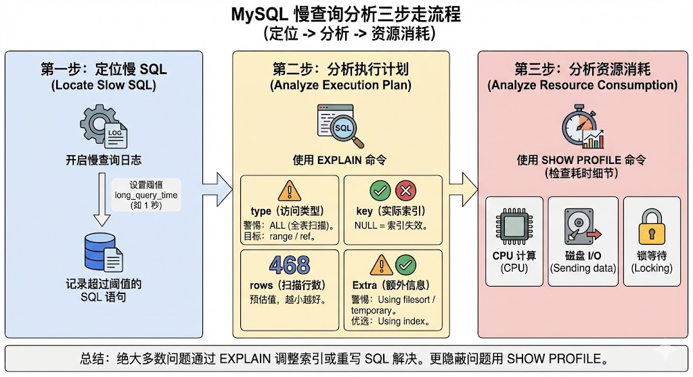

总体来说：**先开启慢查询日志定位问题 SQL，再用 EXPLAIN 分析执行计划，最后结合 Show Profile 查看资源消耗。**

具体的分析路径，通常遵循以下三步走：

1. **第一步：定位慢 SQL**
- **开启慢查询日志（Slow Query Log）：**
    - 这是最基础的一步。在 MySQL 配置文件中开启 `slow_query_log`，并设置阈值 `long_query_time`（比如 1 秒或 0.5 秒）。
    - 这样，凡是执行时间超过这个阈值的 SQL，都会被记录下来。
1. **第二步：分析执行计划**
- 拿到具体的慢 SQL 后，使用 `**EXPLAIN**` 关键字来查看它的执行计划。
- 我们不需要看懂所有的字段，只需要死死盯着这 4 个核心指标：
    - `**type**`**（访问类型）：** 看它是怎么找数据的。如果是 `ALL`（全表扫描），那就必须要优化。至少要优化到 `range`（范围索引）或 `ref`（普通索引）。
    - `**key**`**（实际使用的索引）：** 看它到底有没有走索引。如果是 `NULL`，说明索引失效了。
    - `**rows**`**（扫描行数）：** 这是一个预估值。如果这个值很大（几万、几百万），说明索引过滤性不好，或者需要回表的数据太多。
    - `**Extra**`**（额外信息）：**
        - 出现 `Using filesort`（文件排序）或 `Using temporary`（临时表），说明查询代价极高，必须优化。
        - 出现 `Using index`，说明走了覆盖索引，这是最好的情况。
1. **第三步：分析资源消耗**
- 如果 `EXPLAIN` 看起来没问题（走了索引，扫描行数也少），但 SQL 依然很慢，这时候就要用 `**SHOW PROFILE**`。
- 它可以告诉你，这条 SQL 到底把时间花哪儿了？
    - 是花在 CPU 计算上？
    - 是花在磁盘 I/O 上（`Sending data`）？
    - 还是花在抢锁上（`Locking`）？
- *注：虽然 MySQL 8.0 推荐用 Performance Schema，但面试提 Show Profile 依然是加分项，证明你懂底层耗时分析。*

---

### 面试标准回答

在实际生产环境中，我分析慢 SQL 主要遵循一套标准的三步流程：

第一步，定位问题：

我会开启 慢查询日志，设置合理的阈值（如 1 秒）。然后配合 mysqldumpslow 工具，找出那些出现频次最高或者平均耗时最长的 SQL 语句，作为优先优化的对象。

第二步，分析执行计划：

使用 EXPLAIN 命令对目标 SQL 进行分析。我重点关注以下几个字段：

- `**type**`：判断是否出现了 `ALL`（全表扫描），目标是优化到 `range` 或 `ref` 级别。
- `**key**`：确认是否命中了预期的索引，检查是否发生了索引失效。
- `**rows**`：评估扫描的行数是否过大。
- `**Extra**`：特别警惕 `Using filesort`（文件排序）和 `Using temporary`（临时表），这通常意味着严重的性能损耗。

第三步，资源消耗分析：

如果执行计划看起来没问题但依然慢，我会使用 SHOW PROFILE 命令，检查 SQL 在执行过程中，时间到底是消耗在 CPU 计算、磁盘 I/O 还是 锁等待 上，从而找到更隐蔽的性能瓶颈。

**总结**：绝大多数慢 SQL 问题，通过 `EXPLAIN` 调整索引或重写 SQL 逻辑都能解决。
