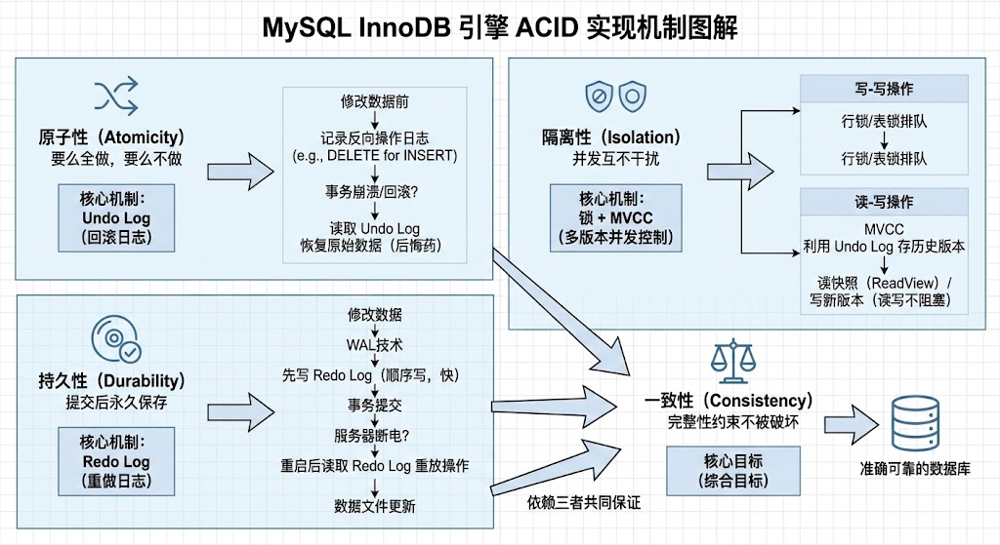

ACID 是数据库事务的四大铁律，它们共同保证了你的数据在复杂的并发和故障环境下，依然一样准确可靠。

简单一句话总结实现机制：**原子性靠 Undo Log，持久性靠 Redo Log，隔离性靠 锁和 MVCC，而一致性是最终目的，靠前面这三者共同来保证。**

具体到 MySQL（InnoDB 引擎）的实现层面，拆解如下：

### 原子性 (Atomicity) —— “要么全做，要么不做”

    - **含义：** 一个事务里的操作，要么全部成功，要么全部失败回滚，不能只做一半。
    - **实现机制：Undo Log（回滚日志）。**
    - **逻辑：** 每次修改数据之前，MySQL 都会先记录一条“反向操作”的日志到 Undo Log 里。
        - 比如你 `INSERT` 一条数据，Undo Log 就记一条 `DELETE`。
        - 比如你 `UPDATE` a=1，Undo Log 就记 `UPDATE` a=0。
        - 万一事务执行中途崩了，或者你手动执行了 `ROLLBACK`，MySQL 就去读取 Undo Log，把数据恢复成原来的样子。**Undo Log 就是事务的“后悔药”。**

### 持久性 (Durability)

    - **含义：** 只要事务提交了（Commit），数据就必须永久保存在磁盘上，哪怕下一秒服务器断电也不能丢。
    - **实现机制：Redo Log（重做日志）。**
    - **逻辑：** 采用了 **WAL（Write-Ahead Logging）** 技术。
        - 修改数据时，MySQL 不会傻傻地直接去改磁盘上那个庞大的数据文件（随机写，太慢），而是先把修改记录写到 Redo Log 文件里（顺序写，极快）。
        - 只要 Redo Log 写成功了，事务就算提交成功。
        - 如果数据库崩了，重启时 MySQL 会自动读取 Redo Log，把还没来得及同步到数据文件的操作重新执行一遍。

### 隔离性 (Isolation)

    - **含义：** 多个事务同时并发执行时，不能互相干扰，不能看到别人还没提交的脏数据。
    - **实现机制：锁（Locks） + MVCC（多版本并发控制）。**
    - **逻辑：**
        - **写-写操作：** 靠**锁**（行锁、表锁）来排队，保证同一行数据同一时间只有一个人能改。
        - **读-写操作：** 靠 **MVCC**。它利用 Undo Log 保存数据的历史版本，让读操作去读历史快照（ReadView），而写操作去修改最新版本。这样**读写互不阻塞**，大大提升了性能。

### 一致性 (Consistency)

    - **含义：** 事务开始前和结束后，数据库的完整性约束没有被破坏（比如转账，A 扣 100，B 必须加 100，总量不变）。
    - **实现机制：****它是核心目标，而非单一手段。**
        - 它依赖于 **原子性**（如果不回滚，数据就不一致）。
        - 它依赖于 **隔离性**（如果并发乱套，数据就不一致）。
        - 它依赖于 **持久性**（如果数据丢了，就不一致）。

---

### 面试标准回答

ACID 是事务的四大特性，MySQL 的 InnoDB 引擎通过不同的底层机制来实现它们：

第一，原子性：

核心依赖 Undo Log（回滚日志）。在事务执行过程中，InnoDB 会记录数据修改前的状态。如果事务执行失败或调用 Rollback，系统利用 Undo Log 将数据恢复到事务开始前的状态，保证‘要么全做，要么全不做’。

第二，持久性：

核心依赖 Redo Log（重做日志）。利用 WAL（Write-Ahead Logging）技术，事务提交时优先将变更记录写入 Redo Log（顺序写，速度快）。即使数据库宕机，重启后也能通过 Redo Log 重放操作，保证已提交的数据不丢失。

第三，隔离性：

核心依赖 锁机制 和 MVCC（多版本并发控制）。

- 对于写写并发，使用行锁（Row Lock）进行互斥。
- 对于读写并发，使用 MVCC 读取数据的历史快照，实现了读写互不阻塞，在保证隔离性的同时提升并发性能。

第四，一致性：

这是一个综合目标。它是通过原子性、持久性、隔离性共同保证的。
