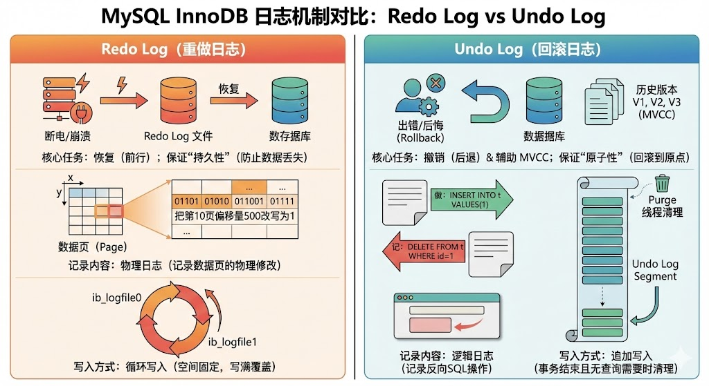

**Redo Log 是为了防止断电数据丢失，保证“持久性”；Undo Log 是为了防止事务执行出错回滚，保证“原子性”，同时兼职帮 MVCC 查历史版本。**

1. **作用核心不同（前行 vs 后退）**
    1. **Redo Log（重做日志）：** 它的核心任务是“恢复”。
        - 数据库修改内存后，还没来得及刷到磁盘，服务器突然断电了。重启后，MySQL 会读 Redo Log，把没写进去的数据**重新做一遍**。它保证了事务提交后绝不丢失（**持久性**）。
    2. **Undo Log（回滚日志）：** 它的核心任务是“撤销”。
        - 事务执行到一半，你突然后悔了（Rollback），或者程序报错了。MySQL 就会读 Undo Log，把刚才改的数据**还原**回去。它保证了事务要么成功，要么回到原点（**原子性**）。
2. **记录内容不同（物理 vs 逻辑）**
    1. **Redo Log 是物理日志：** 它记的是“在哪个数据页（Page）上做了什么修改”。
        - 比如：“把第 10 号页面的偏移量 500 处的字节改为 1”。所以它恢复速度极快，直接覆盖内存即可。
    2. **Undo Log 是逻辑日志：** 它记的是“反向操作的 SQL”。
        - 比如：你写了 `INSERT`，它就记一条 `DELETE`；你写了 `UPDATE a=1`，它就记 `UPDATE a=0`。回滚的时候，是逻辑上把数据改回去。
3. **写入时机与生命周期不同**
    1. **Redo Log：**
        - **循环写：** 它是固定大小的文件（如 `ib_logfile0`），写满了一圈就覆盖开头。
        - 事务提交时，必须先写 Redo Log（WAL 机制）。
    2. **Undo Log：**
        - **追加写：** 它不能随便覆盖，因为 MVCC 还要用它来读取历史版本。只有当长事务结束，且没有查询需要用到旧版本时，才会被后台的 Purge 线程清理。

---

### 面试标准回答（建议背诵）

Redo Log 和 Undo Log 是 InnoDB 存储引擎保证事务 ACID 特性的两大基石，它们的区别主要体现在三个方面：

**第一，功能和对应的 ACID 特性不同**：

- **Redo Log（重做日志）主要用于崩溃恢复（Crash Recovery）**。它保证了事务提交后的数据不会因为宕机而丢失，实现了事务的**持久性（Durability）**。
- **Undo Log（回滚日志）主要用于事务回滚**和 **MVCC（多版本并发控制）**。它保证了事务在异常时可以撤销操作，实现了事务的**原子性（Atomicity）**。

**第二，记录的内容形式不同**：

- **Redo Log 是物理日志**。它记录的是数据页（Page）上的物理修改（如‘在偏移量 X 处写入数据 Y’），因此恢复速度非常快。
- **Undo Log 是逻辑日志**。它记录的是 SQL 的**反向操作**（如执行 Insert 则记录 Delete），回滚时是逻辑地将数据还原。

**第三，写入方式与生命周期不同**：

- Redo Log 采用**循环写入**（Circular Write）的方式，空间固定，写满即覆盖。
- Undo Log 采用**追加写入**的方式，在事务提交后，如果 MVCC 不再需要该记录的历史版本，会被后台 Purge 线程回收。
