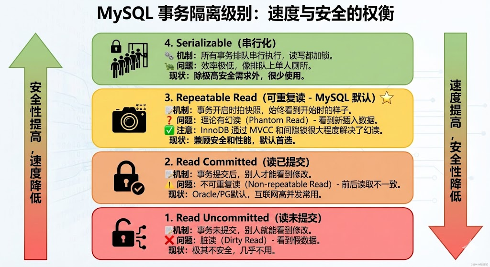

级别越高，数据越安全，但速度越慢；级别越低，跑得越快，但数据越容易出错。

MySQL 的默认级别是 **Repeatable Read（可重复读）。**

具体可以从低到高这四个档次来理解：

1. **Read Uncommitted（读未提交）、**
    1. **机制：** 一个事务还没提交（还在修改中），别的事务就能看到它改的数据。
    2. **问题：** 会产生“脏读”。比如 A 往卡里转了 100 块（没提交），B 看到了余额多了 100。结果 A 后悔了回滚了，B 看到的那 100 块就是假的。
    3. **现状：** 极其不安全，生产环境几乎不用。
2. **Read Committed（读已提交）**
    1. **机制：** 一个事务必须**提交了**，别人才能看到。
    2. **问题：** 会产生“不可重复读”。
        - 比如事务 A 第一次读余额是 100。
        - 这时事务 B 偷偷要把余额改成 200 并提交了。
        - 事务 A 第二次读，余额变成了 200。
        - **结果：** 同一个事务里，读同一个数据，前后结果不一样。
    3. **现状：** Oracle、PostgreSQL 的默认级别。互联网公司为了追求高并发，有时也会把 MySQL 改成这个级别。
3. **Repeatable Read（可重复读）**
    1. **机制：** 事务一开启，就拍了个“快照”。不管外面怎么狂风暴雨、怎么改数据，我在这个事务里看到的永远是开始那一刻的样子。
    2. **问题：** 理论上会有“幻读”**。也就是虽然你看不到别人改的数据，但你可能看到别人**新插入的数据。
        - **注意（加分项）：** 别的数据库有幻读，但 MySQL 的 InnoDB 引擎通过 **MVCC（多版本控制）** 和 **Next-Key Lock（间隙锁）**，在很大程度上**解决了幻读问题**。
    3. **现状：** MySQL 的默认级别，兼顾了安全和性能。
4. **Serializable（串行化）**
    1. **机制：** 所有事务排队执行。读加读锁，写加写锁。
    2. **问题：** 效率极低，就像大家排队进单人厕所。
    3. **现状：** 除非是极高安全级别的金融系统，否则不用。

---

### 面试标准回答

MySQL 的事务隔离级别符合标准的 SQL 规范，分为四种，默认级别是 **Repeatable Read（可重复读）**。

**具体的四个级别如下：**

1. **Read Uncommitted（读未提交）**：允许读取未提交的数据，会导致**脏读**，并发性最高但安全性最差。
2. **Read Committed（读已提交）**：只允许读取已提交的数据，解决了脏读，但会导致**不可重复读**（即同一事务中两次读取数据不一致）。这是 Oracle 等数据库的默认级别。
3. Repeatable Read（可重复读 - MySQL 默认）：
4. 保证在同一个事务中多次读取同一条数据的结果是一致的。
    1. 标准 SQL 定义中，该级别无法解决**幻读**（Phantom Read）问题。
    2. **但是（关键点）**：MySQL 的 InnoDB 引擎通过 **MVCC（多版本并发控制）** 和 **Next-Key Lock（临键锁）** 机制，在 RR 级别下已经解决了大部分的幻读问题。
5. **Serializable（串行化）**：强制事务串行执行，完全解决所有并发问题，但性能极低。
