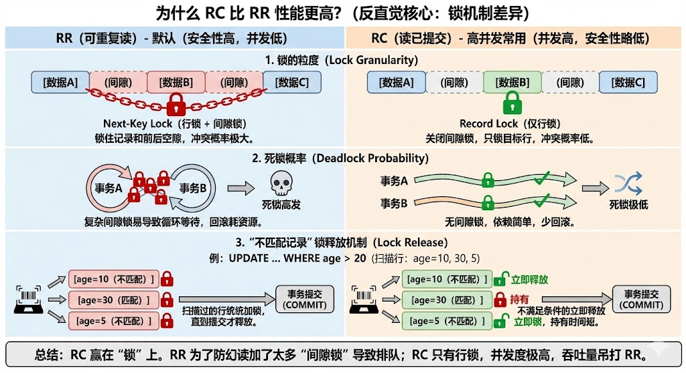

这也是一个经典的“反直觉”问题。按理说 RC（读已提交）每次查询都要生成新的 ReadView，应该更慢才对？

其实不然。在并发场景下，**RC 的性能通常吊打 RR（可重复读）。**

简单一句话总结：**RC 赢在“锁”上。RR 为了防幻读，加了太多的“间隙锁（Gap Lock）”，导致大家经常排队；而 RC 只锁行，并发度极高。**

具体原因可以从以下 **3 个维度** 来拆解：

1. **锁的粒度不同**
    1. **RR 级别：**
        - 为了防止幻读，InnoDB 会默认开启 **Next-Key Lock**（行锁 + 间隙锁）。
        - 这就意味着，RR 不仅锁住了你要找的那行数据，还锁住了这行数据前后的“空隙”。
        - **后果：** 哪怕两个事务操作的不是同一行数据，只要落在了同一个“间隙”里，也会发生冲突。这大大降低了并发度。
    2. **RC 级别：**
        - 它**关闭了间隙锁**。
        - 只使用 **Record Lock**（行锁）。你改 id=1，我就只锁 id=1，绝对不误伤 id=2。
        - **后果：** 锁冲突概率大幅降低，大家各跑各的，吞吐量自然就上来了。
2. **死锁的概率不同**
    1. **RR 级别：** 因为间隙锁的存在，经常会出现“A 等 B 的间隙，B 等 A 的行锁”这种复杂的循环等待。**RR 是死锁的高发区。** 数据库检测死锁并回滚事务是很耗资源的。
    2. **RC 级别：** 因为没有间隙锁，死锁概率变得极低（虽然也会有，但少很多）。
3. **“不匹配记录”的锁释放机制**
    1. 这是一个底层细节。
    2. 假设你要 `UPDATE user SET age=10 WHERE age > 20`。
    3. **RR 级别：** 扫描过程中，凡是扫过的行（哪怕不符合 `age>20`），只要被引擎层读到了，都会加锁，而且直到事务提交才释放。
    4. **RC 级别：** MySQL 做了优化。如果引擎层读到一行数据，发现不满足 `WHERE` 条件，会**立即释放锁**，不需要等事务提交。这就进一步减少了锁的持有时间。

---

### 面试标准回答

虽然从 MVCC 的角度看，Read Committed (RC) 每次查询都要生成新的快照，理论开销稍大；但在实际的高并发生产环境中，**RC 的性能通常要优于 Repeatable Read (RR)**，核心原因在于**锁机制**的不同：

**第一，锁的范围更小（没有间隙锁）**：

- **RR 级别**为了解决幻读，默认会开启 **Next-Key Lock**，这不仅锁住记录本身，还会锁住记录之间的**间隙（Gap）**。这导致并发写入时，锁竞争非常激烈。
- **RC 级别**默认**关闭了间隙锁**，只使用 **Record Lock**（行锁）。这意味着只有真正操作同一行数据时才会冲突，并发度得到了极大的提升。

第二，死锁概率更低：

由于 RR 引入了复杂的间隙锁，导致事务之间的锁依赖关系变得复杂，极易引发死锁。而 RC 只有行锁，死锁概率大幅降低，减少了数据库回滚事务的开销。

第三，提前释放不匹配的锁：

在执行 UPDATE 或 DELETE 时，如果全表扫描或索引扫描，RR 级别会锁住所有扫描过的行直到事务提交。而 RC 级别会对不满足 WHERE 条件的记录立即释放锁，最大限度地减少了锁的持有时间。
