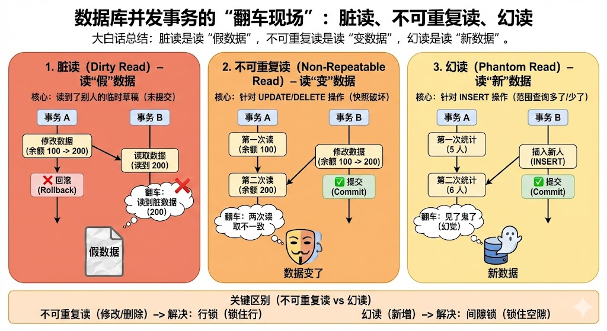

用一句大白话总结：**脏读是读到了“假数据”，不可重复读是读到了“变数据”，幻读是读到了“新数据”。**

它们是在并发环境下，不同事务之间隔离没做好时，出现的三种“翻车现场”。

具体场景拆解如下：

1. **脏读（Dirty Read）—— 读到了“未提交”的数据**
    1. **场景：** 事务 A 改了数据（比如把余额从 100 改成 200），但**还没提交**。这时候事务 B 进来了，读到了这个 200。
    2. **翻车：** 结果事务 A 后来后悔了，回滚了操作，余额变回 100。那事务 B 刚才读到的 200 就是脏数据。
    3. **核心点：** 读到了别人的**临时草稿**。
2. **不可重复读（Non-Repeatable Read）—— 前后读取数据“变了”**
    1. **场景：** 事务 A 先读了一次余额，是 100。这时候事务 B 进来了，把余额改成 200 并**提交了**。事务 A 再读一次，发现余额变成 200 了。
    2. **翻车：** 在同一个事务里，同样的查询，读出来的结果竟然不一样。这破坏了事务的“快照”感觉。
    3. **核心点：** 针对的是**UPDATE**或**DELETE**操作。
3. **幻读（Phantom Read）—— 前后读取数据“多了/少了”**
    1. **场景：** 事务 A 统计表里有多少人，结果是 5 个人。这时候事务 B 进来了，插入（INSERT）了一个新人并提交。事务 A 再统计一次，发现变成 6 个人了。
    2. **翻车：** 事务 A 觉得见了鬼了（幻觉），明明刚才看只有 5 个的。
    3. **核心点：** 针对的是**INSERT**操作。

---

### 面试标准回答

这三个术语描述了数据库在并发事务中可能出现的数据一致性问题，严重程度依次降低：

第一，脏读：

指一个事务读取到了另一个未提交事务修改的数据。如果那个事务回滚，当前事务读取的数据就是无效的。这是隔离级别最低时（读未提交）发生的问题。

第二，不可重复读：

指在一个事务内，多次读取同一行数据，结果不一致。这是因为在两次读取之间，有另一个事务修改（Update）或删除了该数据并提交了。

第三，幻读：

指在一个事务内，多次执行同一个范围查询，返回的记录行数不一致。这是因为在两次查询之间，有另一个事务插入（Insert）了满足条件的新数据。

**（关键补充）：不可重复读和幻读的区别是什么？**

- **不可重复读**的重点在于**修改**（Update/Delete），解决它只需要**锁住满足条件的行**（行锁）。
- **幻读**的重点在于**新增**（Insert），解决它不仅要锁住行，还需要**锁住行之间的空隙**（间隙锁），防止新数据插进来。
