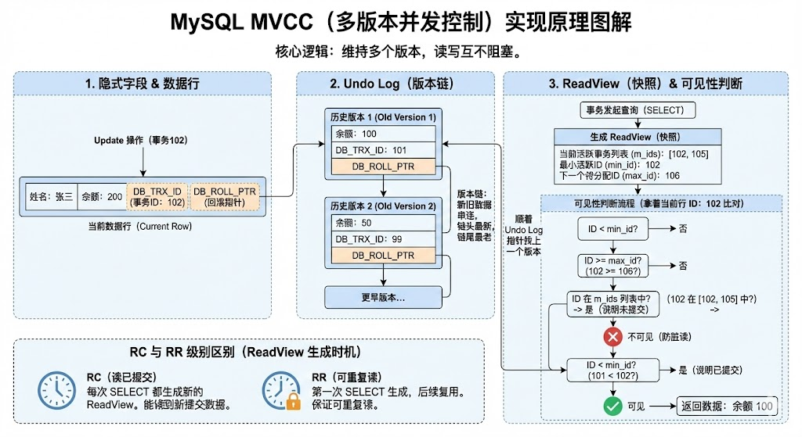

MVCC（多版本并发控制），听起来很高大上，其实核心逻辑就一句话：**“维持数据的多个版本，让读写操作互不阻塞。”**

它的终极目标是：**写的时候可以读，读的时候可以写。** 这彻底摆脱了“读写锁”那种“我们要改数据了，你们谁都别看”的低效模式。

MVCC 的实现原理，主要依赖于这三个点：**隐式字段**、**Undo Log（版本链）** 以及 **ReadView（快照）**。

## 隐式字段

InnoDB 在每一行数据后面，都偷偷加了几个你看不见的字段，最关键的是这两个：

- `**DB_TRX_ID**`**（事务 ID）：** 记录是谁（哪个事务）最后一次修改了这行数据。
- `**DB_ROLL_PTR**`**（回滚指针）：** 指向 Undo Log 中这行数据的**“上一个版本”**。哪怕你改了 100 次，我也能顺着这个指针，把你祖宗十八代的样子都找出来。

## **Undo Log（版本链 ）**

- 当你更新数据时，MySQL 不会直接覆盖旧数据，而是先把旧数据拷贝到 Undo Log 里。
- 通过上面的 `DB_ROLL_PTR` 指针，新数据和旧数据会被串成一条链表。
- **这就是“版本链”**。链头是最新的数据，链尾是最老的数据。

## ReadView

有了版本链，问题来了：我现在去查数据，链条上有 10 个版本，我到底该看哪一个？

这就需要 ReadView 来做裁判。

当事务发起查询（SELECT）时，MySQL 会生成一个 ReadView，里面主要记录了**“当前系统里还有哪些事务是活着的（没提交）”**。

它有一套严密的**可见性算法**（假设当前数据的事务 ID 是 `trx_id`）：

1. 如果 `trx_id` 小于当前系统中最小的活跃事务 ID。说明改这行数据的人早就提交了，**可见**。
2. 如果 `trx_id` 大于当前事务自己的 ID。说明这是未来的某个新事务改的，**不可见**。
3. 如果 `trx_id` 处于中间范围，那就查一下活跃事务列表（`m_ids`）。
    1. 如果在列表里：说明改数据的人还没提交呢，**不可见**（防脏读）。
    2. 如果不在列表里：说明虽然他 ID 比较大，但他已经提交了，**可见**。

如果判定“不可见”，就顺着 Undo Log 的指针往前找上一个版本，再次判断，直到找到一个可见的版本为止。

## RC 和 RR 级别的区别

这两种隔离级别都用了 MVCC，区别只在于**“生成 ReadView 的时机”**不同：

- **RC（读已提交）：****每次**执行 SELECT 语句，都会生成一个新的 ReadView。所以它能看到别人刚提交的数据。
- **RR（可重复读）：** 只有事务里的**第一次** SELECT 会生成 ReadView，后面不管查多少次，都复用这个 ReadView。所以它看到的永远是事务开始时的样子（解决了不可重复读）。

---

### 面试标准回答

MVCC的核心目的是实现**非阻塞的读写并发**，即‘读不加锁，读写不冲突’。它的底层实现主要依赖于三个机制：

第一，隐式字段与 Undo Log（版本链）：

InnoDB 的每行数据都有隐藏的事务 ID 和 回滚指针。

每次事务修改数据时，不会覆盖原数据，而是将旧数据写入 Undo Log，并通过回滚指针将新旧数据连接成一条版本链。这使得数据库可以同时存在该行数据的多个历史版本。

第二，ReadView（可见性视图）：

当事务执行快照读（SELECT）时，会生成一个 ReadView。它记录了当前系统中所有活跃（未提交）的事务 ID。

第三，可见性判断规则（核心流程）：

事务在读取数据时，会拿到当前行数据的事务 ID，去跟 ReadView 做比对：

1. 如果这个数据的事务 ID 比当前所有活跃事务 ID 都小，说明是已提交的历史数据，**可见**。
2. 如果这个数据的事务 ID 在活跃事务列表中，说明是未提交的数据，**不可见**。
3. 如果不可见，就顺着 **Undo Log 版本链**往前找，直到找到一个满足可见性规则的版本。

**最后，关于隔离级别的差异**：

- 在 **RC** 级别下，**每次查询**都会生成新的 ReadView，所以能读到新提交的数据。
- 在 **RR** 级别下，只有**第一次查询**生成 ReadView，后续复用，从而保证了可重复读。
