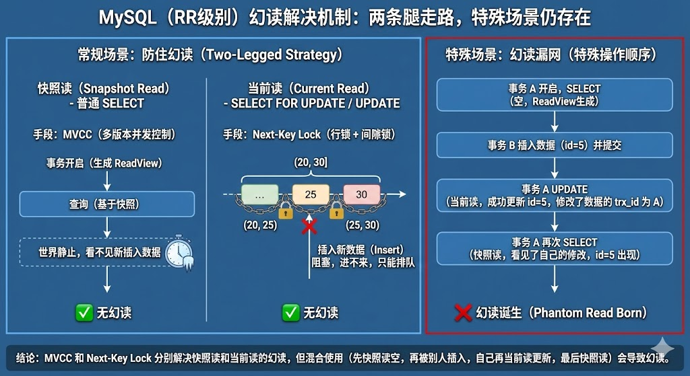

结论是：**在大部分业务场景下，MySQL 确实解决了幻读，但在极端特殊场景下，幻读依然存在。**

它采用的是**“两条腿走路”**的策略来解决幻读，但如果两条腿混着走，就会摔跤。

具体情况拆解如下：

## 常规场景：它是怎么防住幻读的？

MySQL 把读取分成了两种模式，分别用不同的手段防幻读：

- **快照读（Snapshot Read）：** 也就是普通的 `SELECT * FROM table`。
    - **手段：** 靠 **MVCC（多版本并发控制）**。
    - **原理：** 事务一开始，就生成了一张“快照”。不管别的事务怎么疯狂插入新数据（Insert），我的 ReadView 根本看不见它们。对我来说，世界静止了，自然没有幻读。
- **当前读（Current Read）：** 也就是 `SELECT ... FOR UPDATE` 或 `UPDATE / DELETE`。
    - **手段：** 靠 **Next-Key Lock（临键锁）**。
    - **原理：** 比如你查 `age > 20` 的人。InnoDB 不仅锁住所有 `age > 20` 的现有行，还会把它们之间的“间隙”（Gap）全都锁死。别的事务想在这个范围内插入新数据？门都没有，只能排队等着。进不来，自然也就不会出现幻读。

## 特殊场景：幻读是怎么“漏网”的？

只有在一种非常“鸡贼”的操作顺序下，幻读才会发生。

- **场景复现：**
    - **事务 A** 开启，执行 `SELECT * FROM teacher WHERE id = 5`。结果是空（Empty）。**（此时生成了 ReadView）**
    - **事务 B** 开启，插入一条 `id = 5` 的数据，并**提交**。
    - **事务 A** 执行 `UPDATE teacher SET name = 'X' WHERE id = 5`。
        1. *关键点：* 虽然 A 刚才没查到 id=5，但 `UPDATE` 是**当前读**，它能读到 B 刚刚提交的数据，并且成功执行了更新。
        2. *更关键点：这一更新，把这行数据的 `trx_id` 改成了 A 自己的 ID。
    - **事务 A** 再次执行 `SELECT * FROM teacher WHERE id = 5`。
        1. 这时候 MVCC 查记录，发现：“咦？这行数据的事务 ID 是我自己的，那当然可见啊！”
    - **结果：** 事务 A 第一次没查到，第二次查到了。**幻读诞生了。**

---

### 面试标准回答

关于 MySQL 在 RR（可重复读）级别下是否解决了幻读，我的回答是：**很大程度上解决了，但并非 100% 彻底解决。**

**InnoDB 采用了两种机制来应对不同场景下的幻读：**

1. 针对快照读（普通的 Select）：
2. 是通过 MVCC（多版本并发控制） 来解决的。事务启动时生成一个 ReadView，之后所有的查询都基于这个快照，因此看不到其他事务新插入的数据。
3. 针对当前读（Select For Update / Update）：
4. 是通过 Next-Key Lock（行锁 + 间隙锁） 来解决的。它不仅锁住匹配的行，还锁住了行之间的间隙（Gap），从物理上阻塞了其他事务的插入操作，从而避免幻读。

但是，存在一个特殊场景依然会出现幻读：

如果一个事务先进行了快照读（没查到数据），然后另一个事务插入了数据并提交。

此时，当前事务如果手贱去执行了一条 UPDATE 语句（更新了那条它本来看不到的数据），由于 UPDATE 是当前读，它会更新成功，并且修改了数据的事务 ID。

紧接着，当前事务再次 SELECT，就会发现那条数据‘神奇地出现了’。
