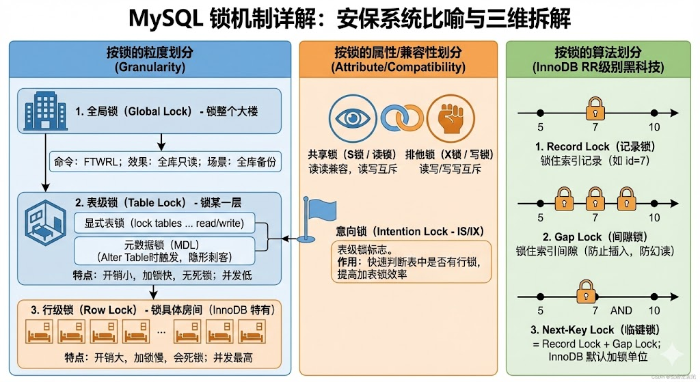

MySQL 的锁机制比较复杂，因为它不仅跟**存储引擎**有关（MyISAM 和 InnoDB 截然不同），还跟**隔离级别**有关。

简单来说，我们可以把 MySQL 的锁想象成一个**“安保系统”**。有的锁是锁整个大楼（全局锁），有的是锁某一层（表锁），有的是锁具体的某个房间（行锁）。

要回答好这个问题，建议从**锁的粒度**、**锁的属性**、以及 **InnoDB 特有的锁算法**这三个维度来拆解：

1. **按锁的粒度划分**
    1. **全局锁：**
        - **命令：**`Flush tables with read lock`。
        - **效果：** 让整个数据库处于“只读状态”。其他线程的增删改都会被阻塞。
    2. **表级锁：**
        - **特点：** 开销小，加锁快，不会死锁；但锁冲突概率高，并发度低。
        - **包含：**
            - **显式表锁：**`lock tables ... read/write`。
            - **元数据锁（MDL）：** 这是个隐形刺客。当你执行 `Select` 时，会自动加 MDL 读锁；当你修改表结构（Alter Table）时，会加 MDL 写锁。如果不注意，Alter Table 会卡住所有的查询，把库搞崩。
    3. **行级锁：**
        - **特点：** InnoDB 特有。开销大，加锁慢，会死锁；但锁定范围最小，并发度最高。
2. **按锁的属性（兼容性）划分**
    1. **共享锁（S 锁 / 读锁）：** 我读的时候，你也只能读，不能改。
    2. **排他锁（X 锁 / 写锁）：** 我改的时候，你既不能读，也不能改。
    3. **意向锁（Intention Lock - IS/IX）：**
        - 这是表级锁。
        - **作用：** 为了提高加表锁的效率。当你想给整张表加锁时，不用一行行检查有没有人锁了行，直接看表头有没有“意向锁”标记就行了。
3. 按锁的算法划分

这三个是 InnoDB 在 RR（可重复读）隔离级别下，为了解决并发问题搞出来的黑科技：

    1. **Record Lock（记录锁）：** 锁住的是**索引记录**，不是数据本身。
    2. **Gap Lock（间隙锁）：** 锁住索引记录之间的**空隙**（比如锁住 5 到 10 之间的空隙，防止别人插入 7）。它的唯一作用就是**防止幻读**。
    3. **Next-Key Lock（临键锁）：** = Record Lock + Gap Lock。锁住记录本身 + 前面的间隙。这是 InnoDB 在 RR 级别下的**默认加锁单位**。

---

### 面试标准回答

MySQL 的锁机制非常丰富，可以从**锁的粒度**、**互斥属性**以及 **InnoDB 的具体实现算法**三个维度来回答：

**第一，从锁的粒度来看，主要分为三类**：

1. **全局锁**：锁住整个数据库实例，通常用于全库逻辑备份（FTWRL），但现在使用较少。
2. **表级锁**：包括显式的表锁和隐式的 **MDL（元数据锁）**。MyISAM 引擎只支持表锁，开销小但并发低。
3. **行级锁**：这是 InnoDB 最核心的特性。它锁住具体的索引记录，并发度最高，但开销大，可能发生死锁。

第二，从互斥属性来看：

分为共享锁（S 锁）和排他锁（X 锁）。为了在加表锁时快速判断表中是否有记录被上锁，InnoDB 还引入了意向锁（IS 和 IX）。

第三，深入到 InnoDB 的底层算法（重要）：

在 RR（可重复读）隔离级别下，InnoDB 有三种行锁算法：

1. **Record Lock**：单纯锁住索引记录。
2. **Gap Lock（间隙锁）**：锁住索引之间的间隙，**专门用于防止幻读**。
3. **Next-Key Lock**：它是前两者的组合（左开右闭区间），是 InnoDB 默认的加锁单位。
